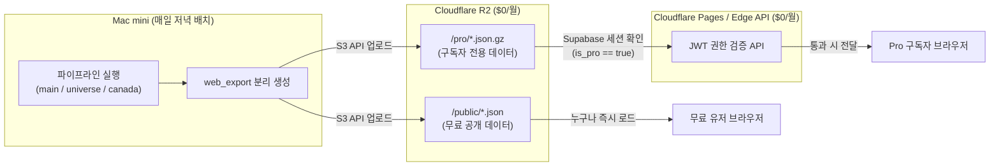

# 퀀트 시스템 → 상업 웹 서비스: 셋업 진단 + 전환 계획

> 작성: 2026-10-14 (온타리오 기준) · 법률 자문 아님 — 유료 전환 전 변호사 확인 필요

## Context
사용자는 이 퀀트 시스템(스크리너 + 페이퍼 트레이딩)을 웹 서비스로 만들고 싶어 함.
- 참고 화면: 인스타 "ARC AI Trading"처럼 캐릭터들이 사무실에서 일하는 게임형 UI
- 핵심 기능:
  1. 필터로 종목 찾기 (매출 성장, 낮은 RSI, MACD 등)
  2. 페이퍼 트레이딩 결과 공개
- 사용자 답변:
  - 대상: 한국 + 북미 (한/영)
  - 수익: 무료 베타로 시작해 나중에 유료
  - 데이터 예산: 월 $100 이하
  - 이번 범위: **정리 계획까지만** (코드 변경 없음)
- 1순위 질문: "지금 셋업으로 상업화해도 나중에 문제가 없나, 무엇을 바꿔야 하나"

## 결론
- **서비스로 만드는 것은 가능하다.** CI가 매일 `data/paper_trading/*_ranked.parquet`(124개 컬럼)와 PT JSON을 이미 만들고 있어서, 웹 화면의 원천 데이터는 거의 준비돼 있다.
- **지금 셋업 그대로 공개·유료화하면 안 된다.** 데이터 출처 3곳이 상업 이용 불가이거나 약관 위반이다.
  - Yahoo: 개인용 전용
  - openinsider: HTML 스크래핑
  - TradingView: 로그인 쿠키로 자동 캡처
- 저장소가 공개 상태라서, 그 데이터를 이미 공개 재배포하고 있다.
- 차트는 생각보다 쉽다. TradingView 무료 위젯을 출처 표기와 함께 임베드하면 합법적으로 넣을 수 있다.

## 1. 현재 셋업 진단

| 항목 | 지금 | 상업 이용 | 바꿀 것 |
|---|---|---|---|
| 가격(OHLCV) | yfinance (`src/data/fetch.py:76`) | ❌ Yahoo는 개인용 전용 | 표시 권한을 서면으로 받은 유료 EOD 공급사 (§3) |
| 재무(매출·마진·부채 등) | yfinance `get_info` (`src/screener/fundamentals.py:120-160`) | ❌ | **SEC EDGAR companyfacts** (미국 정부 데이터, 무료·상업 OK). 이미 만든 `scripts/build_sec_data.py`, `rev_yoy_quarterly.parquet` 로직을 재사용 |
| 공매도%·기관보유%·다음 실적일 | yfinance | ❌ | v1에서는 뺀다. 실적일은 지난 8-K 2.02 날짜 + 1년을 "예상"으로 표시하는 방법을 검토 |
| 내부자 매수 | openinsider 스크래핑 (`src/screener/insider.py:77`) | ❌ 제3자 사이트 스크래핑 | **SEC Form 4 직접 사용**. `scripts/fetch_insider_data.py`, `insider_first_owner.parquet` 재사용 |
| 차트 이미지 | Playwright + `TRADINGVIEW_SESSIONID`로 자동 캡처 (`charts/tradingview_capture.py`) | ❌ TV 약관 3조는 자동 접근을 금지(계정 정지 사유). 개인 용도로도 위험 | 서비스에서는 **TradingView 무료 위젯 임베드**(출처 표기 유지)로 대체 |
| 섹터 | Wikipedia의 GICS (`scripts/update_sp500_tickers.py`) | ⚠️ GICS는 MSCI/S&P 독점 분류. Wikipedia는 CC BY-SA | SEC SIC 코드(submissions API)로 직접 분류 |
| 유니버스 | Nasdaq Trader 심볼 목록, Wikipedia S&P 500 | ⚠️ 낮음 | "S&P 500" 상표를 쓸지 변호사에게 확인한다. 쓰지 않는다면 "미국 대형주 상위 500"(자체 시총 순위)로 정의 |
| ML 모델 | `data/ml_models/*.pkl`(Yahoo 데이터로 학습) | ⚠️ 회색지대 | 라이선스 받은 데이터로 재학습한 뒤 사용 |
| ISB 지표 | `pinescript/ISB.pine` | ✅ 사용자 본인 코드 (goldenEntry 저장소와 동일) | v3.0 최초 버전을 직접 처음부터 쓴 게 맞는지만 본인이 확인. 검증에서 탈락했으므로 상품에는 넣지 않음 |
| 저장소 | `sean-ccho/Project_1` **공개**, LICENSE 없음 | ❌ 코드와 매일 결과가 공짜로 공개됨 | private 전환 (§4) |
| Google Sheets | 결과 기록 + 이메일 | ⚠️ 위법은 아니지만 공개 서비스 백엔드로는 부적합 (분당 읽기 300회, 서비스 계정 1개로 공유, SLA 없음) | **운영자(본인) 전용 화면으로 유지**. 웹은 JSON을 읽음 |
| `내계좌` 탭 | 본인 보유 종목 | — | 서비스에는 절대 넣지 않음 (개인 맞춤 조언 = 등록 대상) |

덤으로 발견한 것: `liquidity_filter`(`src/screener/processing.py:48-51`)는 상위 25%만 남긴다. 그런데 설정 주석(`config.py:119`)에는 "하위 25% 제거"라고 적혀 있다. 스크리너 상품으로 쓰면 종목 범위가 좁아지므로, 나중에 따로 확인할 것.

## 2. 규제: 나라별로 지킬 선

**공통 원칙**
- 누구에게나 같은 정보를 보여 준다. 개인 맞춤 조언은 하지 않는다.
- 1:1 상담·채팅·댓글로 종목 이야기를 하지 않는다.
- 사용자 계좌를 연결하지 않는다.
- 자동매매나 돈을 대신 굴리는 기능을 만들지 않는다.

| 지역 | 근거 | 지금 계획의 위치 | 할 일 |
|---|---|---|---|
| 캐나다 (사용자 거주지, 온타리오) | NI 31-103 s.8.25 "일반 조언" 등록 면제: 개인 맞춤이 아닌 조언 | 필터 도구와 공개 PT 기록은 면제 범위 안으로 보임 | 보유 종목 이해관계 고지 문구 넣기. 유료 전환 전 온타리오 증권 변호사 1회 상담 |
| 미국 | 투자자문업법 publisher 예외 (*Lowe v. SEC*): 비개인적·정기적·홍보 목적이 아닌 출판물 | 같음 | 본인이 가진 종목을 띄우지 않기. 성과는 허위·과장 없이 표시 (사기 금지 조항은 항상 적용) |
| 한국 | 자본시장법 **유사투자자문업** (대가를 받고 불특정 다수에게 정보 제공 → 금융위 신고, 금융투자협회 교육 이수). 2024-08-14부터 **양방향 소통이 있으면 투자자문업 등록** 대상 | 무료 베타는 "대가"가 없어 대상 밖일 가능성이 큼. **유료 전환 시 신고 필요 가능성 높음** | 유료 전환 전에, 해외 거주자가 운영해도 신고 대상인지 한국 변호사·행정사에게 확인. 유료 기능은 일방향만 (커뮤니티·채팅 없음) |

**광고·표현 규칙** (한국 광고 규제 + 미국·캐나다 사기 금지 조항)
- 금지:
  - 수익 보장
  - 허위·미실현 수익률
  - 금융회사로 오인하게 하는 표현
- 필수 고지:
  - 정식 투자자문업자가 아님
  - 개인 상담 불가
  - 원금 손실 가능성과 손실은 투자자 본인 책임

## 3. 성과 표시: 정직이 곧 법적 방어
- 우리 연구의 결론은 "PT-1은 SPY 대비 엣지 없음"이다. 10년 PIT 검증에서 Sharpe 0.70 vs SPY 0.89였다.
  - 따라서 "수익 내는 AI"로 팔면 허위·과장 광고가 된다.
  - 미국 SEC는 2024년 'AI 워싱'(AI를 과장한 광고)을 실제로 제재했다.
- 상품의 정체성: **"종목을 쉽게 찾는 검색 도구 + 투명한 모의투자 실험 기록"**
- 성과 화면 규칙:
  - PT-1과 PT-SPY를 같은 그래프에 그린다
  - 손실 거래를 포함한 전체 거래를 보여 준다
  - 시작일을 명시한다
  - "모의투자(실제 돈 아님)"라고 표시한다
- 백테스트 수치(+147% 등)는 절대 쓰지 않는다
- "AI 팀"이라는 이름은 규칙 기반인 실제 구조에 맞게 "퀀트 팀" 등으로 바꾼다

## 4. 바뀐 셋업 (월 $100 이하 기준)

| 구성 | 선택 | 비용 |
|---|---|---|
| EOD 가격 | 1순위 Tiingo (상업 플랜 약 $50/월). 기본은 "내부 사용"이라서 **"지표만 계산해 공개 사이트에 파생 신호를 표시하고, 원 가격은 표시하지 않음"** 조건으로 서면 허락을 받는다. 거절당하면 다른 공급사 2~3곳에 같은 조건으로 문의한다 | ≈$50 |
| 재무·내부자·섹터 | SEC EDGAR (User-Agent 헤더 필수, 초당 10회 이하) | $0 |
| 화면 속 가격·차트 | TradingView 무료 위젯 (로고·링크 유지). 유료 전환 전에 TV에 상업 사이트 사용 서면 확인 | $0 |
| 웹 호스팅 | Cloudflare Pages (무료 플랜도 상업 이용 가능). ※ Vercel Hobby는 상업 이용 금지 | $0 |
| 저장소 | private 전환. 비공개 저장소는 Actions 무료 한도가 월 2,000분인데 매일 실행이 몇 시간씩 걸려 초과함 → **Mac mini를 self-hosted runner로** (항상 켜져 있음) | $0 |
| 회원·결제 (유료 단계) | Supabase(인증) + Paddle 같은 Merchant of Record. MoR이 국가별 부가세를 대신 처리하는데, 한국 해외 전자용역 VAT도 포함되는지 확인 | 수수료만 |
| 도메인 | — | 약 $15/년 |

- 예산 $100 안에서 Tiingo를 포함해 표시 권한을 주는 곳이 하나도 없다면, 정직한 답은 "예산을 $300~500으로 올려야 한다"이다 (Intrinio·EODHD 상업 플랜 수준).
- 이 경우 계획을 다시 조정한다.
- 저장소를 private로 바꾸면 시트의 `=IMAGE()` 차트가 깨진다. 다만 TV 캡처를 어차피 걷어내므로 함께 정리한다.

## 5. 웹 서비스 구조 (나중에 구현할 때)

```
매일 CI (Mac mini runner)
  ├─ 기존 파이프라인 (스크리너 → PT-1/PT-SPY → 헬스체크)
  ├─ Google Sheets + 이메일  ← 운영자(본인) 전용, 그대로 유지
  └─ [신규] 공개용 내보내기 → screener.json / pt.json / pipeline_status.json
        (허용 컬럼만 화이트리스트로) → Cloudflare Pages
웹 (정적 사이트, 한/영)
  ├─ 스크리너: 브라우저 안에서 필터 (최대 수천 행이라 서버 불필요)
  ├─ 모의투자: PT-1 vs SPY 곡선, 보유 종목, 전체 거래 기록
  ├─ 종목 상세: TradingView 위젯 차트 + 우리 지표
  └─ "퀀트 팀 사무실": pipeline_status.json으로 캐릭터 상태 표시
```

**필터 v1** (모두 허락받은 소스에서 나옴)
- 가격 파생 지표: RSI, MACD 히스토그램·크로스, EMA20/50/200 정배열, 52주 위치, 5일·20일 수익률, 거래량 Z, ATR%, 일·주·월봉 패턴, 점수
- SEC 데이터: 매출 YoY, 이익 성장, 마진, 부채비율, 현금흐름, 90일 내부자 매수, 섹터(SIC)

**사무실 화면**: 캐릭터마다 실제 파이프라인 단계를 하나씩 맡는다.

| 캐릭터 | 맡는 단계 | 근거 코드 |
|---|---|---|
| 수집 | 가격·재무·내부자 데이터 수집 | — |
| 분석 | 지표 계산 | `features.py` |
| 패턴 | 차트 패턴 판별 | `patterns.py` |
| 점수 | 점수·전략 구분 | `signals.py` |
| 시장판정 | 강세/약세 → 슬롯 수 | — |
| 트레이더 | PT-1 | — |
| 심판 | PT-SPY와 비교 | — |
| 감시 | 헬스체크 | — |

- 말풍선에는 실제 로그를 띄운다. 예: "후보 882→227", "오늘 매수 0건(약세장)".
- 그림은 직접 만들거나 CC0 에셋(예: Kenney 아이소메트릭 팩)을 쓴다.
- ARC의 캐릭터·이름·배치는 베끼지 않는다. "아이소메트릭 사무실"이라는 콘셉트 자체는 보호 대상이 아니다.

**나중에 손댈 파일**
- 데이터 교체: `src/data/fetch.py`, `src/screener/fundamentals.py`, `src/screener/insider.py`
- 차트·유니버스: `charts/tradingview_capture.py`, `scripts/update_sp500_tickers.py`
- CI: `.github/workflows/run-screener.yml`
- 신규 공개 내보내기 모듈

## 6. 로드맵

**0단계: 정리** (공개 전 필수, 코드 작업)
1. 저장소 private 전환 + Mac mini self-hosted runner
2. TV 자동 캡처 끄기 (`CHARTS_ENABLED=False`)
3. 내부자 데이터: openinsider → SEC Form 4
4. 재무 데이터: yfinance → SEC companyfacts
5. 섹터: GICS → SIC
6. 가격 공급사에 서면 문의 (표시·파생 데이터 조건)
7. 가격 소스 교체 후 PT 결과가 크게 달라지지 않는지 비교 검증

**1단계: 무료 베타**
1. 공개용 JSON 내보내기
2. 정적 웹사이트 (한/영)
3. 면책 고지·이용약관·개인정보처리방침 (PIPEDA + 한국 개인정보보호법). 이메일을 받을 때만 필요
4. 서비스 이름 상표 검색 (KIPRIS / CIPO / USPTO)

**2단계: 유료 전환 전**
1. 변호사 상담 2건: 온타리오 증권 변호사, 한국 금융규제 변호사·행정사
2. 한국 유사투자자문업 신고 여부 결정
3. TradingView 상업 사용 서면 확인
4. 온타리오 사업자명 등록, HST 등록 (매출이 4분기 합계 $30k를 넘을 때), MoR 결제 연결

## 검증 방법 (이 계획이 맞는지 확인하는 법)
- 데이터 공급사 답장(이메일)으로 "공개 웹 표시 + 파생 지표" 허용 범위를 문서로 확보한다.
- TradingView 위젯의 상업 사용 여부를 TV의 서면 답으로 확보한다.
- 변호사 상담에서 이 문서의 §1, §2 표를 그대로 보여 주고 확인받는다.
- 0단계를 마친 뒤 `grep -rn "yfinance\|openinsider\|tradingview_capture" src/`로 서비스 경로에 남은 사용처가 없는지 확인한다.
- 같은 기간 PT 백테스트를 새 가격 소스로 다시 돌려, 거래 목록 차이가 작은지 확인한다.

## 참고 출처 (요약에 사용)
- yfinance 자체 안내 "Yahoo API는 개인용": https://pypi.org/project/yfinance/
- TradingView 약관 (자동 접근 금지, 위젯 출처 표기): https://in.tradingview.com/policies , 위젯 문서: https://kr.tradingview.com/widget-docs/getting-started/
- OSC NI 31-103: https://www.osc.gov.on.ca/documents/en/Securities-Category3/ni_20190612_31-103_unofficial-consolidation.pdf , 일반 조언 면제 해설: https://nssc.novascotia.ca/node/1147975
- Lowe v. SEC / Seeking Alpha 판결 해설: https://www.gtlaw.com/en/insights/2024/8/no-need-for-seeking-alpha-to-seek-registration
- 한국 자본시장법 개정 (2024-08-14, 양방향 금지): https://www.daeryunlaw.com/newsletter/news/53 , https://www.shinkim.com/kor/media/newsletter/2998
- 데이터 공급사 라이선스: https://www.tiingo.com/about/pricing , https://site.financialmodelingprep.com/insights/platform/can-you-use-fmp-data-in-a-public-app-website-or-client-dashboard , https://massive.com/terms/market_data_terms.pdf
- Google Sheets API 한도: https://developers.google.com/sheets/api/limits
- Vercel Hobby 상업 금지: https://conductatlas.com/platform/vercel/vercel-terms-of-service/provision/CA-P-048642/hobby-plan-personal-non-commercial-use-only/
- ※ 법률 자문이 아님. 가격·약관은 바뀔 수 있으니 실행 시점에 각 공식 페이지로 재확인.

---

## 7. [2026-11-08 업데이트] 초저비용(월 고정비 $0) Subscription 상용화 리뷰 및 실행 플랜

> 작성: 2026-11-08 (온타리오 기준) · 10월 14일 초안 이후 실제 구현된 웹 파이프라인(`src/web_export/`, `universe-scan`, `canada-scan` 등)을 반영한 구독형(Subscription) 최소 비용 상용화 설계

### 7.1 현재 구현 진척도 (2026-10-14 vs 2026-11-08)

**이미 완성된 자산**
- **웹 내보내기 파이프라인 (`src/web_export/`) 구축 완료**:
  - `dashboard.py`: 일일 스크리너·페이퍼 트레이딩 요약 (`dashboard.json`)
  - `universe.py` & `stock_detail.py`: 미국(S&P 500 · NASDAQ · NYSE) 및 캐나다(TSX · TSXV) 전 종목 유니버스 (`{market}.json.gz`) 및 개별 종목 상세 (`stocks/{ticker}.json`)
  - `isb_signals.py` & `sqz_signals.py`: 멀티 타임프레임(일·주·월) ISB 및 Squeeze Momentum 상태 데이터
- **상업 이용이 100% 합법·무료인 고부가 공시/거시 데이터 파이프라인 확보**:
  - SEC 10-K 지역별 매출 비중 (`src/data/geo_revenue.py`)
  - SEC N-PORT ETF 보유 종목 (`src/data/etf_holdings.py`)
  - 매크로·FOMC 금리 결정 일정 (`src/screener/macro_scan.py`, `src/data/rate_calendar.py` — 단, ICE BofA 하이일드 스프레드 제외)
  - ⚠️ **주의 — 미 하원 의원 거래 신고 내역 (`src/data/congress_trades.py`)**: 미국 연방법(`5 U.S.C. § 13107(c)`)상 의원 재산·거래 신고서를 **상업적 목적으로 수집·이용하는 것은 명시적 불법**(뉴스 매체 예외만 인정)이므로 유료 구독 상품에서는 반드시 제외해야 함 (§7.5 참조).
- **프론트엔드 연동 완료**: `seancho.vercel.app`에서 GitHub 고아 브랜치(`dashboard-data`, `universe-data`, `canada-data`)의 JSON을 읽어 화면에 표시 중.

**지금 바로 유료 구독(Subscription)을 붙일 때 막히는 4가지 구조적 병목**
1. **Paywall(유료 잠금) 우회 문제 (`raw.githubusercontent.com` 직접 호출)**:
   - 현재 브라우저가 공개 리포지토리의 `raw.githubusercontent.com` 주소를 직접 호출해 JSON을 받음.
   - 프론트엔드 UI만 블러(잠금) 처리하면 사용자가 브라우저 개발자 도구(Network 탭)에서 원본 JSON URL을 열어 결제 없이 전체 데이터를 볼 수 있음.
   - 반대로 리포를 **Private**으로 전환하면 `raw.githubusercontent.com` 접근이 차단되어 웹사이트 데이터 로드가 즉시 중단됨.
2. **GitHub Private 전환 시 Actions 실행 시간 과금**:
   - 현재 `run-screener.yml` + `universe-scan.yml` + `canada-scan.yml` 실행 시간이 하루 총 **6~8시간(월 10,000분 이상)** 소요됨.
   - Private 전환 시 GitHub 무료 한도(월 2,000분)를 초과하여 매달 큰 종량제 요금이 부과됨.
3. **Vercel Hobby 플랜의 상업적 이용 금지**:
   - 현재 호스팅 중인 Vercel Hobby(무료) 플랜은 유료 구독 결제를 붙이는 순간 약관 위반이 되어 Vercel Pro($20/월) 강제 전환 대상이 됨.
4. **아직 코드에 남아 있는 데이터 라이선스·약관 리스크 3곳**:
   - `charts/tradingview_capture.py`: 쿠키 로그인 기반 자동 스크린샷 캡처 및 `screenshots-*` 브랜치 공개 배포
   - `src/screener/insider.py`: OpenInsider HTML 스크래핑
   - `src/data/fetch.py` & `src/screener/fundamentals.py`: `yfinance` 직접 의존

---

### 7.2 최소 비용(매출 발생 전 월 고정비 $0) 구독 인프라 아키텍처

매출이 나기 전까지는 **월 고정비 $0**, 유료 결제를 여는 시점에도 **서버·호스팅·DB·결제 고정비는 $0**(데이터 라이선스비만 월 ~$50)으로 맞춘 구성이다.

| 영역 | 현재 구조 | 최소 비용 상용화 구조 | 월 고정비 | 선택 이유 |
|---|---|---|:---:|---|
| **웹 호스팅** | Vercel Hobby (`seancho.vercel.app`) | **Cloudflare Pages + Workers** | **$0** | 무료 플랜도 상업적(유료 SaaS) 운영 합법 허용, 대역폭 무제한 무료 |
| **데이터 저장소** | GitHub 고아 브랜치 (`raw.githubusercontent`) | **Cloudflare R2** (`public/` vs `pro/` 분리) | **$0** | 월 10GB 무료, **데이터 전송량(Egress) 요금 평생 $0** (S3 호환 API) |
| **일일 배치 연산** | GitHub-hosted Runner | **Mac mini 로컬 실행 (또는 Self-hosted Runner)** | **$0** | 이미 매일 저녁 6시 ET에 켜져 있는 Mac mini에서 직접 실행 후 R2에 업로드하면 GitHub Private 전환 후에도 Actions 비용 $0 |
| **인증 / 구독 DB** | 없음 | **Supabase (Auth + Postgres Free Tier)** | **$0** | MAU 50,000명까지 무료. 소셜/이메일 로그인 + 유저별 구독 상태(`is_pro`)만 저장 |
| **결제 & 글로벌 세금** | 없음 | **Lemon Squeezy** (또는 **Paddle / Polar**) | **$0** *(건당 수수료만)* | 월 고정비 $0 (결제 발생 시에만 ~5% + $0.50 차감). **Merchant of Record(MoR)**로서 캐나다 HST/GST, 미국 판매세, 한국 해외전자용역 부가세(VAT)를 대신 정산·납부 |
| **차트 표시** | TV 자동 스크린샷 캡처 | **TradingView 무료 임베드 위젯** | **$0** | `universe.py`에 이미 준비된 `tv` 심볼을 위젯에 전달. 이미지 저장소 용량 절감 + 약관 준수 |
| **내부자·재무** | OpenInsider / yfinance | **SEC EDGAR (Form 4 + CompanyFacts)** | **$0** | 미국 정부 공시 데이터(상업 이용 무료). 기존 `scripts/fetch_insider_data.py`, `scripts/build_sec_data.py` 재사용 |
| **일봉 가격(OHLCV)** | yfinance | 베타까지 유지 → **유료 오픈 직전 Tiingo 상업 플랜** | 베타 **$0** → 유료 시 **~$50** | 유료 결제 오픈 직전에만 스왑. 월 $10~$15 구독자 **4~5명만 확보해도 손익분기점(BEP) 달성** |

---

### 7.3 Paywall(무료 vs 유료 데이터 잠금) 아키텍처 설계

무거운 백엔드 DB 서버를 띄우지 않고, 현재의 **정적 JSON 내보내기 구조**를 그대로 살려 **`public/`(무료 공개)과 `pro/`(유료 구독자 전용) 2단계로 분리**한다.



#### Free 티어 vs Pro 구독 티어($9.99~$14.99/월) 상품 구성 전략
- **법적 방어 핵심**: "돈을 받고 매수할 종목을 추천"하면 한국 유사투자자문업 및 북미 투자자문 규제 리스크가 발생하지만, **"5,000+ 종목 퀀트 필터링 소프트웨어 도구와 공시 데이터 열람 편의성"을 유료로 판매**하면 안전한 소프트웨어 SaaS가 된다.
- **Free 티어 (`/public/*.json` — $0, 유입·신뢰 확보용)**:
  - **모의투자(PT-1 vs SPY) 성과 곡선 및 거래 기록 전체 공개**: 대가성 없는 투명한 실험 기록으로 공개해 신뢰 확보 및 규제 회피
  - **오늘의 시장 요약 (`macro.json`)**: 시장 레짐, 섹터 요약, FOMC 일정
  - **스크리너 미리보기**: 시장별 상위 3~5개 종목만 예시로 노출 (나머지 행은 잠금 처리)
- **Pro 구독 티어 (`/pro/*.json.gz` — 월 $9.99~$14.99 / 연 $99)**:
  - **미국(S&P 500 · NASDAQ · NYSE) 전 종목 무제한 필터링·정렬** (캐나다 TSX·TSXV는 캐나다 상업 시세 공급사 계약 후 포함)
  - **멀티 타임프레임(일·주·월봉) 기술적 스캐너**: 25종 차트 패턴, Squeeze Momentum(압축·발사), ISB 신호 전체 검색
  - **공시·수급 통합 데이터 열람**: SEC Form 4 내부자 클러스터 매수 + SEC 10-K 지역별 매출 비중 + SEC N-PORT ETF 보유 종목 + SEC 8-K 공시 경고
  - **개별 종목 상세(`stocks/{ticker}.json`) 무제한 열람** + 사용자 설정 필터 기준 일일 이메일 다이제스트(일방향 발송)

---

### 7.4 단계별 실행 체크리스트 (비용 $0부터 순차 진행)

- [ ] **Phase 1: 코드 클린업 & 데이터 합법화 (비용 $0)**
  - [ ] 웹 화면의 차트를 TradingView 무료 임베드 위젯으로 전환하고, 공개용 `screenshots-*` 브랜치 배포 중단 (`CHARTS_ENABLED=False` 또는 본인 시트 전용으로 격리)
  - [ ] `src/screener/insider.py`의 OpenInsider 스크래핑을 `scripts/fetch_insider_data.py` (SEC Form 4) 기반으로 교체
  - [ ] `src/screener/fundamentals.py`의 `yfinance.info`를 `scripts/build_sec_data.py` (SEC EDGAR `companyfacts`) 기반으로 교체
  - [ ] §7.5의 상업 이용 불가 항목(의원 거래 PTR, Yahoo 기업소개 원문·애널리스트 컨센서스, ICE BofA 스프레드 등) 비활성화 또는 대체
- [ ] **Phase 2: Paywall JSON 분리 & 인프라 $0 이전 (비용 $0)**
  - [ ] `src/web_export/`에서 무료용(`public/`)과 구독자용(`pro/`) JSON을 분리 생성하도록 수정
  - [ ] Cloudflare R2 버킷 생성 후 GitHub 고아 브랜치 push 대신 R2로 업로드하도록 스크립트 변경
  - [ ] Mac mini를 직접 실행(또는 GitHub Self-hosted Runner)으로 전환하고 `sean-ccho/Project_1` 리포지토리를 **Private**으로 전환
  - [ ] 프론트엔드(`seancho.vercel.app`)를 Cloudflare Pages로 이전 배포
- [ ] **Phase 3: 인증·결제(MoR)·약관 연결 (고정비 $0)**
  - [ ] Supabase Auth(구글/이메일 로그인) 및 `subscriptions` 테이블 생성
  - [ ] Lemon Squeezy(또는 Paddle/Polar) 구독 상품 생성 및 Webhook → Supabase 연동
  - [ ] Cloudflare Pages Edge API에서 `is_pro == true` 검증 후 R2 `/pro/*` 데이터 반환
  - [ ] 웹사이트 하단 필수 고지(이용약관, 개인정보처리방침, 비자문·원금손실 면책, 온타리오 NI 31-103 일반 조언 고지) 부착
- [ ] **Phase 4: 유료 결제 오픈 직전 (월 ~$50)**
  - [ ] Tiingo 등 상업용 EOD 가격 공급사 서면 확인 및 구독 후 `src/data/fetch.py` 소스 교체
  - [ ] 결제 스위치(Checkout) 활성화

---

### 7.5 현재 공유 중인 모든 데이터·문구 전수 점검표 (`web_export` 전체 감사, 2026-11-09)

10월 14일 이후 웹사이트(`dashboard.json`, `universe-data`, `canada-data`, `etf.json`, `macro.json`)에 새로 추가된 항목까지 포함하여, **유료 구독(상용화) 시 그대로 공유해도 되는지** 전수 점검한 결과다.

| 공유 항목 | 관련 코드 | 상업 이용 | 문제점 및 해결 방법 |
|---|---|:---:|---|
| **국회의원 거래 신고 (House PTR)** | `src/data/congress_trades.py` | ❌ **절대 금지 (연방법 위반)** | **미국 연방법 `5 U.S.C. § 13107(c)`** 에 따라 하원·상원 재산/거래 신고서(PTR)를 **상업적 목적(유료 서비스·마케팅 포함)으로 수집·사용하는 것은 불법**(민·형사 제재 대상, 뉴스 매체만 예외). 코드 주석(`congress_trades.py:8`)에 적어 둔 대로 개인 무료 사이트에만 가능하므로 **상용화 시 반드시 제거**해야 함. |
| **종목 상세: 애널리스트 의견 수(`rec`)·예상 실적(`eps_est`, `rev_est`)·목표주가** | `src/web_export/stock_detail.py`, `market_summary.py` | ❌ **불가** | 애널리스트 컨센서스(예상 EPS/매출, 매수·매도 의견 수, 목표주가)는 SEC 공시에 없는 **유료 독점 데이터(LSEG/Refinitiv/FactSet 원천)**를 `yfinance`로 가져온 것이라 상업 재배포 불가. **해결:** 예상치·의견 수는 빼고, **실제 발표된 과거 분기 매출·EPS만 SEC EDGAR `companyfacts` (10-Q/10-K)** 로 교체. |
| **종목 상세: 영문 회사 소개 (`about`)** | `src/web_export/universe.py:174` | ❌ **불가** | `yfinance`의 `longBusinessSummary`는 제3자 데이터 제공사의 저작물 텍스트임. **해결:** 빼거나 SEC 10-K 업종(SIC) 설명 / 자체 요약으로 대체. |
| **차트 스크린샷 (`charts`, `all_charts`)** | `src/web_export/dashboard.py:523-616` | ❌ **불가** | TradingView 로그인 세션으로 캡처한 PNG/WebP 이미지를 `screenshots-*` 브랜치로 배포 중 (TV 약관 3조 위반). **해결:** 이미지 배포를 끄고 **TradingView 무료 임베드 위젯**으로 교체. |
| **내부자 매수 (`insider`)** | `src/screener/insider.py`, `dashboard.py:248` | ❌ **교체 필요** | OpenInsider 스크래핑 결과. **해결:** 이미 구현해 둔 **SEC Form 4 직접 파서(`scripts/fetch_insider_data.py`)** 로 연결하면 ✅ 합법. |
| **공매도 잔고·숏스퀴즈 (`short`, `squeeze`)** | `src/screener/short_squeeze.py` | ⚠️ **위험** | FINRA API + Nasdaq 비공개 API(브라우저 UA 위장) + `yfinance` 유통주식 수 결합. FINRA 및 거래소 공매도 데이터는 상업적 재배포 시 별도 라이선스를 요구함. **해결:** 상용 v1에서는 제외 권장. |
| **ETF 기본정보·보유종목 (`etf.json`, `etf_detail.json`)** | `src/screener/etf_scan.py`, `src/data/etf_holdings.py` | ⚠️ **절반만 가능** | `etf_holdings.py`가 **SEC N-PORT 공시**에서 직접 뽑는 보유 종목·비중은 ✅ **100% 합법·무료**. 반면 `yfinance Ticker.funds_data`에서 가져오는 설명·채권 등급·보수율은 ❌ Yahoo 원천이므로 상용화 시 SEC N-PORT + 자체 계산 수익률/변동성만 남길 것. |
| **매크로·금리 (`macro.json`)** | `src/screener/macro_scan.py`, `src/data/rate_calendar.py` | ⚠️ **1개 지표만 제외** | 미 연준·노동부·재무부 데이터(`UNRATE`, `ICSA`, `T10Y3M`, `DFEDTARU`, FOMC 일정)와 캐나다 중앙은행(`BoC Valet`, 출처 표기 시)은 ✅ **합법**. 단, **하이일드 스프레드(`BAMLH0A0HYM2`)** 는 FRED에 있더라도 원 저작권이 **ICE Data Indices(ICE BofA)** 에 있어 상업 재배포가 금지됨 → **국채 금리차 등으로 대체하거나 제거**. |
| **캐나다 전체분석 (`canada-scan.yml`)** | `src/run_universe_scan.py --market ca` | ⚠️ **보류 권장** | 미국 주식은 SEC EDGAR(무료) + Tiingo($50/월)로 해결되지만, 캐나다(TSX/TSXV)는 무료 재무 공시 API가 없고 Tiingo 기본 플랜에 캐나다 시세가 포함되지 않음. **해결:** 최소 비용 상용화 v1에서는 미국 주식만 유료 서비스로 먼저 출시. |
| **지역별 매출 (`geo_revenue`) · 공시 경고 (`sec_flags`) · 실적 발표 후 움직임 (`earnings_move`)** | `src/data/geo_revenue.py`, `src/screener/sec_filings.py`, `src/screener/earnings_moves.py` | ✅ **완전 합법** | SEC 10-K / 8-K 원문에서 직접 추출한 데이터 + 자체 계산 파생 통계이므로 상업 이용에 **아무 문제 없음** (핵심 차별화 포인트). |
| **자체 기술 지표 (`score`, `patterns`, `ma_gap`, `isb`, `sqzmom`, `spark_w`)** | `src/screener/features.py`, `patterns.py`, `web_export/*` | ✅ **가능** *(시세 라이선스 전환 후)* | 전부 직접 작성한 수식·알고리즘으로 계산한 **파생 지표(Derived Data)**. 원천 일봉(OHLCV)만 상업 플랜(Tiingo 등)으로 바꾸면 그대로 공개 가능. 주봉 미니차트(`spark_w`)도 가격 숫자가 아닌 정규화(0~63) 모양 문자열이라 유리함. |
| **화면 표시 문구 (`판단`: `'매수 후보'`, `추천`: `'적극 매수'`, 목표가·손절가)** | `src/web_export/dashboard.py:209-210, 498-505` | ⚠️ **문구 수정 필수 (규제 방어)** | 유료 구독 화면에 **"추천: 적극 매수 / 매수 후보"** 나 **"목표가 / 손절가"** 를 그대로 노출하면 한국 유사투자자문업 및 북미 투자자문 규제의 타깃이 될 수 있음.<br/>**해결 (중립적 용어로 변경):**<br/>· `매수적합도` → **`퀀트 스코어`** / **`팩터 점수`**<br/>· `추천: 적극 매수 / 매수 후보` → **`신호 강도: Tier 1 / 필터 충족`**<br/>· 보유 종목 `exit.up / down` → **`모의투자 봇 규칙 기준선 (참고용)`** 으로 명시. |

#### 7.5.1 Q&A: "문제 되는 데이터는 무료(Free) 탭에 풀고, 다른 기능만 유료(Pro)로 팔면 해결될까?"

결론: **금융 규제(유사투자자문업)에는 매우 효과적인 전략이지만, 데이터 저작권·연방법 위반 항목에는 통하지 않는다.**

| 구분 | 무료(Free)로 빼면 해결되나? | 이유 및 최적 처리 방법 |
|---|:---:|---|
| **① 금융 규제 영역**<br/>*(모의투자 PT-1 종목·매매 내역 공개)* | **⭕ 해결됨 (강력 추천)** | 한국 유사투자자문업 등은 **"대가를 받고"** 투자 판단을 제공할 때 성립한다. 따라서 **PT-1 모의투자 기록·후보 목록은 로그인/결제 없이 100% 무료로 공개**하고, 유료(Pro)는 **"사용자가 직접 조건을 조합해 검색하는 스크리너 필터 도구 · 멀티타임프레임 패턴 검색 · SEC 공시 열람 · 알림"** 기능에만 과금하면 '종목 추천'이 아닌 '소프트웨어 도구(SaaS) 구독'이 되어 규제 방어력이 크게 높아진다. *(단, "유료 결제 시 더 좋은 추천 종목 제공" 같은 광고는 절대 금지)* |
| **② 미국 연방법 영역**<br/>*(국회의원 거래 신고 `congress_trades.py`)* | **❌ 해결 안 됨 (우회 불가)** | `5 U.S.C. § 13107(c)`는 의원 거래 신고서를 **(B) 상업적 목적**으로 쓰는 것뿐 아니라 **(D) 직·간접적으로 금전(구독료 등)을 유인하는 데 사용하는 행위**까지 모두 금지한다. 사이트 내에 유료 결제가 존재하면 무료 탭에 두더라도 '유료 전환을 위한 트래픽 미끼(간접적 영리 목적)'로 간주되므로, 상용 사이트에서는 반드시 제외해야 한다 (본인만 보는 시트·이메일에만 유지). |
| **③ 제3자 독점 데이터·약관 영역**<br/>*(Yahoo 애널리스트 예상치·기업소개, ICE 스프레드, FINRA 공매도)* | **❌ 해결 안 됨** | 데이터 약관의 "비상업적(Personal, non-commercial)" 기준은 **해당 기능을 유료로 파느냐가 아니라, 수익 모델이 있는 웹사이트(Freemium 포함)에 공개 재배포(Public Redistribution)하느냐**로 판단한다. 따라서 무료 탭에 두어도 약관 위반·저작권 침해 소지는 동일하다. |
| **④ $0 대체가 가능한 영역**<br/>*(OpenInsider 내부자, Yahoo 재무, TV 캡처)* | **무료로 숨길 필요 없음 ($0 합법 전환)** | 이미 무료·합법 대안(**SEC Form 4**, **SEC EDGAR `companyfacts`**, **TradingView 무료 공식 위젯**)이 준비되어 있으므로, 소스를 교체한 뒤 당당하게 **유료(Pro) 핵심 기능**으로 넣으면 된다. |


