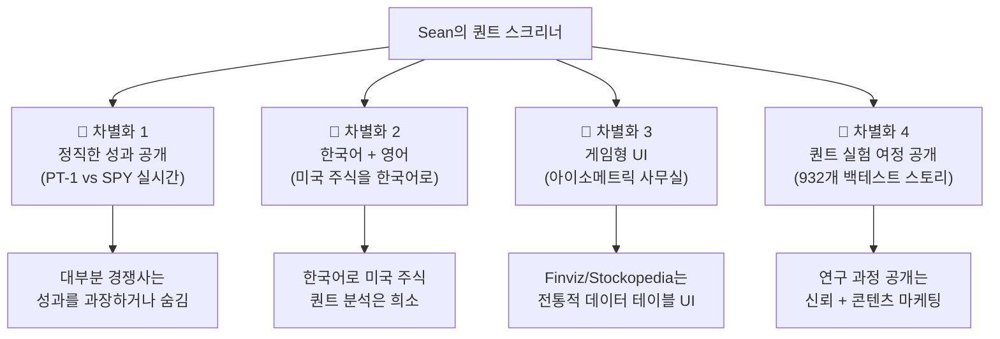

# 🔍 경쟁사 분석: 퀀트 스크리너로 사업하는 업체들

> Sean의 프로젝트와 비슷하게 **퀀트 스크리너 + 기술 지표 + 모의투자/성과 공개**로 상업화하고 있는 국내외 업체들을 분석했습니다.

---

## 한눈에 보기

| 업체 | 국가 | 핵심 모델 | 가격 | Sean과 유사도 | 배울 점 |
|------|------|----------|------|:---:|---------|
| **Danelfin** | 🇪🇸 스페인 | AI 점수 (1~10) + 스크리너 | \$0~134/월 | ⭐⭐⭐⭐⭐ | 설명 가능한 AI, 성과 투명 공개 |
| **Stockopedia** | 🇬🇧 영국 | 팩터 스코어링 (QVM) | ~\$30/월 | ⭐⭐⭐⭐ | 부트스트랩으로 성장, 팩터 점수 |
| **Koyfin** | 🇺🇸 미국 | 매크로+스크리너 "가난한 블룸버그" | \$0~45/월 | ⭐⭐⭐ | 무료 티어로 유저 확보 |
| **Finviz** | 🇺🇸 미국 | 클래식 스크리너 | \$0~40/월 | ⭐⭐⭐ | SEO의 왕, 심플한 UI |
| **퀀터스** | 🇰🇷 한국 | 퀀트 스크리너+자동매매 | 구독형 | ⭐⭐⭐⭐ | 한국 시장 검증, VC 투자 |
| **뉴지스탁(젠포트)** | 🇰🇷 한국 | 노코드 퀀트+자동매매 | 구독형 | ⭐⭐⭐ | AI 대화형 전략 생성 |
| **인텔리퀀트** | 🇰🇷 한국 | 퀀트 코딩+마켓플레이스 | 구독형 | ⭐⭐⭐ | 전략 마켓플레이스 모델 |
| **Prospero.ai** | 🇺🇸 미국 | AI 시그널+뉴스레터 | \$0~19/월 | ⭐⭐⭐⭐ | 모바일 앱, 뉴스레터 |
| **Ziggma** | 🇨🇭 스위스 | 32-메트릭 점수+포트폴리오 | \$0~10/월 | ⭐⭐⭐⭐ | 인디 메이커, 저가 전략 |
| **TrendSpider** | 🇺🇸 미국 | AI 패턴인식+자동매매 | ~\$30~70/월 | ⭐⭐⭐ | 차트 패턴 자동 탐지 |
| **Quantbase** | 🇺🇸 미국 | 테마형 퀀트 포트폴리오 | \$20~35/월 | ⭐⭐⭐ | 특화 데이터(정치인 거래 등) 활용 |

---

## 🏆 카테고리 1: AI 스코어링 서비스 (Sean과 가장 유사)

### 1. Danelfin — "당신의 프로젝트가 커지면 이렇게 됩니다"

> **Sean의 프로젝트와 가장 닮은 상업 서비스.** AI 점수 + 기술/펀더멘탈/센티먼트 분석 + 성과 투명 공개.

| 항목 | 내용 |
|------|------|
| **본사** | 바르셀로나, 스페인 |
| **설립** | ~2017 |
| **핵심 기능** | 매일 수천 종목에 AI Score (1~10) 부여, 향후 3개월 아웃퍼폼 확률 예측 |
| **AI 구조** | 기술 지표 ~60% + 펀더멘탈 ~25% + 센티먼트 ~15% |
| **투명성** | ✅ "Best Stocks" 전략 성과를 S&P 500 대비 **실시간 공개** |
| **설명 가능성** | ✅ 왜 이 점수가 나왔는지 세부 지표 브레이크다운 제공 |
| **수상** | Benzinga Global Fintech Award |

**가격 구조:**
```text
Free        $0     → Top 10 랭킹, 뉴스레터, 월 10개 리포트
Pro        $59/월  → 무제한 스크리너, AI 가격 예측, CSV 내보내기
Elite     $134/월  → 숏 아이디어, 무제한 포트폴리오, 우선 지원
API        $70~599/월 → JSON 데이터 피드 (2017년부터 히스토리)
```

**Sean이 배울 점:**
- 🎯 "AI Score"라는 **단일 숫자**로 복잡한 분석을 단순화 (Sean의 ★ 별점과 동일 개념)
- 🎯 "Explainable AI" — 왜 이 점수인지 보여주는 것이 신뢰 핵심
- 🎯 무료 → Pro → Elite 3단계 깔대기
- 🎯 API 판매로 B2B 수익 추가
- ⚠️ 그들도 "시장을 이긴다"가 아니라 "아웃퍼폼 **확률**"이라고 표현 (규제 회피)

---

### 2. Prospero.ai — "뉴스레터 + 앱" 모델

| 항목 | 내용 |
|------|------|
| **본사** | 미국 |
| **핵심** | AI가 매일 수백만 데이터 포인트 처리 → 매수/매도 시그널을 **일반어로** 번역 |
| **특징** | 옵션 플로우 + 센티먼트 + 기술적 패턴 종합 |
| **가격** | 무료 앱 + 유료 뉴스레터/시그널 ~\$19/월 |
| **채널** | 모바일 앱 (iOS) + 웹 |

**Sean이 배울 점:**
- 🎯 **모바일 앱 우선** — 주식 투자자는 모바일에서 확인
- 🎯 **뉴스레터가 수익 채널** — 매일 나오는 시그널을 이메일로 → 구독료
- 🎯 저가 전략 (\$19/월) — 진입장벽 낮춤

---

## 📊 카테고리 2: 퀀트 스크리너 SaaS (해외 검증된 모델)

### 3. Stockopedia — "부트스트랩 성공 사례"

| 항목 | 내용 |
|------|------|
| **본사** | 영국 (2010년 설립) |
| **펀딩** | 엔젤 ~\$1.4M만 받고 **유기적 성장** |
| **핵심** | StockRanks — Quality, Value, Momentum 3팩터 점수 |
| **시장** | 영국, 유럽, 캐나다, 호주 |
| **가격** | 무료 체험 후 연 구독 (수백 달러/년, 시장별 차등) |
| **특징** | "구루 스크린" — 워렌 버핏, 피터 린치 등 전설적 투자자 전략 모방 |

**Sean이 배울 점:**
- 🎯 **VC 없이도 가능** — 부트스트랩으로 10년+ 운영
- 🎯 3팩터 점수 = Sean의 바닥반등/모멘텀 전략과 유사한 접근
- 🎯 지역별 요금 차등 → 한국/캐나다/미국 별도 가격 가능

---

### 4. Koyfin — "무료로 뿌리고 Pro에서 수확"

| 항목 | 내용 |
|------|------|
| **본사** | 미국 (2016년 설립, 전 월스트리트) |
| **펀딩** | Seed \$3M (Craft Ventures 등) |
| **핵심** | "가난한 블룸버그 터미널" — 매크로 + 주식 + ETF + 채권 + 암호화폐 |
| **무료 티어** | ✅ 매우 강력 (제한적 실시간, 히스토리 제한) |
| **유료** | Plus / Pro / Advisor 플랜 |
| **차별화** | 멀티에셋 (주식만이 아님), 매크로 차트 강점 |

**Sean이 배울 점:**
- 🎯 **강력한 무료 티어** = 유저 유입의 핵심 엔진
- 🎯 Sean의 매크로 탭 (FRED, 수익률 곡선) = Koyfin의 핵심 기능과 동일
- 🎯 "블룸버그 대안"이라는 포지셔닝 → "Finviz 한국어 대안"으로 변형 가능

---

### 5. Finviz — "SEO의 왕, 1인 개발자 전설"

| 항목 | 내용 |
|------|------|
| **창업자** | 1인 개발자 (체코 출신) |
| **핵심** | 주식 스크리너 + 히트맵 + 뉴스 |
| **가격** | 무료 (광고 기반) + Elite \$40/월 |
| **트래픽** | 월 수천만 방문 (SEO 1위) |
| **수익** | 광고 + 프리미엄 구독 |
| **직원** | 극소수 (10명 미만으로 추정) |

**Sean이 배울 점:**
- 🎯 **Programmatic SEO** — "Best stocks with low RSI" 같은 페이지 수천 개 자동 생성
- 🎯 광고 수익만으로도 운영 가능 (무료 유저 트래픽)
- 🎯 **심플함이 승리** — 복잡한 기능보다 빠르고 직관적인 UI

---

## 🇰🇷 카테고리 3: 한국 퀀트 서비스 (직접 경쟁자)

### 6. 퀀터스 (Quantus) — "한국판 Sean의 프로젝트 성공 버전"

| 항목 | 내용 |
|------|------|
| **핵심** | 한국+미국 주식 퀀트 스크리닝 + 백테스트 + 자동매매 |
| **규모** | 자동 주문 집행 **조 단위** |
| **인증** | Microsoft 스타트업 프로그램 선정 |
| **수익** | 구독형 (기본 무료 + 고급 지표/백테스트 유료) |
| **자동매매** | 증권사 API 연동 실계좌 자동 주문 |

**Sean이 배울 점:**
- 🎯 **한국어 + 미국 주식** = Sean과 완전히 같은 타겟
- 🎯 VC 투자 유치 성공 → 시장 수요 검증됨
- 🎯 자동매매 연동이 핵심 차별화 (하지만 규제 리스크도 큼)
- ⚠️ 경쟁자가 이미 있다는 뜻 → **차별화 필수**

---

### 7. 뉴지스탁 (젠포트/Genport) — "노코드 퀀트의 원조"

| 항목 | 내용 |
|------|------|
| **역사** | 국내 퀀트 투자 대중화 **선두 주자** |
| **핵심** | 코딩 없이 조건식 만들어 백테스트 → 자동매매 |
| **최신** | LLM(생성형 AI)로 자연어 → 전략 코드 자동 생성 |
| **수익** | 구독 + 증권사 API 연동 |

**Sean이 배울 점:**
- 🎯 "AI 대화형 전략 생성" = 최신 트렌드
- 🎯 젠포트의 오래된 레거시 → 현대적 UX로 이길 수 있는 틈새

---

### 8. 인텔리퀀트 (IntelliQuant) — "전략 마켓플레이스"

| 항목 | 내용 |
|------|------|
| **핵심** | iQ Studio (코딩 기반 퀀트) + iQ 마켓 (전략 마켓플레이스) |
| **최신** | "바이브코딩" — AI가 전략 코드 생성 + 에러 수정 |
| **수익** | 구독 + **전략 거래 중개 수수료** |

**Sean이 배울 점:**
- 🎯 **마켓플레이스 모델** — 다른 사람의 전략을 구독할 수 있게 하면 플랫폼 효과
- 🎯 하지만 Sean은 1인 → 마켓플레이스보다 **자체 전략 투명 공개**가 현실적

---

### 9. 퀀팃 (Quantit) — "B2B 로보어드바이저"

| 항목 | 내용 |
|------|------|
| **핵심** | AI 퀀트 리서치 + 로보어드바이저 |
| **수익** | B2C (플랜팃 앱) + **B2B (금융기관에 AI 솔루션 공급)** |
| **규모** | 은행, 증권사, 퇴직연금에 인프라 공급 |
| **글로벌** | 동남아, 미국으로 진출 중 |

**Sean이 배울 점:**
- 🎯 B2B가 진짜 돈이 됨 — 하지만 1인 개발자 단계에서는 비현실적
- 🎯 나중에 스크리너 엔진을 API로 팔 수 있는 가능성은 열어둘 것

---

## 🛠️ 카테고리 4: 인디/솔로 메이커 사례

### 10. Ziggma — "소규모로 시작해서 성장"

| 항목 | 내용 |
|------|------|
| **본사** | 스위스 |
| **핵심** | 32개 메트릭으로 주식 점수화 + 포트폴리오 시뮬레이터 |
| **가격** | 무료 + Premium **\$9.90/월** (연간 \$89) |
| **특징** | 무료 체험 7일 |

**Sean이 배울 점:**
- 🎯 **\$10/월 가격대** — 충동구매 가능한 가격
- 🎯 소규모 팀으로 운영 가능한 모델
- 🎯 32개 메트릭 = Sean의 30+ 지표와 직접 비교 가능

---

### 11. Quantbase — "자동 투자 + 특화 테마"

| 항목 | 내용 |
|------|------|
| **본사** | 미국 (SEC 등록 투자자문사) |
| **핵심** | 알고리즘 포트폴리오 자동 투자 (미 의회원 거래 추적 등) |
| **가격** | \$20~35/월 |
| **특이점** | SEC 등록 → 실제 돈을 운용하므로 규제 준수 |

**Sean이 배울 점:**
- 🎯 "의회원 거래 추적" 같은 **독특한 데이터** = 차별화의 핵심
- ⚠️ 실제 투자 운용은 SEC 등록 필요 → Sean은 스크리너/정보 제공만 하는 게 안전

---

## 📈 Sean의 포지셔닝 전략

위 경쟁사들을 분석한 결과, Sean의 프로젝트가 **차별화할 수 있는 영역**:



### 가장 현실적인 벤치마크 업체 3곳

| 순위 | 업체 | 이유 |
|:---:|------|------|
| 1 | **Danelfin** | AI Score + Explainable AI + 성과 공개 = Sean의 확대 버전 |
| 2 | **Ziggma** | 소규모, 저가 구독, 멀티 메트릭 점수 = 현실적 목표 |
| 3 | **퀀터스** | 한국어 + 미국 주식 = 같은 시장, 직접 경쟁 |

### 가격 벤치마크

경쟁사 가격을 보면 Sean의 서비스 적정 가격대는:

| 티어 | 추천 가격 | 근거 |
|------|----------|------|
| **무료** | \$0 | 기본 스크리너 + Top 10 + PT 성과 |
| **Pro** | **\$9.99~19.99/월** | Ziggma(\$10), Prospero(\$19) 참고 |
| **Power** | **\$29.99~49.99/월** | Danelfin Pro(\$59) 보다 저렴하게 |
| **API** | **\$49.99~99.99/월** | 개발자/퀀트 대상 |

> **핵심 인사이트**: 가장 성공적인 경쟁사들의 공통점은 **"복잡한 퀀트 분석을 단일 점수로 단순화"** + **"투명한 성과 추적"**입니다. Sean의 프로젝트는 이미 두 가지를 모두 갖추고 있습니다 (★ 별점 + PT-1 vs SPY). 부족한 건 데이터 라이선스와 마케팅뿐입니다.

