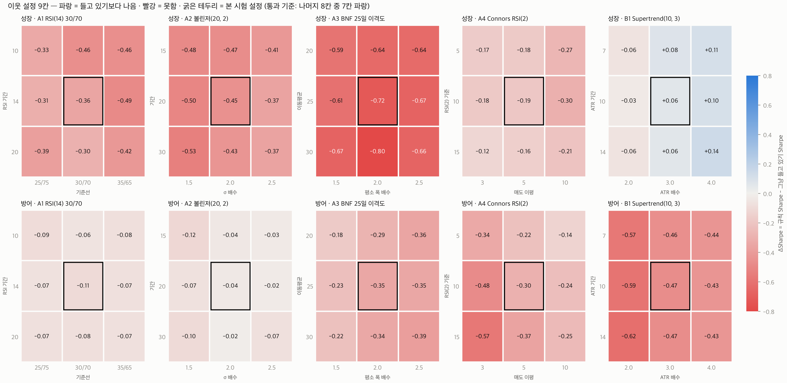
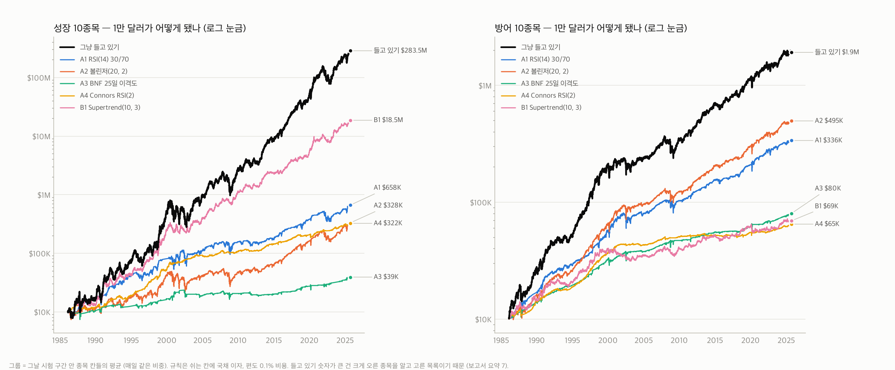
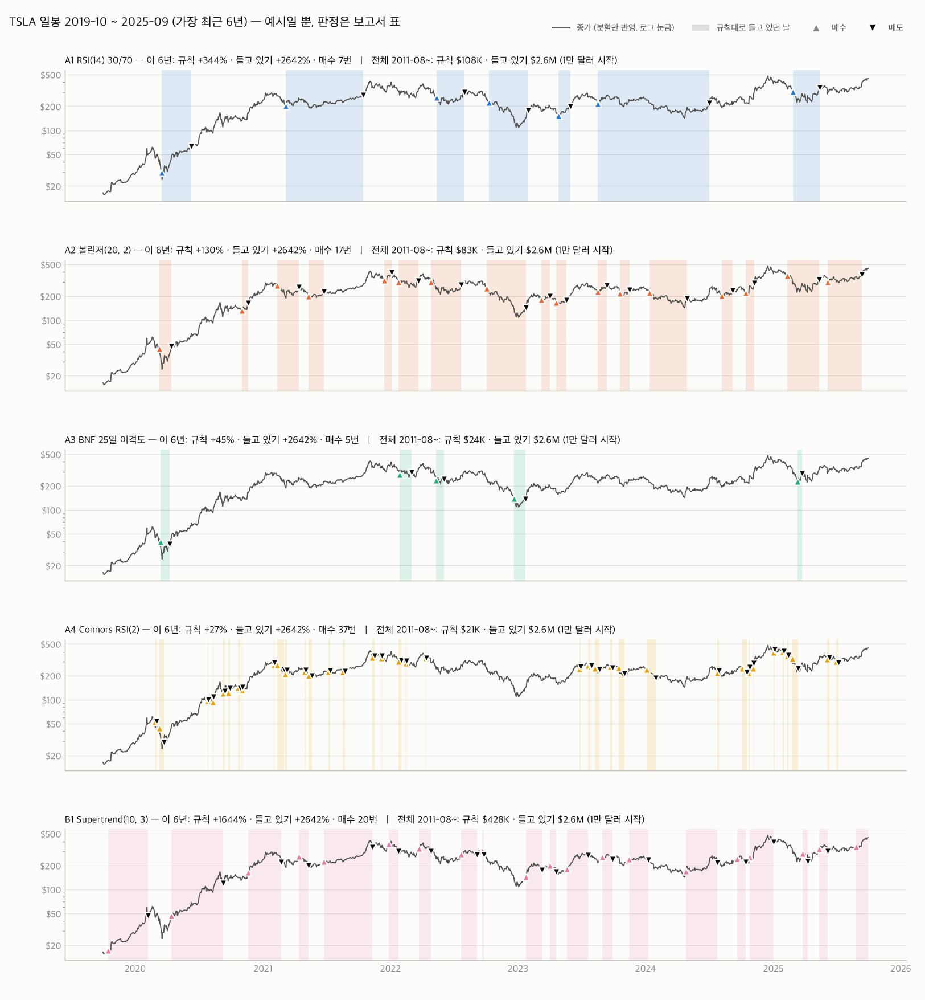
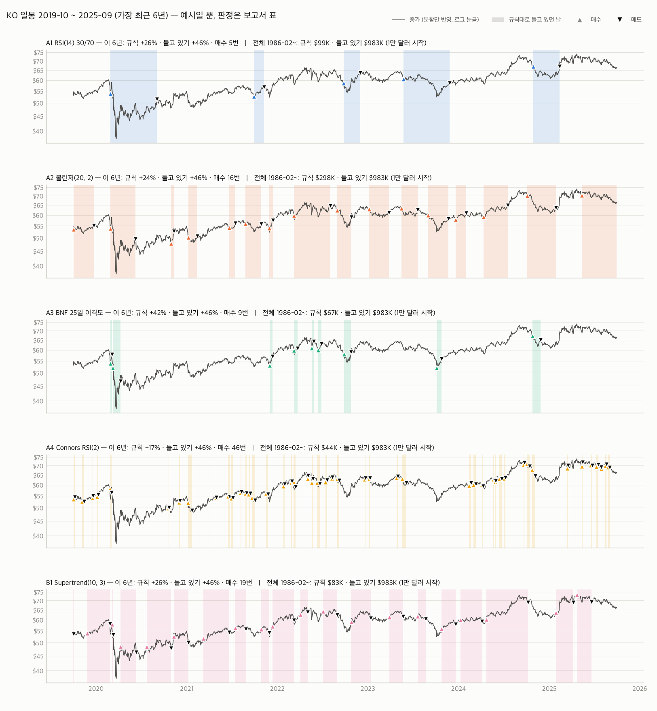

# 유명 종목 일봉 스윙 (swing_famous_v1) — 1986-02 ~ 2025-09

- 사전 등록: TRIAL_LOG family `swing_famous_v1`, 10건 (규칙 5 × 성장·방어) → 채택 기준 p ≤ 0.005 · 누적 시도 4,429건
- 질문: 유명 종목을 일봉으로 저점에 사고 고점에 파는 걸 반복하면, **같은 종목을 그냥 들고 있는 것**보다 나은가
- 공통: 끝난 일봉 종가 신호 → 다음 날 시가 체결 · 종목당 계좌 1/10 칸 · 쉬는 칸 = 1개월 국채 · 매수만 · 편도 0.1%
- 실행 sha `f22580af3549` (등록과 같음) · 정의·사전 등록 전문은 `scripts/swing_famous_research.py` 머리말 · 보고서 작성 2026-10-22 10:03
- **결과: 10건 모두 탈락**

## 쉬운 말 요약

1. **10건 모두 탈락.** 저점에 사고 고점에 파는 규칙 4개(RSI(14)·볼린저·BNF 이격도·RSI(2))와 반등을 확인한 뒤 사는 규칙 1개(Supertrend)를 유명 성장주 10개·방어주 10개에 40년(1986~2025) 일봉으로 돌렸다. 어느 것도 같은 종목을 그냥 들고 있는 것보다 낫지 않았다. 10건 중 9건은 위험 대비 수익(Sharpe)부터 낮았다.
2. **승률은 높았는데 졌다.** 방어주 RSI(14) 규칙은 거래의 85%, 성장주는 74%가 이익이었다. 그런데 큰 상승장에 빠져 있었다. 성장주를 그냥 들고 있으면 2009년 +142%, 2020년 +105%, 2023년 +102%였고 RSI(14) 규칙은 +36%, +18%, +38%였다. 2008년 폭락을 반쯤 피한 것(−48% → −24%)보다 놓친 상승이 훨씬 컸다.
3. **규칙은 '안 오른 종목'에서만 이겼다.** 150개 조합(종목 × 규칙) 중 1만 달러가 들고 있기보다 많이 남은 건 7개뿐이다: VZ·INTC(RSI·볼린저), XOM(RSI)처럼 제자리였던 종목과, 오래 폭락했던 AMD(2000~2015년 −97%)·AAPL(2000~2003년 −82%)의 Supertrend. 크게 오른 종목에서는 크게 졌다: TSLA 1만 달러가 들고 있기 260만 달러 vs RSI(14) 규칙 11만 달러, NVDA 1,608만 달러 vs 2.3만 달러. 장기 수익은 크게 오른 몇 종목이 거의 다 만든다.
4. **가장 가까웠던 건 성장주 Supertrend.** Sharpe 0.87 vs 0.82, 최대 낙폭 −36% vs −65%로 위험은 줄였지만 연수익은 20.9% vs 29.5%였다. 차이(+0.06)는 운과 구별되지 않고(p 0.30), 같은 규칙이 방어주(0.25 vs 0.72)와 2010년 유명주(−0.19)에서는 졌다. 추세 따라가기는 낙폭을 반으로 줄이는 대신 수익도 줄인다 (SPY 로 본 lab_v1 A 와 같은 결론).
5. **RSI(2) 눌림목에는 진짜 신호가 있다 — 너무 작을 뿐.** 매매 횟수·보유 기간이 같은 무작위 매매 2,000번 중 규칙보다 나은 게 성장 1번, 방어 0번이었다. 하지만 거래당 평균 +0.8%(성장)·+0.3%(방어), 4일 보유, 시장에 있는 시간 11~12%라 연수익이 9.2%·4.8%로 들고 있기(29.5%·14.2%)의 3분의 1이었다. 비용을 편도 0.05%로 낮춰도 진다.
6. **결과를 모르고 고른 목록에서도 같다.** 2010년 한 해 거래대금 상위 10개(AAPL·BAC·C·GOOGL·XOM·MSFT·GS·JPM·INTC·CSCO)를 2011~2025에 시험해도 5개 규칙 모두 들고 있기보다 낮았다 (ΔSharpe −0.17 ~ −0.50).
7. **'유명 성장주 들고 있기 연 29.5%'는 미래를 알고 고른 숫자다.** 테슬라·엔비디아가 크게 오른 걸 알고 고른 목록이라서다. 2010년에 그때 유명했던 10개를 골랐다면 연 16.6%였다 (그것도 AAPL·MSFT·GOOGL 덕분). 그래서 이 시험은 SPY 가 아니라 '같은 종목 들고 있기'와 비교했다.

## 한눈에 보기

Sharpe = 1개월 국채를 뺀 초과수익 기준 (일간 × √252). ΔSharpe 구간 = 20일 블록 부트스트랩 1만 회 95%.

| ID | 규칙 | Sharpe (들고 있기) | ΔSharpe [95%] | p | 연수익 (들고 있기) | 최대 낙폭 (들고 있기) | 시장에 있던 비율 | 1만 달러 → (들고 있기) | 판정 |
|---|---|---|---|---|---|---|---|---|---|
| G-A1 | A1 RSI(14) 30/70 | 0.46 (0.82) | −0.36 [−0.56, −0.15] | 1.000 | 11.1% (29.5%) | −47% (−65%) | 34% | $658K ($283.5M) | **탈락** |
| G-A2 | A2 볼린저(20, 2) | 0.37 (0.82) | −0.45 [−0.63, −0.26] | 1.000 | 9.2% (29.5%) | −55% (−65%) | 42% | $328K ($283.5M) | **탈락** |
| G-A3 | A3 BNF 25일 이격도 | 0.10 (0.82) | −0.72 [−1.01, −0.43] | 1.000 | 3.5% (29.5%) | −31% (−65%) | 8% | $39K ($283.5M) | **탈락** |
| G-A4 | A4 Connors RSI(2) | 0.62 (0.82) | −0.19 [−0.52, +0.16] | 0.854 | 9.2% (29.5%) | −32% (−65%) | 11% | $322K ($283.5M) | **탈락** |
| G-B1 | B1 Supertrend(10, 3) | 0.87 (0.82) | +0.06 [−0.15, +0.26] | 0.299 | 20.9% (29.5%) | −36% (−65%) | 55% | $18.5M ($283.5M) | **탈락** |
| D-A1 | A1 RSI(14) 30/70 | 0.62 (0.72) | −0.11 [−0.28, +0.09] | 0.850 | 9.3% (14.2%) | −26% (−35%) | 41% | $336K ($1.9M) | **탈락** |
| D-A2 | A2 볼린저(20, 2) | 0.69 (0.72) | −0.04 [−0.18, +0.13] | 0.637 | 10.3% (14.2%) | −25% (−35%) | 44% | $495K ($1.9M) | **탈락** |
| D-A3 | A3 BNF 25일 이격도 | 0.37 (0.72) | −0.35 [−0.58, −0.09] | 0.997 | 5.4% (14.2%) | −17% (−35%) | 9% | $80K ($1.9M) | **탈락** |
| D-A4 | A4 Connors RSI(2) | 0.43 (0.72) | −0.30 [−0.58, 0.00] | 0.976 | 4.8% (14.2%) | −13% (−35%) | 11% | $65K ($1.9M) | **탈락** |
| D-B1 | B1 Supertrend(10, 3) | 0.25 (0.72) | −0.47 [−0.64, −0.29] | 1.000 | 5.0% (14.2%) | −22% (−35%) | 58% | $69K ($1.9M) | **탈락** |

- 그룹 '들고 있기'는 10종목을 매일 같은 비중으로 맞춘 값이다. 1만 달러 숫자가 큰 건 크게 오른 종목을 알고 고른 목록이라서다 (요약 7). 한 종목씩 사서 그대로 둔 값은 아래 종목별 표.

## 관문별 결과 (✓ 통과 · ✗ 못 넘음)

① 95% 하한 > 0 · p ≤ 0.005 ② 세 구간 모두 ΔSharpe > 0 (1986–2007 / 2008–2015 / 2016–2025.09) ③ 최대 낙폭 2%p 이내 ④ 종목 7/10 이상 ⑤ 무작위 매매 2,000번 중 규칙 이상 ≤ 5% ⑥ 이웃 8칸 중 7칸 ⑦ 비용 2배 · 하루 늦게 ⑧ 대조군 (2010년 유명주, 2011~)

| ID | ① 유의 | ② 세 구간 | ③ 낙폭 | ④ 종목 | ⑤ 무작위 | ⑥ 이웃 | ⑦ 비용 2배 / 하루 늦게 | ⑧ 대조군 |
|---|---|---|---|---|---|---|---|---|
| G-A1 | ✗ p 1.000 | ✗ −0.25 / −0.52 / −0.53 | ✓ −47% vs −65% | ✗ 0/10 | ✗ 92.5% | ✗ 0/8 | ✗ −0.36 / −0.40 | ✗ −0.18 |
| G-A2 | ✗ p 1.000 | ✗ −0.45 / −0.55 / −0.40 | ✓ −55% vs −65% | ✗ 0/10 | ✗ 99.8% | ✗ 0/8 | ✗ −0.47 / −0.45 | ✗ −0.17 |
| G-A3 | ✗ p 1.000 | ✗ −0.70 / −0.83 / −0.71 | ✓ −31% vs −65% | ✗ 0/10 | ✗ 93.8% | ✗ 0/8 | ✗ −0.73 / −0.82 | ✗ −0.50 |
| G-A4 | ✗ p 0.854 | ✗ −0.08 / −0.18 / −0.52 | ✓ −32% vs −65% | ✗ 1/10 | ✓ 0.1% | ✗ 0/8 | ✗ −0.34 / −0.30 | ✗ −0.44 |
| G-B1 | ✗ p 0.299 | ✓ +0.07 / +0.14 / +0.03 | ✓ −36% vs −65% | ✗ 2/10 | ✓ 1.1% | ✗ 5/8 | ✓ +0.02 / +0.05 | ✗ −0.19 |
| D-A1 | ✗ p 0.850 | ✗ −0.13 / −0.11 / −0.01 | ✓ −26% vs −35% | ✗ 1/10 | ✗ 26.5% | ✗ 0/8 | ✗ −0.12 / −0.11 | ✗ −0.18 |
| D-A2 | ✗ p 0.637 | ✗ −0.07 / −0.02 / +0.05 | ✓ −25% vs −35% | ✗ 2/10 | ✓ 2.9% | ✗ 0/8 | ✗ −0.09 / −0.06 | ✗ −0.17 |
| D-A3 | ✗ p 0.997 | ✗ −0.38 / −0.21 / −0.40 | ✓ −17% vs −35% | ✗ 0/10 | ✗ 14.2% | ✗ 0/8 | ✗ −0.39 / −0.33 | ✗ −0.50 |
| D-A4 | ✗ p 0.976 | ✗ −0.14 / −0.51 / −0.65 | ✓ −13% vs −35% | ✗ 0/10 | ✓ 0.0% | ✗ 0/8 | ✗ −0.64 / −0.22 | ✗ −0.44 |
| D-B1 | ✗ p 1.000 | ✗ −0.53 / −0.31 / −0.46 | ✓ −22% vs −35% | ✗ 0/10 | ✗ 100.0% | ✗ 0/8 | ✗ −0.55 / −0.43 | ✗ −0.19 |

- ⑤ 는 '매매 횟수·보유 기간·종목끼리 겹치는 모양은 그대로 두고 날짜만 옮긴 가짜 매매' 2,000번 중 규칙보다 Sharpe 가 높거나 같은 비율이다. 낮을수록 '언제 사고 파는지'에 정보가 있다는 뜻이다. A4 RSI(2) 는 성장·방어 모두 0.1% 이하로 진짜 신호가 있었지만, ① 들고 있기와의 비교에서 졌다.

## 왜 졌나 ① — 승률은 높은데 큰 상승을 놓쳤다

거래 통계 (끝난 거래만, 수익 = 진입 시가 → 청산 시가, 배당 포함, 비용 양쪽):

| 그룹 | 규칙 | 거래 | 승률 | 평균 거래 수익 | 중앙값 | 평균 보유 | 최악 거래 |
|---|---|---|---|---|---|---|---|
| 성장 | A1 RSI(14) 30/70 | 245 | 74% | +9.2% | +11.9% | 96일 | −75% |
| 성장 | A2 볼린저(20, 2) | 745 | 70% | +3.4% | +5.7% | 39일 | −84% |
| 성장 | A3 BNF 25일 이격도 | 287 | 60% | +1.2% | +3.4% | 20일 | −67% |
| 성장 | A4 Connors RSI(2) | 2,037 | 66% | +0.8% | +1.1% | 4일 | −46% |
| 성장 | B1 Supertrend(10, 3) | 1,004 | 47% | +6.2% | −0.8% | 38일 | −38% |
| 방어 | A1 RSI(14) 30/70 | 333 | 85% | +8.0% | +8.1% | 121일 | −52% |
| 방어 | A2 볼린저(20, 2) | 1,144 | 74% | +2.7% | +3.4% | 38일 | −48% |
| 방어 | A3 BNF 25일 이격도 | 494 | 72% | +1.8% | +2.5% | 17일 | −37% |
| 방어 | A4 Connors RSI(2) | 2,834 | 63% | +0.3% | +0.5% | 4일 | −33% |
| 방어 | B1 Supertrend(10, 3) | 1,423 | 45% | +1.0% | −0.8% | 40일 | −18% |

큰 해만 골라 본 그룹 연수익 (%, 그해 1월 첫 거래일 ~ 12월 마지막 거래일 시가 기준):

**성장**

| 연도 | 들고 있기 | A1 | A2 | A3 | A4 | B1 | SPY |
|---|---|---|---|---|---|---|---|
| 1987 | +59 | +53 | +18 | 0 | −4 | +63 | — |
| 2000 | −27 | −31 | −30 | +13 | +29 | −8 | −10 |
| 2002 | −30 | −8 | −12 | −14 | +13 | −15 | −22 |
| 2008 | −48 | −24 | −40 | −10 | −6 | −12 | −37 |
| 2009 | +142 | +36 | +49 | +5 | +6 | +60 | +27 |
| 2013 | +102 | +11 | +22 | +3 | +18 | +59 | +29 |
| 2020 | +105 | +18 | +25 | +3 | +9 | +64 | +18 |
| 2022 | −46 | −30 | −34 | +5 | −2 | −22 | −18 |
| 2023 | +102 | +38 | +40 | +7 | +9 | +54 | +25 |

**방어**

| 연도 | 들고 있기 | A1 | A2 | A3 | A4 | B1 | SPY |
|---|---|---|---|---|---|---|---|
| 1987 | +14 | +15 | +4 | +8 | +1 | +13 | — |
| 2000 | +14 | +26 | +29 | +2 | +14 | 0 | −10 |
| 2002 | −11 | −10 | −4 | +4 | 0 | −8 | −22 |
| 2008 | −16 | −2 | −11 | +5 | −1 | −9 | −37 |
| 2009 | +16 | +2 | +8 | +1 | +3 | +9 | +27 |
| 2013 | +21 | +11 | +12 | +3 | −2 | +9 | +29 |
| 2020 | +13 | +14 | +13 | +4 | +2 | −8 | +18 |
| 2022 | +3 | +9 | +4 | +2 | +2 | +2 | −18 |
| 2023 | +5 | +7 | +10 | +6 | +4 | +2 | +25 |

## 왜 졌나 ② — 안 오른 종목에서만 이겼다

종목별 1만 달러 → (각 종목 시험 첫날 시가에 사서 2025-09-30 시가까지. **굵게** = 들고 있기보다 많이 남음):

**성장**

| 종목 | 시작 | 들고 있기 | A1 | A2 | A3 | A4 | B1 |
|---|---|---|---|---|---|---|---|
| TSLA | 2011-08-10 | $2.6M | $108K | $83K | $24K | $21K | $428K |
| META | 2013-07-05 | $303K | $21K | $23K | $20K | $68K | $112K |
| MSFT | 1987-04-24 | $24.5M | $584K | $958K | $128K | $250K | $456K |
| NFLX | 2003-07-08 | $6.2M | $11K | $50K | $3,154 | $32K | $301K |
| AAPL | 1986-02-13 | $31.0M | $50K | $35K | $17K | $136K | **$36.3M** |
| AMZN | 1998-06-29 | $2.8M | $85K | $256K | $52K | $149K | $190K |
| NVDA | 2000-03-06 | $16.1M | $23K | $24K | $8,277 | $22K | $1.3M |
| GOOGL | 2005-09-30 | $311K | $44K | $54K | $24K | $25K | $93K |
| AMD | 1986-02-13 | $100K | $16K | $1,024 | $5,445 | $93K | **$3.3M** |
| ADBE | 1987-09-24 | $3.3M | $1.1M | $132K | $35K | $112K | $465K |
| Sharpe 이긴 종목 |  |  | 0/10 | 0/10 | 0/10 | 1/10 | 2/10 |

**방어**

| 종목 | 시작 | 들고 있기 | A1 | A2 | A3 | A4 | B1 |
|---|---|---|---|---|---|---|---|
| KO | 1986-02-13 | $983K | $99K | $298K | $67K | $44K | $83K |
| PEP | 1986-02-13 | $955K | $356K | $272K | $76K | $55K | $59K |
| PG | 1986-02-13 | $1.0M | $229K | $245K | $32K | $102K | $51K |
| CL | 1986-02-13 | $946K | $407K | $727K | $79K | $58K | $33K |
| WMT | 1986-02-13 | $2.7M | $764K | $503K | $138K | $81K | $104K |
| COST | 1987-08-19 | $1.1M | $182K | $384K | $33K | $54K | $89K |
| JNJ | 1986-02-13 | $1.5M | $377K | $409K | $74K | $51K | $38K |
| MRK | 1986-02-13 | $711K | $39K | $216K | $87K | $80K | $31K |
| DUK | 1986-02-13 | $471K | $88K | $147K | $54K | $28K | $54K |
| VZ | 1986-02-13 | $224K | **$337K** | **$275K** | $78K | $45K | $7,822 |
| Sharpe 이긴 종목 |  |  | 1/10 | 2/10 | 0/10 | 0/10 | 0/10 |

**대조** (대조군 — 2011-01-03 부터)

| 종목 | 시작 | 들고 있기 | A1 | A2 | A3 | A4 | B1 |
|---|---|---|---|---|---|---|---|
| AAPL | 2011-01-03 | $260K | $28K | $25K | $13K | $23K | $102K |
| BAC | 2011-01-03 | $48K | $39K | $14K | $13K | $11K | $15K |
| C | 2011-01-03 | $29K | $21K | $22K | $12K | $17K | $23K |
| GOOGL | 2011-01-03 | $164K | $35K | $46K | $24K | $25K | $52K |
| XOM | 2011-01-03 | $27K | **$31K** | $18K | $11K | $10K | $20K |
| MSFT | 2011-01-03 | $239K | $40K | $67K | $25K | $21K | $26K |
| GS | 2011-01-03 | $62K | $23K | $35K | $14K | $18K | $19K |
| JPM | 2011-01-03 | $109K | $33K | $64K | $24K | $12K | $25K |
| INTC | 2011-01-03 | $24K | **$29K** | **$44K** | $12K | $12K | $6,898 |
| CSCO | 2011-01-03 | $51K | $27K | $29K | $17K | $9,226 | $17K |
| Sharpe 이긴 종목 |  |  | 2/10 | 1/10 | 0/10 | 0/10 | 1/10 |

## 결과를 모르고 고른 목록 — 대조군 (2010년 거래대금 상위 10, 2011-01 ~ 2025-09)

| 규칙 | Sharpe | 들고 있기 | ΔSharpe | 연수익 (들고 있기) | 최대 낙폭 (들고 있기) | 시장에 있던 비율 |
|---|---|---|---|---|---|---|
| A1 RSI(14) 30/70 | 0.60 | 0.78 | −0.18 | 9.2% (16.6%) | −29% (−37%) | 42% |
| A2 볼린저(20, 2) | 0.60 | 0.78 | −0.17 | 9.6% (16.6%) | −35% (−37%) | 45% |
| A3 BNF 25일 이격도 | 0.28 | 0.78 | −0.50 | 3.7% (16.6%) | −29% (−37%) | 10% |
| A4 Connors RSI(2) | 0.34 | 0.78 | −0.44 | 3.1% (16.6%) | −11% (−37%) | 12% |
| B1 Supertrend(10, 3) | 0.59 | 0.78 | −0.19 | 7.3% (16.6%) | −18% (−37%) | 55% |

## 세 구간별 (ΔSharpe = 규칙 − 들고 있기)

| 그룹 | 규칙 | 1986–2007 ΔSharpe (연수익 규칙 vs 들고 있기) | 2008–2015 ΔSharpe (연수익 규칙 vs 들고 있기) | 2016–2025.09 ΔSharpe (연수익 규칙 vs 들고 있기) |
|---|---|---|---|---|
| 성장 | A1 RSI(14) 30/70 | −0.25 (13% vs 28%) | −0.52 (5% vs 23%) | −0.53 (12% vs 38%) |
| 성장 | A2 볼린저(20, 2) | −0.45 (8% vs 28%) | −0.55 (4% vs 23%) | −0.40 (16% vs 38%) |
| 성장 | A3 BNF 25일 이격도 | −0.70 (4% vs 28%) | −0.83 (0% vs 23%) | −0.71 (7% vs 38%) |
| 성장 | A4 Connors RSI(2) | −0.08 (11% vs 28%) | −0.18 (5% vs 23%) | −0.52 (8% vs 38%) |
| 성장 | B1 Supertrend(10, 3) | +0.07 (22% vs 28%) | +0.14 (15% vs 23%) | +0.03 (23% vs 38%) |
| 방어 | A1 RSI(14) 30/70 | −0.13 (11% vs 18%) | −0.11 (5% vs 8%) | −0.01 (8% vs 11%) |
| 방어 | A2 볼린저(20, 2) | −0.07 (12% vs 18%) | −0.02 (6% vs 8%) | +0.05 (9% vs 11%) |
| 방어 | A3 BNF 25일 이격도 | −0.38 (7% vs 18%) | −0.21 (3% vs 8%) | −0.40 (4% vs 11%) |
| 방어 | A4 Connors RSI(2) | −0.14 (8% vs 18%) | −0.51 (0% vs 8%) | −0.65 (2% vs 11%) |
| 방어 | B1 Supertrend(10, 3) | −0.53 (7% vs 18%) | −0.31 (2% vs 8%) | −0.46 (4% vs 11%) |

## 이웃 설정 히트맵 (판정 ⑥)

- 성장 B1 Supertrend 만 8칸 중 5칸이 양수였다 (ATR 배수 3·4 쪽). 기준(7칸)에 못 미쳤고, 같은 규칙이 방어주와 대조군에서는 졌다. 나머지 9개 규칙은 이웃 72칸 모두 음수 — 설정을 바꿔서 살아나는 규칙은 없었다.

## 비용·체결 스트레스 (ΔSharpe, 들고 있기도 같은 비용)

| ID | 편도 0.05% (참고) | 편도 0.1% (본 시험) | 편도 0.2% | 하루 늦은 체결 |
|---|---|---|---|---|
| G-A1 | −0.35 | −0.36 | −0.36 | −0.40 |
| G-A2 | −0.44 | −0.45 | −0.47 | −0.45 |
| G-A3 | −0.71 | −0.72 | −0.73 | −0.82 |
| G-A4 | −0.12 | −0.19 | −0.34 | −0.30 |
| G-B1 | +0.07 | +0.06 | +0.02 | +0.05 |
| D-A1 | −0.10 | −0.11 | −0.12 | −0.11 |
| D-A2 | −0.01 | −0.04 | −0.09 | −0.06 |
| D-A3 | −0.33 | −0.35 | −0.39 | −0.33 |
| D-A4 | −0.13 | −0.30 | −0.64 | −0.22 |
| D-B1 | −0.43 | −0.47 | −0.55 | −0.43 |

## SPY 와 비교 (참고, 1993-02 ~ 2025-09, 같은 날짜)

| ID | 규칙 Sharpe | SPY Sharpe | 규칙 연수익 | SPY 연수익 |
|---|---|---|---|---|
| G-A1 | 0.45 | 0.51 | 10.0% | 10.7% |
| G-A2 | 0.43 | 0.51 | 10.1% | 10.7% |
| G-A3 | 0.14 | 0.51 | 3.4% | 10.7% |
| G-A4 | 0.75 | 0.51 | 9.3% | 10.7% |
| G-B1 | 0.94 | 0.51 | 21.1% | 10.7% |
| D-A1 | 0.58 | 0.51 | 8.1% | 10.7% |
| D-A2 | 0.71 | 0.51 | 9.7% | 10.7% |
| D-A3 | 0.38 | 0.51 | 4.7% | 10.7% |
| D-A4 | 0.46 | 0.51 | 4.1% | 10.7% |
| D-B1 | 0.19 | 0.51 | 3.7% | 10.7% |

- SPY 보다 Sharpe 가 높은 것: G-A4, G-B1, D-A1, D-A2 · 연수익까지 높은 것: G-B1. 하지만 크게 오른 걸 알고 고른 종목이라서다 — 같은 종목을 그냥 들고 있으면 더 높다. 결과를 모르고 고른 대조군에서는 규칙 5개 모두 들고 있기에 졌다.

## 그림

예시 구간 표 (2019-10 ~ 2025-09, 가장 최근 6년 — 그림과 같은 값. 판정은 위 표):

| 종목 | 규칙 | 매수 | 규칙 수익 | 그냥 들고 있기 |
|---|---|---|---|---|
| TSLA | A1 RSI(14) 30/70 | 7 | +344% | +2,642% |
| TSLA | A2 볼린저(20, 2) | 17 | +130% | +2,642% |
| TSLA | A3 BNF 25일 이격도 | 5 | +45% | +2,642% |
| TSLA | A4 Connors RSI(2) | 37 | +27% | +2,642% |
| TSLA | B1 Supertrend(10, 3) | 20 | +1,644% | +2,642% |
| KO | A1 RSI(14) 30/70 | 5 | +26% | +46% |
| KO | A2 볼린저(20, 2) | 16 | +24% | +46% |
| KO | A3 BNF 25일 이격도 | 9 | +42% | +46% |
| KO | A4 Connors RSI(2) | 46 | +17% | +46% |
| KO | B1 Supertrend(10, 3) | 19 | +26% | +46% |

## 방법

- 가격: `data/research/tv_ohlcv_max.parquet` (분할만 반영 = TradingView 화면 가격, S&P 500 586/586 종가 일치 검증본, SHA256 고정). 신호는 이 가격, 수익은 배당 재투자 시가 (시가 × 수정종가/종가). 국채 = Kenneth French 일간 RF (고정본).
- 지표는 Pine 과 같은 계산: RSI = ta.rsi (Wilder RMA, 첫 n개 평균에서 시작), 볼린저 = ta.bb (모표준편차), Supertrend = ta.supertrend 원문을 그대로 옮김. 테스트가 `ta` 라이브러리 RSI·볼린저, Pine 원문 Supertrend 와 같은 값을 확인.
- 상태: 들고 있지 않을 때만 매수 신호, 들고 있을 때만 매도 신호를 본다. t 종가 신호 → t+1 시가 체결. 손절·공매도 없음.
- 시험 구간: 종목마다 자기 282번째 봉(약 1년 1개월 — 모든 지표가 계산되는 첫날)부터. TSLA 2011-08, META 2013-07, 1985년부터 있는 종목은 1986-02. 대조군은 2011-01-03 부터. 홀드아웃(2025-10-01~)은 쓰지 않았다.
- 그룹 수익 = 그날 구간 안 종목 칸들의 평균 (매일 같은 비중). 들고 있기도 같은 방식이라 차이는 '사고판 시점'만이다.
- 무작위 매매 (⑤): 모든 종목의 실제 보유 기록을 같은 k 일(63일 ~ 가장 짧은 구간 − 63일) 통째로 밀어 날짜만 바꿨다 (끝은 앞으로 돌림). 매매 횟수·보유 기간·종목끼리 겹치는 모양은 그대로다.
- 대조군 목록은 실행 때 데이터로 다시 뽑아 같은지 확인했다 (2010년 평균 종가 × 거래량, 거래일 ≥ 200, ETF·두 번째 주식 종류 제외). 11위 F, 12위 GE. 2016년 전에 상장폐지된 종목은 이 가격 파일에 없지만, 2010년 거래대금 10위 안 종목은 모두 살아 있어 영향이 없다.
- 실행 뒤 바꾼 것: 보고서·그림 코드를 붙였고, `pd.concat(..., axis=1)` 에 `sort=True` 를 명시했다 (지금 pandas 기본값과 같아 숫자는 그대로 — 다시 계산해 저장값과 차이 0 확인).

## 다음 단계

- 실전(PT-1·시트·이메일)에 바꿀 것은 없다. 채택 후보·관찰이 없어서 그림자 추적이나 새 페이퍼 계좌도 제안하지 않는다.
- 이 결과가 말하는 것: 유명 종목을 고르는 것까지는 쉽지만, 그 종목을 일봉으로 사고팔아서 들고 있기를 이기기는 어렵다. 규칙이 이기는 건 결국 안 오른 종목이고, 어떤 종목이 안 오를지는 미리 모른다.

연도별 전체 (그룹 연수익 %)

**성장**

| 연도 | 들고 있기 | A1 | A2 | A3 | A4 | B1 | SPY |
|---|---|---|---|---|---|---|---|
| 1986 | −12.5 | −15.3 | −12.3 | −6.9 | +17.8 | −10.9 | — |
| 1987 | +58.8 | +53.0 | +17.7 | −0.5 | −3.6 | +62.6 | — |
| 1988 | +12.5 | +13.8 | +8.2 | +6.3 | −1.1 | −8.5 | — |
| 1989 | +6.9 | +12.4 | +1.8 | +4.4 | +6.2 | −2.3 | — |
| 1990 | +26.8 | +13.9 | +6.5 | +15.3 | +2.7 | +41.9 | — |
| 1991 | +134.0 | +41.8 | +35.6 | +6.4 | +20.9 | +77.8 | — |
| 1992 | −3.5 | +9.7 | −17.9 | +2.3 | +19.1 | +2.8 | — |
| 1993 | −2.7 | +10.8 | +1.9 | −6.9 | −6.1 | +6.0 | +8.6 |
| 1994 | +49.3 | +25.9 | +27.7 | +3.7 | +14.7 | +15.0 | +0.7 |
| 1995 | +19.2 | +2.5 | +1.4 | −4.2 | +18.2 | +25.3 | +37.4 |
| 1996 | +13.7 | +6.5 | +4.9 | +6.7 | +16.4 | +27.8 | +23.5 |
| 1997 | +2.2 | +3.3 | −1.1 | +12.6 | +34.8 | +19.6 | +32.9 |
| 1998 | +153.4 | +61.7 | +51.6 | +7.4 | +18.4 | +82.7 | +28.4 |
| 1999 | +109.6 | +7.5 | +50.7 | +7.1 | +24.2 | +71.4 | +21.5 |
| 2000 | −26.7 | −31.2 | −30.5 | +12.9 | +29.1 | −8.0 | −10.0 |
| 2001 | +46.7 | +87.6 | +20.8 | +24.2 | +4.3 | +22.9 | −11.7 |
| 2002 | −30.3 | −7.8 | −11.6 | −14.0 | +13.5 | −15.2 | −21.6 |
| 2003 | +105.3 | +4.5 | +19.0 | 0.0 | +15.1 | +46.3 | +27.8 |
| 2004 | +27.1 | +12.4 | +12.7 | −5.6 | +1.5 | +18.0 | +10.9 |
| 2005 | +55.0 | +17.8 | +18.3 | +8.2 | −0.6 | +33.8 | +4.8 |
| 2006 | +13.0 | +11.8 | −3.7 | +1.3 | +4.5 | +21.6 | +15.7 |
| 2007 | +29.5 | +1.8 | +12.0 | +5.5 | +12.2 | +23.4 | +4.9 |
| 2008 | −48.4 | −23.6 | −40.4 | −10.2 | −5.7 | −12.4 | −36.8 |
| 2009 | +141.7 | +35.9 | +49.4 | +5.0 | +6.4 | +60.1 | +27.1 |
| 2010 | +21.8 | +3.4 | +7.1 | +2.1 | +7.0 | +18.0 | +15.0 |
| 2011 | −6.6 | −16.0 | 0.0 | −7.6 | −6.1 | −6.8 | +2.9 |
| 2012 | +14.2 | +11.0 | −3.7 | −1.4 | +2.9 | +12.6 | +16.1 |
| 2013 | +102.2 | +11.1 | +21.7 | +2.7 | +18.3 | +59.4 | +29.3 |
| 2014 | +16.0 | +5.0 | +6.0 | +2.5 | +8.2 | +1.8 | +14.4 |
| 2015 | +41.8 | +23.9 | +19.1 | +5.2 | +10.4 | +7.7 | −0.8 |
| 2016 | +47.5 | +19.1 | +25.3 | +3.6 | +4.7 | +28.0 | +14.7 |
| 2017 | +50.1 | +6.1 | +22.2 | +3.4 | +13.3 | +20.0 | +21.3 |
| 2018 | +11.7 | −2.5 | +1.9 | +13.0 | +4.1 | +6.1 | −6.4 |
| 2019 | +64.2 | +41.1 | +37.0 | +6.8 | +5.8 | +30.1 | +34.0 |
| 2020 | +104.6 | +17.6 | +25.3 | +2.8 | +8.6 | +63.7 | +18.2 |
| 2021 | +45.3 | +13.8 | +21.7 | +2.1 | +11.8 | +17.5 | +28.6 |
| 2022 | −45.6 | −29.6 | −34.3 | +5.4 | −2.2 | −22.1 | −18.0 |
| 2023 | +101.9 | +37.9 | +39.6 | +7.2 | +9.2 | +53.6 | +24.7 |
| 2024 | +45.8 | +14.7 | +28.3 | +7.9 | +15.4 | +32.4 | +26.4 |
| 2025 | +20.0 | +16.8 | +13.1 | +11.9 | +4.2 | +15.8 | +13.5 |

**방어**

| 연도 | 들고 있기 | A1 | A2 | A3 | A4 | B1 | SPY |
|---|---|---|---|---|---|---|---|
| 1986 | +36.6 | +13.8 | +8.1 | +8.7 | +7.2 | +10.4 | — |
| 1987 | +14.4 | +14.8 | +4.2 | +8.4 | +1.5 | +12.6 | — |
| 1988 | +17.0 | +17.5 | +17.4 | +7.6 | +7.1 | +1.5 | — |
| 1989 | +50.1 | +9.9 | +23.1 | +9.3 | +23.4 | +16.9 | — |
| 1990 | +18.2 | +27.8 | +9.4 | +11.3 | +9.0 | +18.6 | — |
| 1991 | +43.1 | +16.2 | +21.4 | +7.6 | +8.0 | +23.0 | — |
| 1992 | +5.5 | +7.1 | +11.6 | +6.2 | +6.8 | +0.2 | — |
| 1993 | +4.2 | +7.5 | +5.0 | +7.6 | −0.4 | −6.1 | +8.6 |
| 1994 | 0.0 | −0.8 | +1.1 | +2.6 | +4.4 | +2.0 | +0.7 |
| 1995 | +38.6 | +10.5 | +18.1 | +6.7 | +7.9 | +19.6 | +37.4 |
| 1996 | +24.8 | +8.8 | +25.3 | +10.2 | +15.4 | +3.5 | +23.5 |
| 1997 | +49.2 | +20.0 | +22.8 | +15.2 | +21.1 | +25.1 | +32.9 |
| 1998 | +35.9 | +17.3 | +20.1 | +10.3 | +16.1 | +19.9 | +28.4 |
| 1999 | +14.3 | +15.6 | +14.6 | +11.5 | +11.1 | +3.1 | +21.5 |
| 2000 | +14.1 | +26.1 | +29.4 | +2.3 | +13.9 | −0.3 | −10.0 |
| 2001 | −1.5 | +11.4 | +11.0 | +8.2 | +4.4 | −11.5 | −11.7 |
| 2002 | −11.4 | −10.1 | −3.8 | +4.0 | +0.3 | −7.7 | −21.6 |
| 2003 | +9.0 | +10.3 | +5.1 | +1.6 | +0.3 | +3.0 | +27.8 |
| 2004 | +8.9 | +2.9 | +3.5 | −0.4 | −1.3 | +6.0 | +10.9 |
| 2005 | +2.8 | +4.2 | +3.4 | +3.7 | +1.8 | −2.2 | +4.8 |
| 2006 | +19.6 | +13.4 | +14.4 | +6.6 | +7.1 | +11.2 | +15.7 |
| 2007 | +20.0 | +8.9 | +11.8 | +6.3 | +6.3 | +6.4 | +4.9 |
| 2008 | −16.5 | −2.3 | −10.8 | +4.9 | −1.2 | −9.5 | −36.8 |
| 2009 | +16.2 | +1.9 | +8.5 | +0.9 | +2.7 | +9.4 | +27.1 |
| 2010 | +10.6 | +5.0 | +3.5 | +1.6 | +0.7 | +4.9 | +15.0 |
| 2011 | +13.9 | +12.8 | +16.4 | +4.2 | +1.1 | +1.6 | +2.9 |
| 2012 | +13.7 | +5.4 | +9.4 | +3.8 | +1.9 | +5.2 | +16.1 |
| 2013 | +21.1 | +10.6 | +12.4 | +3.1 | −2.2 | +8.6 | +29.3 |
| 2014 | +14.8 | +9.0 | +11.5 | +4.0 | +1.4 | +4.7 | +14.4 |
| 2015 | −3.1 | −1.0 | +2.2 | 0.0 | −1.2 | −7.9 | −0.8 |
| 2016 | +12.1 | +4.6 | +8.8 | +1.7 | +0.9 | +4.1 | +14.7 |
| 2017 | +17.4 | +7.1 | +7.3 | +0.4 | −1.7 | +7.7 | +21.3 |
| 2018 | +3.6 | +8.4 | +4.9 | +3.0 | +0.9 | +7.0 | −6.4 |
| 2019 | +26.1 | +12.2 | +18.2 | +5.9 | +6.5 | +9.1 | +34.0 |
| 2020 | +13.1 | +14.5 | +12.7 | +4.5 | +2.1 | −7.5 | +18.2 |
| 2021 | +12.9 | +8.3 | +10.1 | +3.9 | −0.6 | +3.4 | +28.6 |
| 2022 | +2.8 | +9.4 | +4.1 | +2.4 | +1.8 | +2.1 | −18.0 |
| 2023 | +4.7 | +7.0 | +9.7 | +5.9 | +4.4 | +1.7 | +24.7 |
| 2024 | +16.2 | +4.4 | +10.4 | +4.6 | +3.7 | +11.6 | +26.4 |
| 2025 | +4.2 | +6.4 | +5.1 | +5.5 | +5.2 | +0.6 | +13.5 |

**대조**

| 연도 | 들고 있기 | A1 | A2 | A3 | A4 | B1 | SPY |
|---|---|---|---|---|---|---|---|
| 2011 | −13.0 | −10.3 | −4.3 | +6.0 | +1.6 | −12.4 | +2.9 |
| 2012 | +28.9 | +15.3 | −1.0 | +1.8 | −1.2 | +27.8 | +16.1 |
| 2013 | +29.7 | +4.0 | +15.0 | +3.7 | +5.6 | +7.6 | +29.3 |
| 2014 | +17.8 | +8.4 | +11.3 | +5.6 | +3.9 | +2.1 | +14.4 |
| 2015 | +2.2 | +15.2 | +3.2 | +5.2 | +1.7 | −1.4 | −0.8 |
| 2016 | +24.3 | +11.8 | +13.3 | −2.7 | +3.3 | +16.5 | +14.7 |
| 2017 | +27.5 | +4.9 | +13.1 | +0.4 | +6.5 | +11.2 | +21.3 |
| 2018 | −9.0 | −4.5 | −2.5 | +3.9 | +3.0 | −11.6 | −6.4 |
| 2019 | +45.3 | +34.4 | +36.1 | +7.9 | +2.5 | +21.7 | +34.0 |
| 2020 | +8.1 | +7.3 | −0.2 | −15.0 | −6.5 | +13.9 | +18.2 |
| 2021 | +40.1 | +5.0 | +11.0 | 0.0 | +7.2 | +17.0 | +28.6 |
| 2022 | −16.9 | −5.1 | −5.4 | +11.7 | +0.5 | −12.9 | −18.0 |
| 2023 | +31.1 | +17.2 | +25.0 | +6.2 | +5.5 | +8.2 | +24.7 |
| 2024 | +21.2 | +14.2 | +20.7 | +8.2 | +7.5 | +8.1 | +26.4 |
| 2025 | +30.7 | +25.9 | +14.3 | +14.3 | +5.4 | +22.4 | +13.5 |

