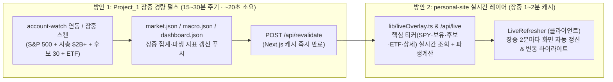

# 웹사이트 실시간화(Live Dynamic Update) 설계 및 실행 플랜

> 작성일: 2026-11-08 (온타리오 기준)  
> 대상 리포지토리:
> - 백엔드/파이프라인: `Project_1` (`/Users/sean-server/Documents/Code/Project_1/Project_1`)
> - 프론트엔드(UI): `personal-site` / `seanccho-site` (`/Users/sean-server/Documents/Code/personal-site`, `https://seancho.vercel.app`)  
> 목표: **추가 비용 $0(완전 무료)** 조건에서 하루 1번(야간)만 바뀌던 정적(Static) 웹사이트를 장중 내내 살아 움직이는 **실시간 퀀트 대시보드**로 전환한다.

---

## 1. 배경 및 현재 문제 진단 (Why Static?)

### 1.1 현재 업데이트 구조의 한계
현재 웹사이트(`seancho.vercel.app`)는 매일 저녁 6:00~6:30 PM ET에 시작하는 야간 배치(`run-screener.yml`, `universe-scan.yml`, `canada-scan.yml`)가 무거운 차트 캡처(최대 90분)와 5,000+ 종목 분석을 모두 끝낸 뒤 **밤 8~9시경에야 하루 1번 업데이트**된다.

이로 인해 다음과 같은 문제가 발생한다:
1. **장중(09:30~16:00 ET) 완전 멈춤**: 주식이 활발히 움직이는 장 시간 내내 웹사이트의 모든 숫자·신호·경보가 **어제 마감(`bar_date`) 기준**으로 멈춰 있다.
2. **장 마감 후 4~5시간 공백**: 오후 4시에 장이 끝나도 차트 스크린샷 캡처 등을 기다리느라 밤 8~9시까지 오늘 마감 데이터가 올라오지 않는다.
3. **단면(Snapshot) 위주의 표시**: 전일 대비 점수가 얼마나 올랐는지, 오늘 새로 진입한 후보인지, 장중에 과열되었는지 같은 **흐름(Delta & 상태 변화)** 이 보이지 않는다.

### 1.2 현재 `personal-site` 페이지별 동적/정적 현황

| 구분 | 페이지 / 컴포넌트 | 현재 데이터 소스 | 현재 갱신 주기 | 문제점 |
|---|---|---|---|---|
| **이미 동적** | 오늘·내계좌·PT-1 **뉴스** (`lib/news.ts`) | Google News RSS 직접 조회 | 30분 캐시 (`revalidate: 1800`) | 양호 |
| **이미 동적** | **내계좌** (`/quant/account`) | Google Sheets API 직접 읽기 | 매 요청 즉시 (`force-dynamic`) | 내계좌 탭의 `GOOGLEFINANCE` 수식 값만 ~20분 지연 반영 |
| **이미 동적** | **관리** (`/quant/admin`) | GitHub Actions API | 5분 캐시 | 양호 |
| **정적 (개선 대상)** | 상단 상태바 & **`TickerTape`** (`layout.tsx`) | `dashboard.json` | **하루 1번 (밤)** | SPY, PT-1 $5,000 평가액, SPY 대비, 숏스퀴즈 숫자가 온종일 고정 |
| **정적 (개선 대상)** | 오늘 탭 **지금 경기 상태** (`TodayGlance.tsx`, `MacroSection.tsx`) | `macro.json` | **하루 1번 (밤)** | SPY 200일선, 순환/방어 상대강도, 환율, 당일 경제지표 발표 미반영 |
| **정적 (개선 대상)** | 오늘 탭 **시장 한눈에** (`MarketToday.tsx`) | `universe-data/market.json`, `canada-data/market.json` | **하루 1번 (밤)** | 상승/하락 종목 수, 50/200일선 비율, 52주 신고/신저가, 급등/급락/거래량 Top 5, 섹터 등락이 전부 어제 마감 기준 |
| **정적 (개선 대상)** | **PT-1 탭** (`/quant/pt1`, `HoldingsPanel.tsx`) | `dashboard.json` | **하루 1번 (밤)** | 보유 종목 수익률, 트레일링 스탑 상향, 손절/익절 돌파 경보 배너(`alertsFor`), $5,000 곡선이 장중에 안 움직임 |
| **정적 (개선 대상)** | **매수 후보** (`/quant/candidates`) | `dashboard.json` | **하루 1번 (밤)** | 후보 30개가 오늘 장중에 이미 급등(과열)했는지, 거래량이 터졌는지, 골든크로스 예고가 켜졌는지 알 수 없음 |
| **정적 (개선 대상)** | **종목 상세** (`/quant/stock/[ticker]`) | `dashboard.json` + `stocks/{ticker}.json` | **하루 1번 (밤)** | 현재가, 당일 수익률, 52주 위치 바, 목표주가 괴리율, PER·시총·배당률이 어제 종가 기준 |
| **정적 (개선 대상)** | **ETF & 섹터 지도** (`/quant/etf`, `/quant/sectors`) | `etf.json`, `sp500.json.gz` | **하루 1번 (밤)** | ETF 수익률·추세·모멘텀 픽 및 4분면 섹터 수익률이 어제 기준 |

---

## 2. 핵심 아키텍처: 비용 $0 하이브리드 라이브 설계 (방안 1 + 방안 2 결합)

5,000개 전 종목의 30+ 기술적 지표와 차트 패턴을 1분마다 다시 계산할 수는 없으므로, **역할을 둘로 나누어 결합(Hybrid)** 한다.

### 2.1 방안 1: `Project_1` 백엔드 장중 펄스 & 야간 파이프라인 순서 최적화
- **역할**: 프론트엔드에서 즉석 계산하기 무거운 **시장 전체 집계(`market.json` — 상승/하락 종목 수, 신고가/신저가, 급등/급락/거래량 폭발 Top 5, 섹터 로테이션)** 와 **장중 공시/이벤트**를 15~30분마다 갱신한다.
- **구현 방법**:
  1. 이미 Mac mini가 평일 장중(09:30~16:00 ET) 30분마다 깨우는 `account-watch.yml` (또는 Mac mini 로컬 스크립트)에 경량 시장 펄스 스텝(`python -m web_export.intraday_pulse`)을 추가한다.
  2. 어제 밤 저장해 둔 스냅샷(`sp500_ranked.parquet`, `nasdaq_ranked.parquet`, `ca_ranked.parquet`)에서 각 종목의 **기존 기준선(50일선, 200일선, 52주 최고/최저, 20일 평균 거래량)** 을 읽고, 오늘 장중 배치 가격(`yf.download`, 약 10~15초 소요)만 대입해 `market.json`, `macro.json`, `dashboard.json`을 빠르게 갱신하여 `dashboard-data` / `universe-data` 브랜치에 push 후 `/api/revalidate`를 호출한다.
  3. **장 마감 후 업데이트 3시간 단축**: `run-screener.yml`에서 90분 걸리는 `Capture remaining charts` 스텝 **이전에** `dashboard.json`, `etf.json`, `macro.json`을 **1차로 먼저 push & revalidate** 하고, 차트 캡처가 끝나면 2차로 차트 이미지 주소만 반영한다.

### 2.2 방안 2: `personal-site` (Next.js) 실시간 시세 오버레이 & 자동 갱신
- **역할**: 사용자가 사이트에 접속했을 때 30분 배치를 기다리지 않고 **1~2분 이내의 실시간 주가와 파생 지표**를 즉시 보여주고, 브라우저를 켜두면 자동으로 화면이 업데이트되게 한다.
- **구현 방법**:
  1. `personal-site/lib/liveOverlay.ts`를 만들어 장중에는 핵심 티커 묶음(**지수 `SPY`·`QQQ`·`^VIX`·`^GSPTSE` + PT-1 보유 종목 + 매수 후보 30개 + 주요 ETF**) 또는 **현재 보고 있는 종목 상세(`/quant/stock/[ticker]`)** 의 최신 시세(현재가, 당일 시/고/저가, 거래량, 전일 종가)를 Next.js 서버에서 1~2분 캐시(`revalidate: 120`)로 가져온다.
  2. 가져온 실시간 가격·고가·저가·거래량을 바탕으로 아래 **3절의 파생 지표들을 서버에서 즉시 재계산**하여 `dashboard.json` 데이터 위에 덮어씌운다(Overlay).
  3. 클라이언트에는 `components/LiveRefresher.tsx`를 넣어, **평일 장중(09:30~16:10 ET) + 브라우저 탭 활성화(`document.visibilityState === "visible"`)** 상태일 때만 2분마다 `router.refresh()`를 호출해 새로고침(F5) 없이도 화면 숫자와 배지가 살아 움직이게 한다.

---

## 3. 단순 주가 외에 라이브로 변경되어야 할 7대 파생 영역 상세 명세

단순히 `$150.20 (+1.2%)` 같은 가격 숫자만 바꾸는 것이 아니라, **가격·고가·저가·거래량·시간이 변함에 따라 연쇄적으로 바뀌어야 하는 '판단·신호·경보·집계'** 목록이다.

### ① 오늘 탭: 시장 체온계 & 실시간 리더보드 (`MarketToday.tsx`)
| 파생 지표 | 라이브 재계산 로직 | 사용자 체감 변화 |
|---|---|---|
| **상승 vs 하락 종목 수 (`adv` / `dec`)** | S&P 500 (캐나다는 TSX 시총 C$1B+) 종목의 `장중 현재가 > 전일 종가` 실시간 집계 | 장중 매수/매도세 역전에 따라 상승·하락 숫자와 비율 막대그래프가 계속 움직임 |
| **50일·200일선 상회 비율 (`above50`, `above200`)** | 어제까지 확정된 49일/199일 종가 합 + 오늘 장중 현재가로 실시간 이동평균선 상회 여부 판정 | 장중 지수 급락/반등 시 이평선 위 종목 비율(%)이 즉시 변동 |
| **52주 신고가 / 신저가 (`new_high`, `new_low`)** | 직전 251봉 최고가/최저가와 **오늘 장중 고가(Intraday High) / 저가(Intraday Low)** 비교 | 장중에 신고가/신저가를 찍는 순간 카운트가 올라가고, 숫자를 클릭하면 전체분석에서 해당 종목들이 바로 필터링됨 |
| **장 경과 시간 보정 거래량 배수 (`vol_ratio`)** | 단순 누적 거래량은 장 초반(예: 10:00 AM)에 무조건 0.1~0.2배로 낮게 나오는 문제를 해결하기 위해, **장 경과 시간 비율(Intraday Volume Pace)** 로 보정: `현재 거래량 ÷ (20일 평균 거래량 × 장 경과 시간 비율)` | 개장 직후 30분~1시간 만에도 평소보다 거래량이 폭발하는 종목을 즉시 포착 |
| **실시간 급등 / 급락 / 거래량 급증 Top 5 (`Movers`)** | 시총 $2B+ 종목 중 장중 `ret_1d` 상위/하위 5개, 시간 보정 `vol_ratio` 상위 5개 실시간 재정렬 + 주봉 미니 차트(`Spark`) 마지막 점에 현재가 반영 | 어제 마감 명단이 아니라 **지금 이 순간** 시장을 주도하는 종목 5개로 계속 교체 |
| **11개 섹터 실시간 로테이션 (`sectors`)** | 섹터별 소속 종목들의 장중 평균 등락률 재계산 및 내림차순 정렬 | 오늘 어느 섹터로 자금이 쏠리는지 실시간 순위 변동 |

### ② 상단 `TickerTape` & PT-1 탭: 포지션 경보 · 트레일링 스탑 · 실시간 계좌 곡선 (`TickerTape.tsx`, `pt1/page.tsx`, `HoldingsPanel.tsx`)
1. **장중 최고가(`highest_price`) 갱신 → 트레일링 스탑(`exit.down`) 실시간 상향**:
   - PT-1 엔진(`paper_trading/engine.py::exit_levels`)은 보유 종목의 최고가(`highest_price`)가 올라가면 트레일링 스탑 기준선을 함께 올린다.
   - 장중 고가(또는 현재가)가 기존 `highest_price`를 넘으면 `highest_price = max(기존 최고가, 장중 현재가)`로 갱신하고, 이에 맞춰 **매도선(`exit.down`) 달러 가격과 다음 단계(`exit.next`)를 실시간으로 다시 계산**한다.
2. **실시간 손절 / 익절 경보 배너 (`alertsFor` in `pt1/page.tsx`)**:
   - 장중 가격이 바뀌면 PT-1 페이지 상단의 노란/빨간 경보 카드가 즉시 반응한다:
     - `p.price <= exit.down` → **🛑 매도선 하회**
     - `exit.down / p.price - 1 > -3%` → **⚠️ 매도선까지 X.X% 남음**
     - `p.price >= exit.up` → **🎯 목표가 돌파 (종가 유지 시 익절/Hold-Winners 재평가)**
     - `exit.up / p.price - 1 < 3%` → **🎯 목표가까지 X.X% 남음**
3. **$5,000 계좌 실시간 평가액 & Equity Curve 마지막 점 (`EquityChart.tsx`)**:
   - `보유 종목별 (주식 수 × 장중 현재가) 합계 + 잔여 현금`으로 **실시간 계좌 평가액(`dollar.equity`)** 과 **수익률(`dollar.return`)**, **같은 시각 SPY 평가액(`dollar.spy_equity`)**, **SPY 대비 초과수익(`pp`)** 을 갱신한다.
   - `EquityChart` 곡선의 맨 끝에 **오늘 장중 실시간 점**을 추가(또는 갱신)해 그래프가 살아 움직이게 한다.

### ③ 매수 후보 Top 30: "장중 후보 유효성 & 진입 타이밍" 판정 (`candidates/page.tsx`, `ScreenView.tsx`)
어제 밤에 뽑힌 후보 30개가 오늘 장중에 여전히 사도 되는 상태인지, 아니면 이미 날아가버렸는지(추격 매수 위험) 실시간으로 알려준다:
1. **장중 과열 / 진입 적기 실시간 상태 배지**:
   - 장중 현재가로 실시간 RSI(14), 5일 수익률(`ret_5d`), 52주 위치(`position_52w`)를 갱신한다.
   - **하드 필터 이탈 감지**:
     - 장중 급등으로 `RSI ≥ 75` 또는 `5일 수익률 ≥ +15%` 도달 시 → **`⚠️ 장중 과열 (추격 주의)`** 배지 표시
     - 바닥반등 전략 후보인데 장중 급등으로 `52주 위치 > 0.65` 도달 시 → **`⚠️ 바닥 구간 이탈`** 표시
     - 반대로 전략별 최적 RSI 스윗스팟(바닥반등 25~40, 모멘텀 45~60) + 거래량 유입 시 → **`🟢 장중 진입 적기`** 표시
2. **장중 이동평균선 갭(`ma_gap`) & 골든크로스 예고(`preview`)**:
   - 현재가 기준으로 일봉/주봉/월봉 EMA10-EMA20 갭(`ma_gap`)을 갱신하고, *"지금 가격으로 이번 봉이 마감되면 골든크로스/데드크로스 발생"* 예고(`preview.weekly`, `preview.monthly`)를 실시간으로 켜고 끈다.

### ④ 종목 상세 페이지: 전 지표 실시간 연동 (`stock/[ticker]/page.tsx`)
종목 상세 페이지를 열었을 때 어제 종가가 아니라 **지금 시세 기준**으로 모든 카드가 재계산된다:
- **상단 고정 바 (`stock-bar`)**: 실시간 가격 + 오늘 장중 등락률(`ret_1d`) + 장중 거래량 배수
- **한눈에 바 (`StockGlance`)**: 52주 최저~최고 범위 막대 위의 **현재가 위치 점** 실시간 이동 (장중 52주 신고가/신저가 경신 시 범위 자체도 확장)
- **기간 수익률 (`ReturnsStrip`)**: 1일 · 5일 · 20일 · 3개월 · 1년 수익률 및 같은 기간 SPY 대비 초과수익률 실시간 재계산
- **밸류에이션 & 애널리스트 카드 (`ValuationCard`, `AnalystCard`)**:
  - 애널리스트 평균 목표주가 대비 **남은 상승 여력(`+X.X%`)** 을 실시간 가격 기준으로 재계산
  - 실시간 주가 기준 **PER / Forward PER / 시가총액 / 배당수익률(`연간배당금 ÷ 현재가`)** 즉시 반영

### ⑤ 오늘 탭: 경기 상태 신호등 & 일정 (`TodayGlance.tsx`, `MacroSection.tsx`)
- 6개 핵심 경기/시장 지표 중 시장 가격으로 산출되는 지표들의 실시간화:
  - **`SPY 200일선` (`spy200`)**: 장중 SPY 현재가와 200일선의 이격도(`%`) 및 상태 점(`good` / `watch` / `bad`) 실시간 변경
  - **`경기순환 vs 방어` (`cycdef`)**: 순환주 ETF(`XLY`, `XLI`) 대 방어주 ETF(`XLP`, `XLU`)의 상대강도 실시간 반영
  - **`USD/CAD 환율` (`fx.usdcad`)**: 장중 실시간 환율 반영 (내계좌 탭의 통화 합산 비중 계산에도 즉시 연동)
- **경제 일정 발표 반영**: 오전 8:30 ET(CPI·고용·GDP 등)나 오후 2:00 ET(FOMC 금리 결정) 직후 도는 장중 배치에서 FRED 및 연준 결과를 바로 읽어 밤까지 기다리지 않고 당일 낮에 반영한다.

### ⑥ 숏스퀴즈 상태 전환(`fuel` ↔ `fire`) & 장중 실시간 공시/이벤트 레이더
- **숏스퀴즈 실시간 점화**: `squeeze_watch` 대상 종목이 장중에 `5일 수익률` 및 `거래량 배수` 조건을 충족하면 대기(`fuel`)에서 **🔥 진행 가능(`fire`)** 으로 즉시 바뀌고 상단 `TickerTape`의 불꽃 카운트가 올라간다.
- **장중 퀀트 레이더 (Live Event Feed — 신규 컴포넌트)**:
  - `watch_sec.py`(SEC 8-K 실적·중대 공시, Form 4 내부자 거래, S-3 유상증자)와 `account_watch.py`가 장중 30분마다 포착하는 이벤트 + 후보 종목의 장중 거래량 폭발(2.5배↑) / 목표가·손절선 터치 기록을 `live_events.json`으로 내보내어, 오늘 탭 상단에 **시간순 라이브 피드**로 표시한다.

### ⑦ 전일 대비 변화량(Delta) 배지 추가 ("어제와 무엇이 달라졌나?")
장 마감 후나 주말에 들어와도 정적으로 보이지 않도록, 전날 스냅샷(`prev/*_ranked.parquet`)과 비교한 **변화량(Delta)** 데이터를 추가한다:
- 매수 후보 및 스크리너 목록에 **`NEW` (오늘 신규 진입)**, **`★ +1.4 ▲` (전일 대비 점수 급등)**, **`순위 +8 ▲`**, **`🔥 3일 연속 후보`** 배지 표시
- 오늘의 하드 필터 탈락 퍼널(`debug["rejections"]` — 전체 N개 중 전략점수·과열·어닝 등으로 몇 개가 걸러지고 최종 몇 개가 남았는지) 요약 표시

---

## 4. 비용 $0 (무료 한도) 보장 및 안전장치 설계

유료 API나 유료 서버를 일절 사용하지 않으며, 무료 플랜 한도를 절대 넘지 않도록 다음 4가지 안전장치를 적용한다.

| 항목 | 무료 한도 | 우리의 설계 (안전장치) | 예상 사용량 | 비용 |
|---|---|---|---|---|
| **Yahoo Finance / FRED / SEC** | 무료 (과도한 단건 호출 시 429 차단) | 단건 루프 호출 금지, 항상 **멀티 티커 1회 배치 요청**으로 묶어서 조회 | 장중 2~3분에 1회 배치 | **$0** |
| **GitHub Actions** | Public 리포지토리 **무제한 무료** | 새 워크플로를 남발하지 않고 기존 장중 30분 주기 `account-watch.yml`에 15초 스텝 통합 | 기존과 동일 | **$0** |
| **Vercel Hobby (무료 플랜)** | 월 100만 회 Function 호출, 100GB 대역폭 | ① 서버 캐시 `revalidate: 120` (2분간 전 유저가 캐시 공유) ② **평일 장중(09:30~16:10 ET) 게이트**: 장외·주말엔 라이브 조회 0회 ③ **탭 가시성 체크(`document.hidden`)**: 탭을 안 보고 있으면 자동 갱신 일시정지 | 월 ~3,000회 (무료 한도의 **0.3%**) | **$0** |
| **번역 / 뉴스 RSS** | Google News RSS 무료 | 기존 30분 캐시(`revalidate: 1800`) 그대로 유지 | 기존과 동일 | **$0** |

---

## 5. 단계별 구현 계획 (Step-by-Step Roadmap)

### Step 1: `personal-site` 실시간 오버레이 & 파생 신호 라이브 재계산 + 자동 갱신 (방안 2 — 즉시 체감)
> `Project_1` CI를 기다릴 필요 없이, 프론트엔드 서버에서 핵심 티커 실시간 시세를 받아와 기존 데이터를 라이브로 덮어씌우는 작업

- [ ] **1-1. 실시간 시세 배치 조회 모듈 (`personal-site/lib/liveQuotes.ts`)**
  - 평일 장 시간(또는 프리/애프터마켓 포함 09:00~16:30 ET) 판별 헬퍼 작성
  - 티커 배열을 받아 현재가(`price`), 전일 종가(`prevClose`), 당일 고가(`dayHigh`), 당일 저가(`dayLow`), 당일 거래량(`volume`), 장 경과 시간 보정 거래량 배수(`volRatioPace`)를 1회 배치로 가져오는 함수 작성 (`unstable_cache` / `revalidate: 120`)
- [ ] **1-2. 대시보드 & 종목 상세 라이브 오버레이 (`personal-site/lib/liveOverlay.ts`)**
  - `getDashboard()` / `getDashboardCore()` 결과에 실시간 시세를 결합하여:
    - `TickerTape`의 SPY 등락률, PT-1 $5,000 실시간 평가액(`equity`), 수익률(`return`), SPY 대비(`pp`) 재계산
    - PT-1 `positions`의 실시간 가격, 수익률, `highest_price` 갱신 및 트레일링 스탑(`exit.down`) 실시간 상향, 경보 배너(`alertsFor`) 연동
    - 매수 후보(`candidates`) 30개의 실시간 가격, 당일 수익률, 시간 보정 거래량 배수, 장중 과열/진입 적기 상태 계산
  - 종목 상세 페이지(`/quant/stock/[ticker]/page.tsx`)에서 해당 티커 실시간 시세를 반영해 52주 위치 바(`StockGlance`), 기간 수익률(`ReturnsStrip`), 목표주가 괴리율(`AnalystCard`), 배당률/시총 실시간 갱신
- [ ] **1-3. 클라이언트 장중 자동 리프레시 & 상태 표시 (`personal-site/components/LiveRefresher.tsx`)**
  - 장중일 때 상단 상태바(`q-status`)에 초록색 라이브 펄스 표시(`● LIVE · 장중 2분마다 자동 갱신`)
  - 탭이 활성화되어 있을 때 2분 주기로 `router.refresh()` 실행

### Step 2: `Project_1` 장중 시장 전체 펄스(`market.json` · `macro.json`) & 마감 가속 (방안 1)
> 500~1,500개 종목을 집계해야 하는 오늘 탭 '시장 한눈에'(`MarketToday.tsx`)와 경기 지표를 장중 30분마다 갱신하고, 장 마감 직후 업데이트를 3시간 앞당기는 작업

- [ ] **2-1. 야간 파이프라인(`run-screener.yml`) 웹 푸시 순서 앞당기기**
  - `Capture remaining charts` (90분 소요) 실행 **전에** `ETF scan`, `Macro scan`, `Export web dashboard data`, `Push web dashboard data`, `Refresh personal website`를 먼저 1차 실행하도록 변경 (장 마감 후 웹 반영 시각: 밤 9시 → 저녁 6시 15분)
  - 차트 캡처 완료 후 차트 이미지가 포함된 `dashboard.json`을 2차 푸시
- [ ] **2-2. 장중 경량 마켓 펄스 스크립트 (`Project_1/src/web_export/intraday_pulse.py`)**
  - 직전 야간 스냅샷(`universe-data`, `canada-data`, `dashboard-data`)의 기준값 위에 장중 일봉(`yf.download`, ~15초)을 결합해 오늘 탭용 `market.json`(상승/하락 수, 50/200일선 비율, 장중 52주 신고/신저가, 시간 보정 거래량 급증/급등/급락 Top 5, 섹터 등락)과 `macro.json`(SPY 200일선, 순환/방어, 환율)을 장중 갱신
  - `account-watch.yml`에서 장중 30분마다 함께 실행하고 `/api/revalidate` 호출

### Step 3: 전일 대비 변화량(Delta) 배지 & 장중 실시간 이벤트 타임라인
> 정적인 스냅샷을 '스토리와 흐름이 있는 화면'으로 업그레이드

- [ ] **3-1. 전일 대비 변화량(Delta) 내보내기 (`Project_1/src/web_export/dashboard.py`, `universe.py`)**
  - 전날 스냅샷과 비교해 종목별 `score_delta` (점수 변화), `rank_delta` (순위 변화), `is_new` (신규 후보 진입), `streak_days` (연속 후보 일수) 필드 추가 및 프론트엔드 배지 표시
- [ ] **3-2. 장중 퀀트 레이더 타임라인 (`live_events.json` + 오늘 탭 배너)**
  - 장중 포착된 SEC 공시(`watch_sec.py`), 목표가/손절선 터치, 후보 종목 거래량 폭발 이벤트를 시간순 타임라인으로 노출

