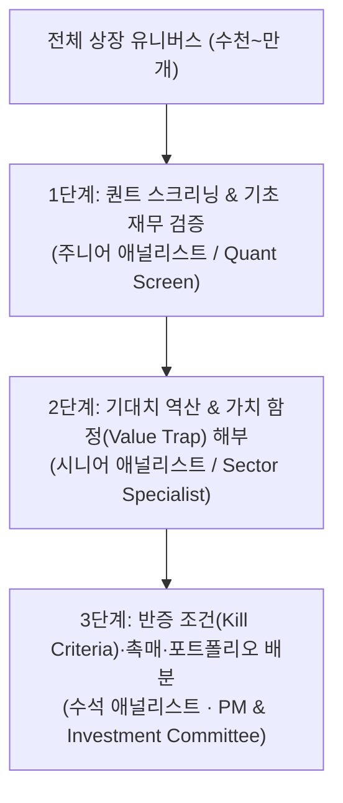
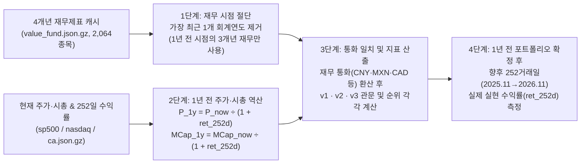

# 월스트리트 저평가 주식 발굴 프로세스 및 우리 예측 모델 (`/quant/model`) 비교 · `v3` 제안

> 작성일: 2026-11-14 (온타리오 기준)  
> 관련 코드 및 문서: [`src/web_export/value_model.py`](../src/web_export/value_model.py) · [`docs/블로그주식분석.md`](블로그주식분석.md)  
> 대상 페이지: `https://seancho.vercel.app/quant/model` (`내계좌 › 예측 모델`)

---

## 목차

1. **[1부] 월스트리트급 기관은 저평가 주식을 어떻게 찾는가?** *(우리 모델을 모른다는 가정)*
   - 1.1 월스트리트가 정의하는 '저평가'의 3대 축 (그리고 워런 버핏의 위치)
   - 1.2 월스트리트 실제 의사결정 파이프라인 (주니어 → 시니어 → PM)
   - 1.3 [1단계] 주니어 애널리스트 / 1차 퀀트 스크리닝의 역할
   - 1.4 [2단계] 시니어 애널리스트의 역할 — "왜 싼가?(Value Trap)" 해부
   - 1.5 [3단계] 수석 애널리스트 & 포트폴리오 매니저(PM)의 역할
2. **[2부] 월스트리트 방식 vs 우리 예측 모델 (`/quant/model`) 1:1 비교**
   - 2.1 역할별·단계별 1:1 매핑 비교표
   - 2.2 우리 예측 모델(`v1`·`v2`)이 월스트리트 기준으로도 뛰어난 강점 4가지
   - 2.3 월스트리트 시각에서 본 차이점과 한계 (개선 포인트 5가지)
   - 2.4 2부 결론 (한 줄 요약)
3. **[3부] `v3 (수석 애널리스트 · PM)` 설계를 위한 월스트리트 롤모델 추천**
   - 3.1 현재 우리 모델(`v1`·`v2`)의 월스트리트 계보
   - 3.2 `v3`로 벤치마킹할 월스트리트 최고 대가·운용사 4선
   - 3.3 최종 추천: `v1` · `v2` · `v3` 완전체 라인업 & 4대 후보 싱크로율 비교
   - 3.4 기존 데이터(`yfinance`)로 즉시 구현 가능한 `v3 (PM)` 4대 기본 규칙
   - 3.5 코드 정밀 진단: 더 완벽해지기 위한 5가지 추가 구조적 개선 포인트 & 최종 7대 설계표
4. **[4부] 종합 결론 (Summary & 다음 단계)**

---
---

# 1부. 월스트리트급 기관은 저평가 주식을 어떻게 찾는가?

월스트리트에서 "저평가된 주식(Undervalued Stock)"을 찾는다는 것은 단순히 **PER·PBR이 낮은 주식을 고르는 것이 아니다.** 월가에서는 단순 저배수 종목의 상당수를 **"싼 이유가 있는 주식(Value Trap, 가치 함정)"** 으로 본다.

실제 월스트리트(Citadel·Point72 같은 멀티매니저 헤지펀드, Baupost·Pershing Square 같은 정통 밸류 펀드, AQR·BlackRock 같은 퀀트 운용사, 골드만삭스·모건스탠리 리서치)에서는 **주니어 애널리스트 → 시니어 애널리스트 → 포트폴리오 매니저(PM)** 로 이어지는 다단계 검증 깔때기를 통해 종목을 압축한다.

---

## 1.1 월스트리트가 정의하는 '저평가'의 3대 축

| 접근 방식 | 대표 하우스 | 저평가의 정의 및 핵심 무기 |
|---|---|---|
| **① 정통 펀더멘털 밸류**<br/>(Fundamental Long/Short · Value) | Baupost(세스 클라만), Pershing Square(빌 애크먼), Greenlight(데이비드 아인혼) | **내재가치(Intrinsic Value) 대비 안전마진(Margin of Safety)** + 시장 컨센서스와 다른 독자적 시각(**Variant Perception**) + 가치 재평가 계기(**Catalyst**) |
| **② 시스템적·팩터 밸류**<br/>(Systematic / Quantitative Value) | AQR(클리프 아스네스), Gotham(조엘 그린블랫), Dimensional, BlackRock Systematic | 단순 저PER이 아닌 **복합 밸류(FCF/EV, EBIT/EV)** + **퀄리티(ROIC, 매출총이익률, 분식회계 배제)** + **실적·가격 추세 결합** 및 업종 중립화 |
| **③ 퀀타멘털**<br/>(Quantamental — 현대 월가 표준) | Citadel Surveyor, Point72, Counterpoint Global(모건스탠리) | 1단계에서 정량 스크리닝·포렌식 회계·Reverse DCF로 유니버스를 좁히고, 2단계에서 시니어 애널리스트가 사업 해자와 구조적 리스크를 정밀 해부 |

### 💡 잠깐: 워런 버핏(Warren Buffett)은 이 중 어느 접근방식인가?

워런 버핏은 **기본적으로 [접근방식 ①: 정통 펀더멘털 밸류]의 원조이자 정점**이다. 하지만 흥미로운 점은 **버핏 본인은 ①번(사람이 직접 10-K를 읽고 판단하는 펀더멘털)으로 투자했는데, ②번(AQR 같은 퀀트 하우스)이 버핏의 두뇌를 수학 공식으로 복제해 냈고, 이를 자동화 파이프라인과 결합한 것이 ③번(우리 모델의 지향점)** 이라는 사실이다.

1. **버핏의 원래 소속 — 접근방식 ① (정통 펀더멘털 밸류의 진화)**
   - **초기 버핏 (벤저민 그레이엄식 Deep Value):** 회사가 아무리 평범해도 청산가치(장부가)보다 무조건 싼 '담배꽁초 주식'을 사서 한 모금 피우고 파는 방식.
   - **중·후기 버핏 (찰리 멍거 합류 이후 Quality Compounder):** *"그냥 싼 삼류 기업을 사지 말고, **자본수익률(ROE·ROIC)이 꾸준히 높은 일류 기업을 적당한 가격(안전마진)** 에 사서 오래 보유하라."* (3부에서 추천하는 **프랑수아 로숑·테리 스미스**가 바로 이 중·후기 버핏의 직계 후예다.)
2. **왜 접근방식 ②(퀀트·팩터)와도 연결되는가? — AQR의 전설적인 논문 《Buffett's Alpha》**
   - 3부 첫 번째 추천 하우스인 **AQR(클리프 아스네스 팀)** 이 발표한 유명 논문 *《Buffett's Alpha (버핏의 알파)》* 에서, 버핏의 40년 포트폴리오를 정량 데이터로 역추적해 보니 버핏의 수익률은 신비한 직관이 아니라 **딱 3가지 팩터 공식(접근방식 ②)** 으로 완벽히 설명되었다:
     - **Quality (고품질·일관성):** `ROE`·`ROIC`가 높고, 매년 이익 변동성(`CV`)이 낮은 회사
     - **Low Beta (저베타·안전성):** 시장보다 덜 흔들리고(베타 $\beta$가 낮고), 부도 위험(`Altman Z` 등)이 없으며 빚이 적은 회사
     - **Cheap Owner Earnings + Buybacks (실질 현금흐름 저평가 + 자사주 소각):** 회계상 순이익이 아닌 **주주 실질 귀속 현금(Owner Earnings)** 대비 주가가 싸고, 남는 현금으로 **자사주를 사서 소각(`sh_y > 0`)** 하는 회사
3. **우리 예측 모델(`v1` → `v2` → `v3`) 속의 워런 버핏**
   - 결국 우리가 만든 `/quant/model`은 **"①번 워런 버핏의 투자 철학을 ②·③번(퀀트·자동화 파이프라인)으로 구현한 버핏 복제기"** 에 가깝다.

| 워런 버핏의 핵심 원칙 (주주서한) | 우리 모델에서의 위치 | 코드 대응 ([`value_model.py`](../src/web_export/value_model.py)) |
|---|---|---|
| *"자본수익률이 꾸준히 높은 기업만 본다"* | **주니어 (`v1`)** | `ROE ≥ 15%`, `ROIC ≥ 12% > WACC`, 변동성 `CV ≤ 0.3` |
| *"저베타 우량주가 장기 복리에 유리하다"* | **주니어 (`v1`)** | 요구수익률 `Ke = Rf + β × 5.36%` (저베타일수록 허들 낮음) |
| *"제1원칙: 절대 돈을 잃지 마라 (안전마진)"* | **시니어 (`v2`)** | **하방 관문 (`g_bear`)**: FCF가 30% 토막 나고 성장이 멈춰도 `알파 ≥ 0` |
| *"주식보상비용(SBC)은 선물이 아니라 진짜 비용이다 (Owner Earnings)"* | **PM (`v3` 제안 1)** | `FCF_real = FCF − SBC(주식보상비용)` 차감 |
| *"최고의 자본배분은 저평가 때 자사주를 소각하는 것이다"* | **PM (`v3` 제안 3)** | 주주환원율 `sh_y (배당 + 자사주 순매입) > 0` 관문 |

- **한 줄 정리:** **버핏 본인**은 **①번(정통 펀더멘털)** 이고, **버핏의 두뇌를 수학 공식으로 뽑아낸 것**이 **②번(AQR의 *Buffett's Alpha*)** 이며, **그 공식을 매일 2,100개 종목에 자동으로 돌려 후보를 추리고(`v1`·`v2`·`v3`) 마지막에 사람(`author` / 4단계 체크리스트)과 대조하는 하이브리드**가 **③번(퀀타멘털 = 우리 시스템의 지향점)** 이다.

---

## 1.2 월스트리트 실제 의사결정 파이프라인



---

## 1.3 [1단계] 유니버스 정제 & 1차 재무 필터 (주니어 애널리스트 / Quant Screen)

주니어 애널리스트(또는 1차 퀀트 파이프라인)의 역할은 **"분석할 가치가 없는 기업과 회계적 지뢰를 제거하고, 숫자상 저평가된 후보군을 추리는 것"** 이다.

1. **비교 불가능 섹터 분리 및 유동성 컷**
   - 은행·보험·리츠(REITs)처럼 부채가 곧 영업자산이거나 잉여현금흐름(FCF)의 정의가 전혀 다른 업종을 일반 기업 유니버스에서 분리한다.
   - 기관 자금이 들어갈 수 있도록 시가총액(보통 US\$1B 이상)과 일평균 거래대금 기준을 적용한다.
2. **퀄리티(Quality) & 자본효율성 검증**
   - *"이 회사가 주주와 채권자의 돈을 굴려 자본비용 이상의 수익을 내는가?"*
   - 핵심 지표는 **ROIC(투하자본수익률) > WACC(가중평균자본비용)**, 그리고 **ROE의 장기 일관성(낮은 변동성)** 이다. 한두 해 반짝 번 회사가 아니라 수년간 꾸준히 높은 자본수익률을 유지했는지를 본다.
3. **재무 건전성 & 포렌식(분식회계) 스크리닝**
   - 손익계산서의 당기순이익은 경영진이 회계 추정으로 부풀리기 쉽다.
   - 따라서 **영업현금흐름/FCF 전환율**, **이자보상배율(`EBIT / 이자비용`)**, 부도 위험(**Altman Z-Score** 등), 매출채권이나 발생액(Accruals) 급증을 통한 이익 조작 가능성(**Beneish M-Score**, Sloan Ratio 등)을 먼저 체크한다.
4. **기초 밸류에이션 모델링 (DCF / Multiples)**
   - 과거 성장률과 기본 가정을 넣은 2~3단계 DCF(현금흐름할인법) 또는 FCF 수익률(FCF Yield) 모델을 돌려, 요구수익률(CAPM 기반 `Ke` 또는 `WACC`) 대비 **안전마진(Margin of Safety)** 이 있는 종목 리스트와 목표 매수가를 뽑아 시니어에게 올린다.

---

## 1.4 [2단계] "왜 싼가?" 검증 & 기대치 해부 (시니어 애널리스트)

주니어가 *"재무도 우량하고 DCF로 계산해 보니 30% 저평가된 주식입니다"* 라고 가져오면, 월가 시니어 애널리스트는 절대 바로 매수하지 않는다. 시니어는 **"시장이 바보가 아닌데 왜 이 좋은 회사를 싸게 팔고 있는가?"** 부터 의심한다.

1. **Reverse DCF (시장 내재 기대치 역산 — Expectations Investing)**
   - 애널리스트가 임의로 미래 성장률(예: 연 8%)을 가정해 적정주가를 구하는 것은 입력값에 따라 결론이 널뛰기 쉽다.
   - 대신 시니어는 **현재 주가를 출발점**으로 놓고 역산한다:
     > *"지금 주가가 정당화되려면 시장이 이 회사의 영구 성장률(Implied Growth Rate)을 몇 %로 보고 있는가?"*
   - 예를 들어 실제로는 연 7%씩 성장하는 회사인데, 현재 주가가 **"앞으로 영원히 0% 성장할 것"** 이라는 극단적 비관을 반영하고 있다면, 이 **'실제 성장률과 시장 내재 성장률의 괴리(Gap)'** 가 바로 진짜 알파(Variant Perception)가 된다.
2. **가치 함정(Value Trap) 및 최근 실적 모멘텀 훼손 체크**
   - 5년 평균 ROE·FCF가 아무리 좋아도, **최근 1~2분기 매출이나 마진이 전년 동기 대비 꺾이기 시작한 기업**은 과거 평균의 착시(Falling Knife)일 확률이 높다.
   - 시니어는 연간 평균 뒤에 숨은 **최근 분기(YoY) 추세**를 확인해 성장 엔진이 멈추고 있는 기업을 걸러낸다.
3. **하방 스트레스 테스트 (Bear Case / Downside Protection)**
   - *"우리의 성장 가정이 틀려서 FCF가 20~30% 토막 나고 성장이 멈춰도, 현재 주가에서 원금 손실(또는 요구수익률 미달)을 피할 수 있는가?"*
   - 상승 여력(Upside)보다 **최악의 시나리오(Bear Case)에서 바닥이 어디인지**를 먼저 계산한다.
4. **회계 왜곡 조정 (Normalized FCF / Owner Earnings)**
   - 회계기준(GAAP) FCF를 그대로 믿지 않고, **주식보상비용(SBC)** 차감, 일회성 비용 조정, 운전자본 착시 제거, 경기 사이클 고점(Peak Earnings) 여부를 보정한다.
5. **모델 파라미터 민감도(Sensitivity) 점검**
   - 베타($\beta$)나 영구 성장률($g$)을 조금만 보수적으로 바꿔도 '저평가' 결론이 깨진다면, 그 아이디어는 안전마진이 얇다고 판단한다.

---

## 1.5 [3단계] 반증 조건(Kill Criteria)·촉매(Catalyst)·포트폴리오 리스크 관리 (PM)

시니어의 검증을 통과해도 PM이 포트폴리오에 편입할 때는 다음 세 가지를 확정한다.

1. **사전 반증 조건 (Pre-mortem / Kill Criteria)**
   - 매수 전에 미리 *"어떤 숫자가 나오면 우리의 가설이 틀렸다고 인정하고 즉시 손절/청산할 것인가?"* (예: 분기 매출 역성장 전환, 품질 지표 이탈, 시장 내재 기대치가 실제 성장을 추월, 적정가 도달)를 명문화해 감정에 휘둘리는 물타기를 막는다.
2. **촉매 (Catalyst) & 자본배분 검증**
   - 저평가된 주식이 만년 저평가로 남지 않으려면, 경영진이 잉여현금으로 **자사주 매입·소각(Buyback)** 이나 배당을 통해 주당 가치를 스스로 끌어올리는지(Self-Help Catalyst), 반대로 유상증자·스톡옵션으로 주주를 희석시키지는 않는지 확인한다.
3. **테마·업종 집중(Crowding) 통제**
   - 개별 종목 10개를 골랐는데 알고 보니 7개가 전부 "AI 공포로 폭락한 IT 서비스주"라면, 이는 10개 종목에 분산 투자한 것이 아니라 **하나의 거시/테마에 몰빵한 것**이다. PM은 업종·팩터 쏠림을 체크해 포트폴리오 편입 한도를 둔다.

---
---

# 2부. 월스트리트 방식 vs 우리 예측 모델 (`/quant/model`) 1:1 비교

우리 백엔드 코드([`src/web_export/value_model.py`](../src/web_export/value_model.py#L1-L85))와 설계 문서([`docs/블로그주식분석.md`](블로그주식분석.md#L426-L541))에 구현된 **주니어(`v1`) · 시니어(`v2`) · 저자(`author`)** 구조를 월스트리트 프로세스와 1:1로 대조해 보면, **우리 모델의 `주니어(v1) → 시니어(v2)` 진화 구조는 실제 월스트리트 밸류/퀀타멘털 하우스의 의사결정 체계를 정확히 코드로 옮겨 놓은 형태**임을 알 수 있다.

---

## 2.1 역할별·단계별 1:1 매핑 비교표

| 월스트리트 프로세스 | 우리 예측 모델 (`/quant/model`) | 실제 코드 구현 ([`value_model.py`](../src/web_export/value_model.py)) |
|---|---|---|
| **유니버스 정제**<br/>(금융·리츠 분리, 시총 컷) | **공통 대상 (`us-tsx-1b`)** | 미국(S&P 500·NASDAQ·NYSE) + 캐나다(TSX), 시총 US\$1B 이상. **은행·보험·운용·증권·리츠 제외**(단, FDS 같은 금융데이터·결제망·보험중개는 유지). 중복 상장/클래스주는 1개로 통합 ([`L200-L214`](../src/web_export/value_model.py#L200-L214)) |
| **주니어 애널리스트**<br/>(Quality + Forensic + 기본 DCF 스크리닝) | **주니어 (`v1`)** | **① 품질 관문 5개**: ROE(평균 ≥15%, CV≤0.3), ROIC(평균 ≥12%, CV≤0.3, ROIC>WACC), Altman Z(≥2.99), Beneish M(≤−2.22), FCF(전 해 흑자 & FCF합 > 순차입합)<br/>**② 가격 관문**: 3년 평균 FCF 수익률 기반 2단계 IRR(5년 `g1` [-5%,+10%], 이후 영구 `g2=2.5%`) − 요구수익률 `Ke` ≥ **+5%p**<br/>**③ 우선순위 (`top_v1`)**: 매수 기준가까지 남은 하락폭(`drop`) 순 ([`L474-L526`](../src/web_export/value_model.py#L474-L526), [`L571-L575`](../src/web_export/value_model.py#L571-L575)) |
| **시니어 애널리스트**<br/>(Reverse DCF, 스트레스 테스트, Falling Knife 제거, 민감도·섹터 집중 체크) | **시니어 (`v2`)** | 주니어(`v1`)에 **5가지 시니어 보강** 추가 ([`L528-L593`](../src/web_export/value_model.py#L528-L593)):<br/>1. **Reverse DCF 괴리(`gap`) 우선순위**: 시장 내재 영구 성장률 `implied_g = (Ke - FCF_y)/(1 + FCF_y)` 역산 → `gap = g1 - implied_g` 큰 순 정렬<br/>2. **하방 스트레스 관문(`g_bear`)**: FCF −30% 토막 & 향후 5년 성장 ≤ 0%에서도 `alpha_bear ≥ 0`<br/>3. **반증 조건(`kill_reasons`)**: 품질 탈락 / 최근 분기(YoY)·연간 매출 동시 감소(`rev_down`) / `gap < 0` / 적정가 도달(`alpha < 0`) 시 기록 종료<br/>4. **베타 민감도(`sensitive`)**: 베타 하한을 `0.3 → 0.6`으로 올리면 탈락하는 종목 경고 배지<br/>5. **업종 집중 경고(`theme_counts`)**: 상위 20개 내 동일 업종 3개 이상 경고 |
| **부티크/스페셜리스트**<br/>(정성적 해자·특수상황·카탈리스트 분석) | **저자 (`author` — Baoro Research)** | 숫자 공식만으로 알 수 없는 사업 구조, 일시적 공포 vs 구조적 쇠퇴 판별, 특수상황(광산 블록케이브·송유관 프로젝트 등) 심층 리서치. 우리 주니어·시니어와 같은 날부터 수익률 대결 ([`L98-L143`](../src/web_export/value_model.py#L98-L143)) |

---

## 2.2 우리 예측 모델(`v1`·`v2`)이 월스트리트 기준으로도 뛰어난 강점 4가지

1. **주니어(`v1`)에서 시니어(`v2`)로 넘어가며 "진짜 월가식 질문"을 던짐**
   - 주니어(`v1`)는 단순히 *"매수 기준가 대비 얼마나 싼가(`drop`)"* 로 줄을 세운다.
   - 반면 시니어(`v2`)는 **① 하방 스트레스 테스트(`FCF -30%`, `성장 0%`)** 를 통과시키고, **② 시장이 반영한 내재 성장률(`implied_g`)과 실제 성장률(`g1`)의 괴리(`gap`)** 로 우선순위를 매기며, **③ 최근 분기·연간 매출이 줄어드는 Falling Knife(`rev_down`)** 를 잘라낸다. 이는 월가 시니어 애널리스트가 주니어의 리포트를 반려할 때 쓰는 핵심 논리 그대로다.
2. **원작자(Baoro Research) 모델의 방법론적 허점을 정석대로 교정함 ([`블로그주식분석.md` 9.7절](블로그주식분석.md#L531-L541))**
   - **영구 성장률(`g2`) 교정**: 저자는 영구 성장률로 국채금리(~4.8%)를 써서 저베타 종목의 가치를 과대평가했으나, 우리 모델은 월가 표준(장기 실질 GDP + 물가 하단인 **2.5%**)으로 고정했다.
   - **현금흐름 지표 단일화**: 저자처럼 기업마다 DDM·배당+자사주·FCFE 중 입맛에 맞는 공식을 골라 쓰는 재량(Confirmation Bias)을 없애고 **3년 평균 FCF** 하나로 통일했다.
   - **베타 민감도(`sensitive`) 가시화**: 베타가 0.3으로 낮게 잡혀 요구수익률(`Ke`)이 낮아진 덕에 간신히 통과한 종목(예: CGI 사례)을 배지로 바로 드러낸다.
3. **Beneish M-Score + Altman Z-Score + 현금흐름 순차입 비교의 결합**
   - 개인이나 일반 퀀트 스크리너들이 흔히 놓치는 **분식회계(`Beneish M ≤ −2.22`)** 와 **빚내서 배당/자사주 매입하는 회사 차단(`FCF 합 > 순차입 합`)** 이 기본 관문으로 들어가 있어 재무 지뢰를 피하는 능력이 강하다.
4. **사후 과적합(Hindsight Bias)을 원천 차단한 실험 설계**
   - 백테스트 숫자를 맞출 때까지 규칙을 고치는 대신, **시작일에 규칙을 고정**하고(바꾸려면 새 버전 신설) 저자 종목을 모르는 상태(`own_universe`)에서 `v1` · `v2` · `author`를 전진 기록(`value_log.json`)으로 SPY/XIU와 경쟁시키는 방식은 기관급 리서치 거버넌스에 부합한다.

---

## 2.3 월스트리트 시각에서 본 차이점과 한계 (개선 포인트 5가지)

월스트리트의 시니어 애널리스트나 퀀트 PM이 현재 `v1`·`v2` 코드를 리뷰한다면, 다음 5가지를 **"무료 데이터와 자동화 구조 때문에 생기는 차이점"** 으로 짚어낼 것이다.

### ① 주식보상비용(SBC, Stock-Based Compensation) 미차감 문제 *(가장 큰 실전 차이)*
- **현황**: [`value_model.py`](../src/web_export/value_model.py#L462-L465)에서 `Free Cash Flow (= Operating Cash Flow + Capital Expenditure)`를 그대로 사용한다.
- **월가의 시각**: 회계상 주식보상비용(SBC)은 현금이 나가지 않았다는 이유로 영업현금흐름(OCF)에 다시 더해진다. 하지만 미국 IT·소프트웨어·데이터 서비스 기업(FDS, ACN, ADBE, INTU 등 우리 모델 상위에 자주 뜨는 업종)은 임직원 연봉의 상당 부분을 주식으로 주며, 이는 주주 지분 희석(실질적 비용)이다.
- **영향**: 월가 시니어는 반드시 **`Adjusted FCF = FCF - SBC`** 로 밸류에이션한다. SBC를 빼지 않으면 테크/서비스 기업의 FCF 수익률이 1~3%p 부풀려져 실제보다 싸게 보인다. (`yfinance` 현금흐름표의 `Stock Based Compensation` 행으로 보완 가능)

### ② 시가총액(Market Cap) 대비 FCF 수익률과 부채(Debt) 레버리지 착시
- **현황**: 가격 관문에서 `fcf_y = 3년 평균 FCF ÷ 시가총액(mcap_fc)`을 구하고 주주 요구수익률(`Ke`)과 비교한다 ([`L513-L518`](../src/web_export/value_model.py#L513-L518)).
- **월가의 시각**: 부채가 많은 기업은 시가총액(E)이 작아져서 `FCF ÷ 시가총액`이 높게 나타난다. 물론 품질 관문(`Altman Z ≥ 2.99`, `ROIC > WACC`)으로 과도한 부채 기업을 1차로 걸러내지만, 관문을 통과한 기업들 사이에서는 **무차입 현금부자 기업보다 적당히 부채를 쓴 기업의 `fcf_y`가 더 높게 나오는 구조적 편향**이 있다.
- **영향**: 월가에서는 순부채(`총부채 − 현금`)를 시가총액에 반영한 **기업가치(`EV = Market Cap + Debt − Cash`)** 기준으로 FCF 수익률을 보거나, 순현금/순부채만큼 매수 기준가(`buy`)를 보정한다.

### ③ 과거 매출 성장률(`g1`) vs 미래 컨센서스(Forward Estimates)
- **현황**: `g1`은 과거 4~5년 연간 매출 CAGR을 쓰고, 시니어(`v2`)가 최근 분기/연간 매출 감소(`rev_down`) 여부로 보완한다 ([`L510-L512`](../src/web_export/value_model.py#L510-L512), [`L539-L553`](../src/web_export/value_model.py#L539-L553)).
- **월가의 시각**: 주가는 과거 4년 평균이 아니라 **향후 12~24개월 컨센서스(Forward Revenue/EPS)와 애널리스트 추정치 상향/하향(Earnings Revisions)** 에 반응한다. 아직 매출이 역성장(`rev_down`)까지는 안 갔더라도 성장률이 `12% → 8% → 3%`로 급감속 중이면 시장은 먼저 주가를 떨어뜨린다.

### ④ 4~5년 데이터 한계로 인한 경기순환주 고점(Cyclical Peak) 착시
- **현황**: `yfinance` 무료 재무제표가 최근 4~5년치만 제공하기 때문에, 최근 3~4년이 업황 호황기였던 경기순환주(원자재·산업재·건자재 등)는 **평균 ROE·ROIC가 높고 변동성(CV)도 낮게** 찍힌다.
- **월가의 시각**: 월가는 최소 10년(불황기를 포함한 한 사이클 전체) 데이터를 쓰거나, 경기순환주는 피크 FCF가 아닌 **장기 평균 마진(Normalized Margin)** 을 곱한 정상 FCF를 넣는다. (현재는 시니어 `v2`의 `FCF -30%` 하방 관문이 이 위험을 상당 부분 완충해 주고 있다.)

### ⑤ "일시적 공포 vs 구조적 쇠퇴"와 촉매(Catalyst)의 판별
- **현황**: [`블로그주식분석.md` 9.4절](블로그주식분석.md#L504-L516)에 정리된 것처럼, 주가가 빠진 이유가 *"AI에 시장을 영구히 뺏기는 구조적 쇠퇴"* 인지 *"과도한 공포로 인한 일시적 매도"* 인지는 재무제표에 **1~2년 시차를 두고** 나타난다.
- **월가의 시각**: 월가에서는 이 시차를 메우기 위해 **대체 데이터(신용카드 결제액, 앱 트래픽, 구인공고 추세, 고객 이탈률)** 와 산업 전문가 인터뷰(Expert Network)를 쓴다. 우리 사이트에서는 이 영역을 억지로 공식화하지 않고, **저자(`author`)의 정성적 리서치와 주니어(`v1`)·시니어(`v2`)의 정량 규칙을 나란히 두고 장기 성적을 비교**하도록 설계한 것이 현실적이고 영리한 해법이다.

---

## 2.4 2부 결론 (한 줄 요약)

- **주니어(`v1`)** 는 월가의 **Quality + Forensic + DCF 안전마진 스크리너** 역할을 충실히 수행하고 있고,
- **시니어(`v2`)** 는 월가 시니어 애널리스트의 핵심 무기인 **Reverse DCF(내재 기대치 괴리 `gap`) + Bear Case 스트레스 테스트(`FCF -30%`) + 실적 훼손 손절 규칙(`kill_reasons`)** 을 정확히 짚어내어 `v1`의 가치 함정(Value Trap) 위험을 한 단계 높게 걸러내고 있다.
- 여기에 향후 **`v3` (수석 애널리스트 / PM)** 를 얹는다면, 가장 월가다운 업그레이드는 **① FCF에서 주식보상비용(SBC) 차감**, **② 시가총액 대신 EV(순차입금/순현금 반영) 기반 밸류에이션 보정**, **③ 주주환원(`sh_y > 0`) 확인 및 업종 집중 제한**이다.

---
---

# 3부. `v3 (수석 애널리스트 · PM)` 설계를 위한 월스트리트 롤모델 추천

## 3.1 현재 우리 모델(`v1`·`v2`)의 월스트리트 계보

먼저 현재 `v1`과 `v2`가 이미 어떤 월스트리트 대가를 닮아 있는지 정리하면 다음과 같다.

- **주니어(`v1`)의 롤모델** = **애스워스 다모다란(Aswath Damodaran, NYU 교수)** + **회계 포렌식(Altman · Beneish)**
  - 이자보상배율로 부도 스프레드를 매겨 WACC를 구하고([`value_model.py L91-L95`](../src/web_export/value_model.py#L91-L95)), 2단계 FCF IRR로 매수 기준가를 뽑는 정석 밸류에이션 교과서 스타일이다.
- **시니어(`v2`)의 롤모델** = **마이클 모부신(Michael Mauboussin, 모건스탠리 Counterpoint Global 리서치 헤드)** + **세스 클라만(Seth Klarman, Baupost Group)**
  - 모부신의 명저 *《Expectations Investing(기대치 투자)》* 핵심인 **"현재 주가가 내포한 영구 성장률(`implied_g`)을 역산해 실제 성장률과의 괴리(`gap`) 찾기"** 와, 클라만의 **"하방 안전마진(`FCF -30%` 스트레스 테스트)"** 이 정확히 `v2`에 구현되어 있다.

따라서 **`v3 (수석 애널리스트 / PM)`** 은 `v2`가 놓치는 마지막 사각지대(**① 회계상 FCF 부풀리기(주식보상비용 SBC), ② 부채 레버리지 착시(EV 미반영), ③ 자본배분·주주희석, ④ 특정 업종 쏠림**)를 해결하는 인물이어야 한다.

---

## 3.2 `v3`로 벤치마킹할 월스트리트 최고 대가·운용사 4선

우리 시스템(`us-tsx-1b` 유니버스 + `yfinance` 재무·가격 데이터)에 **코드로 바로 이식할 수 있는 월스트리트 최고 대가·운용사 4곳**은 다음과 같다.

### 후보 1. 클리프 아스네스 (Cliff Asness) — **AQR Capital Management**
> **한 줄 요약:** *"가치 함정(Value Trap)을 수학적으로 격파한 현대 퀀트 밸류 PM의 정점"*

- **어떤 회사/인물인가?**
  - 시카고대 유진 파마(노벨경제학상) 제자로 골드만삭스 퀀트 헤드를 거쳐 AQR을 설립한 현대 팩터 투자의 대부다.
  - "왜 싼 주식이 오르지 않고 계속 싼가?"를 연구해 **Quality Minus Junk(QMJ)** 논문과 **회계 왜곡을 제거한 진짜 밸류**를 정립했다.
- **무엇을 따라 해야 하나? (`v2` 대비 차이점)**
  1. **주식보상비용(SBC) 차감 (`True FCF = FCF - SBC`)**: 미국 테크·데이터 서비스 기업들이 현금 대신 주식을 뿌려 `FCF`를 부풀리는 착시를 제거한다.
  2. **시가총액(Market Cap) 대신 기업가치(`EV = 시총 + 총부채 − 현금`) 기준 평가**: 부채가 많아 시총이 작아 보이는 회사가 유리해지는 현상을 막고, 순현금이 많은 알짜 기업을 제대로 대우한다.
  3. **매출총이익률(`Gross Profit / Total Assets`) 또는 마진 추세 결합**: 손익계산서 맨 아래(순이익·FCF)보다 조작이 불가능한 매출총이익·영업이익 마진의 견고함을 본다.

### 후보 2. 프랑수아 로숑 (François Rochon, **Giverny Capital**) & 테리 스미스 (Terry Smith, **Fundsmith**)
> **한 줄 요약:** *"미국 + 캐나다(TSX) 주식으로 30년간 시장을 이긴 '퀄리티 컴파운더(Quality Compounder)' PM"*

- **어떤 회사/인물인가?**
  - **프랑수아 로숑(Giverny Capital)**: 캐나다 몬트리올 기반으로 1993년부터 **미국 상장주 + 캐나다 TSX 종목**을 운용해 연평균 ~15%(S&P 500 대비 연 +4~5%p 초과수익)를 기록한 전설적인 PM이다. **우리 모델의 대상(`us-tsx-1b`, 미국+TSX)과 투자 무대가 100% 일치**한다.
  - **테리 스미스(Fundsmith)**: *"좋은 회사를 사서, 비싸게 사지 말고, 아무것도 하지 마라"* 라는 3원칙으로 유명한 영미권 최고 퀄리티 펀드매니저다.
- **무엇을 따라 해야 하나? (`v2` 대비 차이점)**
  1. **자본배분(Capital Allocation) & 주식 희석 차단**: 아무리 FCF가 좋아도 유상증자나 과도한 스톡옵션으로 **주식 수가 늘어나는 회사(주당 가치 희석)** 는 사지 않는다. 반대로 잉여현금으로 **자사주를 꾸준히 사서 소각하는 회사(Cannibals)** 에 높은 점수를 준다.
     - *(참고: 우리 [`value_model.py L514`](../src/web_export/value_model.py#L514)에 이미 `sh_y`(3년 평균 배당+자사주 순매입 수익률)가 계산되어 있는데, 지금은 화면 표시만 하고 관문에는 안 쓰고 있다!)*
  2. **이익의 질(Cash Conversion)과 마진 방어력**: 매출(`g1`)만 느는 것이 아니라 영업이익률(`EBIT / Revenue`)이 최근 해에 꺾이지 않았는지 확인한다.

### 후보 3. 조엘 그린블랫 (Joel Greenblatt) — **Gotham Asset Management**
> **한 줄 요약:** *"월가 연 40% 신화, 'ROIC + EV 대비 정상화 현금흐름(Normalized FCF/EV)'의 창시자"*

- **어떤 회사/인물인가?**
  - 헤지펀드 고담 캐피탈(Gotham Capital)에서 10년간 연평균 50% 수익률을 올리고, 현재는 기관용 롱숏 밸류 펀드(Gotham Asset Management)를 운용하는 컬럼비아대 교수다.
- **무엇을 따라 해야 하나? (`v2` 대비 차이점)**
  1. **피크 마진(Peak Earnings) 착시 제거**: 최근 3년이 업황 최고점(예: 원자재·해운·건설 호황)이어서 FCF가 일시적으로 부풀려진 경기순환주를 걸러내기 위해, 최근 마진이 과거 중앙값보다 비정상적으로 높으면 평균 마진으로 눌러서(Normalize) 계산한다.
  2. **`EV` 대비 기대수익률 + 섹터 분산**: 개별 종목의 저평가도 중요하지만, 상위 포트폴리오를 짤 때 특정 업종에 베팅이 쏠리지 않도록 강제 분산한다.

### 후보 4. 빌 애크먼 (Bill Ackman) — **Pershing Square Capital**
> **한 줄 요약:** *"Top 10 소수 정예 집중투자 PM — '업종 쿼터제'와 '확실한 주주환원 촉매(Catalyst)'"*

- **어떤 회사/인물인가?**
  - 철저한 재무 관문을 통과한 **딱 8~12개 대형 우량주**에만 집중 투자하는 하이 컨빅션(High-Conviction) 헤지펀드 매니저다. 우리 모델이 매달 뽑는 **`top_v1` / `top_v2` (상위 10종목 묶음)** 와 포트폴리오 호흡이 똑같다.
- **무엇을 따라 해야 하나? (`v2` 대비 차이점)**
  1. **PM의 포트폴리오 규율 (업종 하드 캡)**: `v2`는 상위 20개 안에 같은 업종이 3개 이상이면 경고(`theme_counts`)만 띄우지만, 실제 PM은 **Top 10 포트폴리오에 같은 업종(Industry)을 최대 2개까지만 편입**해 거시/테마 한 방에 계좌 전체가 흔들리는 일을 막는다.
  2. **자체 촉매(Self-Help Catalyst)**: 남이 사주길 기다리는 만년 저평가주가 아니라, 회사가 스스로 **자사주 매입+배당(`sh_y`)** 으로 주당순이익(EPS)을 밀어 올리는 종목을 선호한다.

---

## 3.3 최종 추천: `v1` · `v2` · `v3` 완전체 라인업 & 4대 후보 싱크로율 비교

한 명만 베끼기보다 **"클리프 아스네스(AQR)의 회계 정밀도 + 프랑수아 로숑(Giverny)의 자본배분 + 조엘 그린블랫/빌 애크먼의 EV·분산 규율"** 을 합친 **'월스트리트 PM(`v3`)'** 으로 정의하는 것이 가장 설득력 있고 스토리텔링도 명확하다.

| 단계 | 페르소나 | 월스트리트 롤모델 | 핵심 질문 (한 줄 정의) |
|---|---|---|---|
| **주니어 (`v1`)** | 1차 재무 스크리너 | **Aswath Damodaran**<br/>(NYU / 정석 밸류에이션) | *"장부상 재무가 우량하고(5대 관문), 3년 평균 FCF 대비 주가가 싼가?"* |
| **시니어 (`v2`)** | 가치 함정(Value Trap) 검증 | **Michael Mauboussin & Seth Klarman**<br/>(Morgan Stanley · Baupost) | *"시장이 반영한 성장률(`implied_g`)이 지나치게 비관적인가? FCF가 30% 꺾여도 버티고, 최근 매출이 줄고 있진 않은가?"* |
| **수석·PM (`v3` 제안)** | **회계 왜곡 교정 & 포트폴리오 규율** | **Joel Greenblatt (Gotham) & Cliff Asness (AQR) & François Rochon (Giverny)** | *"주식보상(SBC)과 부채(EV)를 빼도 진짜 싼가? 주주를 희석시키지 않고 자사주를 소각(`sh_y > 0`)하며, Top 10이 한 업종에 쏠리지 않았는가?"* |

### 💡 `v3`는 어느 접근방식(①·②·③)이며, 4명 중 누구와 가장 가까운가?

1. **접근방식 분류:**
   - **`v3` 코드 자체(엔진)** = **①번(정통 펀더멘털)의 깊은 회계 분석을 100% 자동화한 [② 시스템적·팩터 밸류 (Systematic Fundamental Value)]** 다.
   - **`/quant/model` 전체 워크플로(`v1·v2·v3` + `author` 비교)** = 정량 엔진(`v3`)이 재무 지뢰와 가치 함정을 다 걸러내고 추려낸 Top 10을 정성 리서치(`author` 또는 9.4절 사람 체크리스트)와 결합·비교하는 **[③ 퀀타멘털 (Quantamental)]** 체계다.

2. **4명의 후보 중 싱크로율 순위:**
   - **🥇 1위 (싱크로율 85%): 조엘 그린블랫 — Gotham Asset Management**
     - 로숑·스미스·애크먼은 사람이 직접 보고서를 읽는 수작업 매니저인 반면, 그린블랫의 Gotham은 실제로 **매일 수천 개 상장사의 재무제표를 컴퓨터 코드로 스캔해 ① 높은 `ROIC`, ② 회계 왜곡(`SBC`)과 부채를 보정한 `Real FCF / EV`, ③ 내재가치 할인율로 순위를 매겨 포트폴리오를 짜는 시스템적 가치투자 운용사**다. 뼈대부터 실행 방식까지 우리 `v1 → v2 → v3` 엔진과 가장 판박이다.
   - **🥈 2위 (싱크로율 80%): 클리프 아스네스 — AQR Capital Management**
     - 품질 관문(`ROE·ROIC 일관성`) + 저베타 요구수익률(`Ke`) + 포렌식 회계(`Altman Z · Beneish M`) + 실질 현금흐름(`FCF - SBC`) + 주주환원(`sh_y > 0`) 조합이 바로 AQR의 *《Buffett's Alpha》* 공식 그대로다. (단, AQR은 수백 종목 롱숏 분산, 우리는 매수 Top 10 집중이라는 점만 다르다.)
   - **🥉 3위 (싱크로율 65%): 프랑수아 로숑 (Giverny) & 테리 스미스 (Fundsmith)**
     - **투자 무대(`us-tsx-1b`: 미국 + 캐나다 TSX)** 와 최종적으로 뽑히는 종목의 성격(5년 내내 FCF 흑자·낮은 변동성·자사주 소각을 갖춘 **Quality Compounder**)이 가장 많이 겹친다.
   - **4위 (싱크로율 50%): 빌 애크먼 — Pershing Square**
     - 관문을 통과한 **상위 10종목(`top_v3`)만 추리고 동일 업종 쿼터제(최대 2종목)를 둔다**는 포트폴리오 집중 관리 규칙만 닮았다.

---

## 3.4 기존 데이터(`yfinance`)로 즉시 구현 가능한 `v3 (PM)` 4대 기본 규칙

외부 유료 API 없이 현재 [`value_model.py`](../src/web_export/value_model.py)가 받는 `yfinance` 연간/분기 재무제표에 행 하나(`Stock Based Compensation`)만 추가하면 바로 구현할 수 있는 `v3` 기본 규칙이다.

### 규칙 1. SBC(주식보상비용) 차감 진성 FCF (`Real Owner FCF`)
- **배경 (AQR / 다모다란)**: IT·데이터·서비스 기업이 현금 급여 대신 주식을 발행해 회계상 FCF를 부풀리는 착시를 차단한다.
- **수식**:
  $$\text{FCF}_{\text{real}} = \text{FCF} - \text{Stock Based Compensation}$$
- **적용**: 최근 3년 평균 $\text{FCF}_{\text{real}}$을 기준으로 가격 관문과 하방 관문을 다시 평가한다.

### 규칙 2. 순부채/순현금(`EV`) 보정 밸류에이션
- **배경 (조엘 그린블랫 / AQR)**: 시가총액(`Market Cap`)만 분모로 쓰면 부채가 많은 기업이 싸 보이고, 무차입 현금부자 기업이 비싸 보이는 왜곡을 바로잡는다.
- **수식**:
  $$\text{EV} = \text{Market Cap} + \text{Total Debt} - \text{Cash}$$
  $$\text{Real FCF Yield} = \frac{\text{3년 평균 }\text{FCF}_{\text{real}}}{\text{EV}}$$
- **적용**: 순현금($\text{Cash} > \text{Total Debt}$) 기업은 매수 기준가가 올라가고, 순부채 기업은 부채 부담만큼 매수 기준가가 엄격해진다.

### 규칙 3. 자본배분·주주희석 방지 관문 (`sh_y > 0` & 마진 방어)
- **배경 (프랑수아 로숑 / 테리 스미스)**: 벌어들인 현금을 주주에게 돌려주지 않고 유상증자·스톡옵션으로 지분을 희석하는 기업, 혹은 매출은 늘어도 영업이익률이 무너지는 기업을 걸러낸다.
- **수식**:
  - 주주환원 수익률 `sh_y` (3년 평균 `[배당 + 자사주매입 − 주식발행] ÷ 시가총액`, 이미 [`value_model.py L514`](../src/web_export/value_model.py#L514)에 계산됨) `> 0`
  - 최근 해 영업이익률(`EBIT / Revenue`)이 최근 4~5년 평균 영업이익률의 80% 이상 유지(급격한 마진 훼손 없음)

### 규칙 4. PM 포트폴리오 룰 — Top 10 업종 쿼터제 (`MAX_PER_INDUSTRY = 2`)
- **배경 (빌 애크먼 / 기관 PM 리스크 관리)**: `v2`에서는 상위 20개 내 동일 업종 3개 이상일 때 경고(`theme_counts`)만 표시하지만, `v3` PM은 실제 포트폴리오(`top_v3` 상위 10종목)를 구성할 때 **같은 업종(Industry)에서 최대 2종목까지만 편입**한다.
- **효과**: 특정 시기(예: AI 대체 공포로 IT 컨설팅·정보서비스 업종이 동반 급락할 때)에 Top 10이 사실상 '단일 테마 베팅'으로 변질되는 것을 자동으로 막아 준다.

---

## 3.5 코드 정밀 진단: 더 완벽해지기 위한 5가지 추가 구조적 개선 포인트 & 최종 7대 설계표

[`src/web_export/value_model.py`](../src/web_export/value_model.py)의 실제 구현 코드를 한 줄씩 정밀 점검해 보면, 위 4대 기본 규칙 외에도 **`v3`에서 함께 바로잡으면 논리적 빈틈이 완전히 사라지는 5가지 구조적 디테일**이 존재한다.

### 🔍 추가 발견 1. `top_v2`(시니어 Top 10)가 정작 `v2` 관문 탈락 종목도 뽑는 문제
- **코드 위치:** [`value_model.py L577-L582`](../src/web_export/value_model.py#L577-L582)
  ```python
  q = [r for r in rows if r.get("own", True) and r["quality"] and _f(r.get("gap")) is not None and not r.get("kill")]
  ```
- **무엇이 문제인가?**
  - `v2` 통과(`pass_v2`)의 핵심은 **가격 관문(`alpha >= 5%p`) + 하방 스트레스 테스트(`g_bear`: FCF -30%에서도 `alpha >= 0`)** 다.
  - 그런데 매달 뽑는 **`top_v2`(시니어 Top 10)** 조건식에는 `r["pass_v2"]`가 빠져 있고 `r["quality"]`와 `not r["kill"]`(`alpha >= 0`)만 검사한다.
  - 그 결과, **하방 관문(`g_bear`)에서 탈락했고 알파도 0.5%p밖에 안 되는 종목**이 단지 과거 매출 성장률(`g1`)이 높아 `gap`이 크다는 이유만으로 시니어 Top 10(`v2_top`) 1등으로 편입될 수 있다.
  - 마찬가지로 `top_v1`([`L571-L574`](../src/web_export/value_model.py#L571-L574))도 가격 관문(`pass`)을 통과한 종목이 10개가 안 되면, **아직 매수 기준가보다 비싸서 사면 안 되는 종목**까지 억지로 10개를 채워 매수 기록을 남긴다.
- **완벽한 개선책 (`v3`):**
  - `top_v3`는 반드시 **모든 관문(`pass_v3`)을 실제로 통과한 종목을 최우선(또는 통과 종목만 한정)** 으로 뽑아, 관문 미달 종목이 Top 10에 섞이는 현상을 차단한다.

### 🔍 추가 발견 2. "매출은 느는데 이익은 줄어드는 기업"을 고성장(`g1`)으로 착각하는 함정
- **코드 위치:** [`value_model.py L510-L512`](../src/web_export/value_model.py#L510-L512)
  ```python
  g1 = (_at(rev, -1) / _at(rev, 0)) ** (1 / (n - 1)) - 1
  ```
- **무엇이 문제인가?**
  - 향후 5년 FCF 성장률(`g1`)로 **과거 매출(Revenue) 성장률**만 넣는다.
  - 저가 수주나 인수합병으로 **매출은 연 +8%씩 늘었는데, 마진이 악화되어 영업이익(`EBIT`)과 `FCF`는 매년 -5%씩 줄어드는 기업**도 앞으로 5년간 FCF가 연 +8%씩 성장할 것이라고 낙관적으로 계산된다.
- **완벽한 개선책 (`v3`):**
  - 성장률 `g1`을 구할 때 매출 성장률 단독이 아니라 **`g1 = min(매출 CAGR, 영업이익 CAGR, 실질 FCF CAGR)`** (또는 최근 영업이익률이 과거 평균보다 꺾였으면 성장률 캡 적용)로 보수화해 **'속빈 강정 성장주'** 를 막는다.

### 🔍 추가 발견 3. 자본잠식(`eq <= 0`) 기업 무조건 프리패스 구멍
- **코드 위치:** [`value_model.py L476-L480`](../src/web_export/value_model.py#L476-L480)
  ```python
  neg_eq = bool((eq.dropna() <= 0).any())
  out["g_roe"] = None if neg_eq else bool(out["roe"] >= ROE_MIN and out["roe_cv"] <= CV_MAX)
  ```
- **무엇이 문제인가?**
  - 알트리아(MO)·맥도날드·오토존처럼 **자사주를 엄청나게 사들인 탓에 회계상 자기자본(`Stockholders Equity`)이 마이너스가 된 우량주**를 구제하려고 `eq <= 0`이면 ROE 관문을 무조건 통과(`None`)시킨다.
  - 문제는 자사주 매입 때문이 아니라 **만성 적자나 부실로 자본잠식에 빠진 기업**도 ROE와 이익 일관성(`CV ≤ 0.3`) 검사를 무사통과한다는 점이다.
- **완벽한 개선책 (`v3`):**
  - `eq <= 0`일 때 무조건 통과시키는 대신, **① 모든 해 순이익(`ni`)이 흑자이고, ② 순이익 변동성(`cv(ni) ≤ 0.3`)이 낮으며, ③ 누적 주주환원(`payout`)이 양수인 경우에만** '자사주 매입에 의한 우량 자본잠식'으로 인정해 통과시킨다.

### 🔍 추가 발견 4. 캐나다(TSX) 종목 분기 매출 누락 & 실제 발행주식수 희석 미체크
- **코드 위치:** [`value_model.py L539-L553`](../src/web_export/value_model.py#L539-L553)
- **무엇이 문제인가?**
  1. **TSX 종목 분기 매출 역성장 체크 누락:** 주석(`L542`)에 적혀 있듯 외부 캐시(`detail.json.gz`)에 캐나다 종목의 분기 매출이 들어있지 않으면 `rev_down`이 `None`이 되어, **캐나다 TSX 종목은 최근 분기 매출이 급감해도 `v2` 반증 조건(`kill_reasons`)에 걸리지 않고 살아남는다.**
  2. **발행주식수 실제 희석률 미체크:** 현금흐름표의 자사주 매입액(`sh_y`)이 플러스여도, 임원에게 스톡옵션/RSU를 더 많이 발행하면 **실제 총발행주식수(`Ordinary Shares Number`)는 늘어난다.**
- **완벽한 개선책 (`v3`):**
  1. 재무 캐시(`fetch_one`)를 받을 때 `tk.quarterly_income_stmt`의 분기 매출(`Total Revenue`) 한 줄을 함께 저장해 미국·캐나다 전 종목의 최근 분기 YoY 매출 감소를 100% 잡아낸다.
  2. 대차대조표(`BAL_ROWS`)에 `"Ordinary Shares Number"`(발행주식수)를 추가해, 최근 3년간 **실제 발행주식수가 연 1% 이상 늘어난 기업은 희석(Dilution)으로 탈락**시킨다.

### 🔍 추가 발견 5. WACC와 가격 관문(`fcf_y`)의 분모 불일치
- **코드 위치:** [`value_model.py L495`](../src/web_export/value_model.py#L495) vs [`L513`](../src/web_export/value_model.py#L513)
- **무엇이 문제인가?**
  - `G2 ROIC`에서는 부채와 현금을 모두 반영한 투하자본(`IC = Debt + Equity - Cash`)과 `WACC`를 쓰면서, 가격 관문(`L513`)에서는 현금과 부채를 무시하고 `FCF ÷ 시가총액(mcap_fc)`만 계산한다.
  - 이 때문에 **시가총액의 20~30%를 순현금으로 들고 있는 무차입 알짜 기업이 실제보다 비싸게 채점**되고, 반대로 부채를 레버리지로 쓴 기업이 싸게 채점된다.
- **완벽한 개선책 (`v3`):**
  - 규칙 2에서 제시한 대로 분모를 시가총액(`mcap_fc`) 대신 **기업가치(`EV = 시가총액 + 총부채 − 현금`)** 로 일치시킨다.

---

### 📊 총정리: `v3 (수석 PM)` 초기 7대 개선 설계표 (백테스팅 검증 전 초안)

| 번호 | 구분 | 개선 항목 | 해결하는 문제 |
|---|---|---|---|
| **1** | 회계 정밀도 (AQR) | **`FCF_real = FCF − SBC(주식보상비용)`** | 주식으로 월급 주며 FCF 부풀리는 테크/서비스 착시 제거 |
| **2** | 밸류에이션 (Gotham) | **분모를 `시총` → `EV(시총+부채−현금)`로 전환** | 부채 레버리지 착시 제거 & 무차입 현금부자 기업 정당 평가 |
| **3** | 성장률 보수화 | **`g1 = min(매출 성장률, 영업이익/FCF 성장률)`** | 매출만 늘고 마진·이익은 줄어드는 '속빈 강정' 기업 차단 |
| **4** | 자본배분 (Giverny) | **주주환원 `sh_y > 0` & 실제 주식수 증가(희석) 금지** | 유상증자·스톡옵션으로 주주 지분 희석하는 회사 탈락 |
| **5** | 예외 구멍 차단 | **`eq <= 0` 통과 조건에 `순이익 전 해 흑자 & CV≤0.3` 추가** | 진짜 부실 자본잠식 기업이 MO처럼 프리패스하는 구멍 차단 |
| **6** | 캐나다(TSX) 완결성 | **`fetch_one`에 분기 매출(`quarterly_income_stmt`) 내장** | 캐나다 종목이 분기 매출 역성장(`rev_down`) 검사를 피하던 문제 해결 |
| **7** | PM 포트폴리오 규율 | **`top_v3`는 실제 관문 통과(`pass_v3`) 우선 + 동일 업종 최대 2~3개** | 관문 미통과 종목이 Top 10에 섞이거나 특정 테마에 몰빵되는 현상 차단 |

---

## 3.6 유니버스(모집단) 구조 해부: 왜 A-Series는 11,505개이고 우리 모델(`v1·v2·v3`)은 미국·캐나다 2,061개인가?

저자(Baoro Research)의 시황 글에 등장하는 **"A-Series 11,505개 스크리닝"** 숫자와 우리 시스템의 종목 수를 비교하면, 왜 우리 예측 모델([`value_model.py`](../src/web_export/value_model.py))이 **2,061개(`us-tsx-1b`)** 를 스캔하는지 명확히 이해할 수 있다.

### 1) 11,505개 vs 7,395개 vs 2,061개의 정체

| 구분 | 종목 수 | 포함 대상 및 구성 | 비고 |
|---|---|---|---|
| **저자 A-Series 원시 모집단** | **11,505개** | 미국 거래소(NYSE · NASDAQ · AMEX) 및 장외(OTC)에 등록된 **모든 티커(Raw Tickers)**<br>• 일반 미국 상장 보통주 약 4,500개<br>• ETF · ETN · 폐쇄형 펀드(CEF) 약 3,500개<br>• 우선주 · 워런트 · 유닛 · 스팩(SPAC) · 다중 클래스(A/B/C주) · 시총 \$1B 미만 초소형주 수천 개 | 상장된 모든 증권 기호를 필터링 없이 합산한 원시 티커 수 |
| **우리 전체 스크리너 모집단** | **7,395개** | ETF·워런트·우선주를 1차 제외한 **미국 + 캐나다 전체 보통주 스캔 풀**<br>• 미국 S&P 500 (`sp500_ranked.parquet`): **506개**<br>• 미국 나스닥·NYSE 전체 (`nasdaq_ranked.parquet`): **4,957개**<br>• 캐나다 TSX·TSXV 전체 (`ca_ranked.parquet`): **1,932개** | 매일 밤 전체분석(`run_universe_scan.py`)이 스캔하는 풀 |
| **예측 모델(`/quant/model`) 유니버스 (`us-tsx-1b`)** | **2,061개**<br>*(+저자 비교용 3개 = 2,064개)* | 위 7,395개에서 **기관 투자 가능 기준(시가총액 US\$10억 이상 + 금융·리츠 제외 + 중복 상장 통합)** 을 통과한 최종 알짜 기업<br>• 미국 S&P 500: **417개**<br>• 미국 나스닥·NYSE(S&P 500 외): **1,434개**<br>• 캐나다 TSX: **210개** | **`v1(주니어)` · `v2(시니어)` · `v3(수석 PM)`가 공통으로 전수 조사하는 대상** |

### 2) 왜 7,395개에서 2,061개로 압축하는가? ([`own_universe()`](../src/web_export/value_model.py#L952-L993) 4단계 정제)

1. **캐나다 TSXV(벤처 거래소) 동전주 제외 (`UNIVERSE_MARKETS = {"sp500", "nasdaq", "tsx"}`)**
   - 매출·현금흐름이 없는 초기 탐사 광산주·동전주가 대부분인 TSXV를 제외하고 정규 거래소(미국 본장 + 캐나다 TSX)만 남긴다.
2. **시가총액 US\$10억(약 1.4조 원) 이상 하한선 (`MCAP_MIN_USD = 1e9`)**
   - 캐나다 TSX 종목은 실시간 `CADUSD` 환율(예: `0.7008`)을 곱해 미국 달러 기준으로 통일한 뒤 시총 US\$1B 미만 소형주를 제외한다.
   - 시총 \$1B 미만 초소형주는 일회성 기저효과로 재무 비율이 쉽게 왜곡되고 기관 자금이 매수할 유동성이 나오지 않기 때문에, 실제 월스트리트 퀀트 펀드(AQR, Gotham 등)도 \$1B 이상(Russell 1000~2000 중대형주 + TSX 대형주)을 핵심 유니버스로 삼는다.
3. **FCF·Altman Z가 성립하지 않는 섹터 제외 (`excluded`)**
   - 은행·보험·자산운용·증권·리츠(REITs)는 일반 기업의 잉여현금흐름(FCF)이나 Altman Z-Score 공식이 적용되지 않으므로 제외한다.
   - 단, 자본집약도가 낮고 현금창출력이 뛰어난 **금융데이터·거래소(`Financial Data & Stock Exchanges`, 예: FDS·SPGI), 결제망(`Credit Services`, 예: V·MA), 보험중개(`Insurance Brokers`, 예: AJG·MMC)** 는 제외하지 않고 살려둔다.
4. **미국·캐나다 동시 상장(Dual-Listing) 및 다중 주식 클래스(Class A/B) 중복 통합**
   - 예컨대 로저스 커뮤니케이션(`RCI` ↔ `RCI-B.TO`), 브룩필드(`BIP` ↔ `BIP-UN.TO`), 알파벳(`GOOGL` ↔ `GOOG`)처럼 같은 회사가 두 거래소나 두 티커로 상장된 경우, `TSX 본장 → S&P 500 → 거래대금(ADV) 큰 쪽 → 시가총액 큰 쪽` 순으로 **회사당 딱 1개의 대표 티커만 남긴다.**

> [!IMPORTANT]
> **결론:** 앞으로 개발할 **`v3(수석 PM)` 역시 미국(1,851개)과 캐나다 TSX(210개)를 모두 합친 2,061개 고유 기업(`us-tsx-1b`) 전체를 매일 스캔**한다. `v1` · `v2` · `v3`가 100% 동일한 종목 풀 위에서 돌아가야 "누가 진짜 알파를 내고 가치함정을 피했는가"를 공정하게 비교할 수 있기 때문이다.

---
---

# 4부. 코드 구현 전 실증 백테스팅(Empirical Backtesting) 방법론 및 검증 결과

`v3(수석 PM)` 코드를 실제 프로덕션([`src/web_export/value_model.py`](../src/web_export/value_model.py))에 작성하기에 앞서, 우리가 설계한 7대 규칙이 실제로 `v1(주니어)`과 `v2(시니어)` 대비 **수익률을 높이고 폭락주(Value Trap)를 걸러내는지**, 혹은 **예상치 못한 부작용은 없는지** 검증하기 위해 2,061개 전체 유니버스를 대상으로 실증 백테스팅을 수행했다.

---

## 4.1 어떻게 백테스팅했는가? (데이터 구조 · 시점 복원 · 미래 참조 편향 차단 원리)

### 1) 백테스팅에 사용한 원천 데이터 (100% 로컬 스냅샷 기반)
외부 추정치나 임의 샘플링 없이, 현재 프로젝트의 Git 데이터 브랜치에 저장된 실제 전체 유니버스 데이터를 그대로 사용했다.
1. **연간 재무제표 캐시 (`origin/universe-data:snapshot/value_fund.json.gz`)**
   - 총 **2,064개 종목**(우리 유니버스 `us-tsx-1b` 2,061개 + 저자 비교용 3개)의 최근 **4개 회계연도** 손익계산서(`inc` 14개 행), 재무상태표(`bal` 15개 행), 현금흐름표(`cf` 13개 행) 원시 데이터.
2. **전 종목 주가 및 기간별 실현 수익률 (`sp500.json.gz`, `nasdaq.json.gz`, `ca.json.gz`)**
   - 기준일(`2026-11-13`) 현재 종가(`price`), 시가총액(`market_cap`), 그리고 **배당 재투자가 반영된 수정주가(Adjusted Close)** 기준으로 정확히 계산된 **252거래일(1년) 수익률(`ret_252d`)**, **63거래일(3개월) 수익률(`ret_63d`)**, **20거래일(1개월) 수익률(`ret_20d`)**.
3. **할인율·베타 및 이종 통화 환율 (`value_model.json`, `value_fin_ccy.json`)**
   - 각 종목의 60개월 월간 수익률 회귀 베타(`beta`), 미국 10년물 국채금리(`rf = 5.15%`), 그리고 거래 통화(`USD`, `CAD`)와 재무제표 보고 통화(`financialCurrency`: `CNY`, `MXN`, `DKK`, `EUR`, `GBP`, `JPY` 등 24개 통화, 총 230개 종목) 간의 환산 환율(`FX`).

### 2) 왜 '10년 백테스트'가 아니라 '1년 전 시점 Walk-Forward 백테스트'인가?
- `yfinance` 무료 API는 종목당 최근 **4개 회계연도(예: FY2022, FY2023, FY2024, FY2025)** 의 연간 재무제표만 반환한다.
- 그런데 우리 모델(`v1·v2·v3`)은 단 1년의 반짝 실적을 걸러내기 위해 **최소 3개년(`MIN_YEARS = 3`)** 의 평균(`ROE`, `ROIC`, `FCF`)과 변동계수(`CV ≤ 0.30`)를 필수로 요구한다.
- 따라서 4개년 데이터에서:
  - **과거 3개년(1~3번째 해, 예: FY2022~2024)** 만 잘라내면 → **1년 전 시점(`2025-11-13`)** 의 상태가 되고,
  - **최근 3~4개년(2~4번째 해, 예: FY2023~2025)** 을 쓰면 → **오늘 시점(`2026-11-13`)** 의 상태가 된다.
- 즉, 무료 API가 주는 4개년 데이터 안에서 **미래 참조 편향(Look-Ahead Bias) 없이 3개년 이동평균 관문을 엄밀하게 검증할 수 있는 최대 과거 시점이 정확히 '1년 전(252거래일 전)'** 이다.

### 3) 미래 참조 편향(Look-Ahead Bias)을 0으로 만든 4단계 시점 복원(Point-in-Time) 알고리즘



1. **1단계 — 재무제표 시점 절단 (`trim_ent_years`)**:
   - 각 기업의 손익계산서(`inc`), 재무상태표(`bal`), 현금흐름표(`cf`)에서 **가장 최근 회계연도 데이터를 삭제**하여, 1년 전 투자자가 실제로 열람 가능했던 과거 3개년 재무제표만 남겼다.
   - 분기 매출 캐시(`detail.json.gz`) 역시 최근 분기 데이터가 미래 정보를 담고 있으므로 1년 전 백테스트에서는 사용하지 않았다.
2. **2단계 — 1년 전 주가 및 시가총액 역산**:
   - 252거래일 수정주가 수익률 공식 $\text{ret}_{252d} = \frac{P_{\text{now}}}{P_{t-252}} - 1$을 역산하여, 정확히 1년 전(`2025-11-13`)의 주가와 시가총액을 복원했다:
     $$P_{t-252} = \frac{P_{\text{now}}}{1 + \text{ret}_{252d}}, \qquad \text{MCap}_{t-252} = \frac{\text{MCap}_{\text{now}}}{1 + \text{ret}_{252d}}$$
   - 3개월 전(`2026-08-14`, 63거래일 전) 백테스트 역시 동일한 방식으로 $P_{t-63} = \frac{P_{\text{now}}}{1 + \text{ret}_{63d}}$와 `2026-05-31` 이전 결산 재무제표만 사용하여 복원했다.
3. **3단계 — 재무제표 통화(`mcap_fc`) 및 기업가치(`EV_fc`) 환산**:
   - 미국에 상장된 중국 ADR(`VIPS`, 재무제표 위안화 `CNY`), 멕시코 공항(`OMAB`, 페소화 `MXN`), 유럽·일본·캐나다 기업 등 거래 통화와 재무 통화가 다른 종목은 환율(`rate`)로 나누어 재무제표 통화 기준 시가총액($\text{MCap}_{\text{fc}} = \text{MCap} / \text{rate}$)을 구했다.
   - `v3`의 경우 여기에 재무상태표의 최근 총부채(`Total Debt`)를 더하고 현금성자산(`Cash & Short Term Investments`)을 빼서 재무 통화 기준 기업가치($\text{EV}_{\text{fc}} = \max(\text{MCap}_{\text{fc}} + \text{Debt} - \text{Cash},\; 0.25 \times \text{MCap}_{\text{fc}})$)를 산출했다.
4. **4단계 — 포트폴리오 선정 및 1년 뒤 실제 성과 대조**:
   - 복원된 1년 전 시점(`2025-11-13`)에서 `v1(주니어)`, `v2(시니어)`, `v3(수석 PM)`가 각각 선택한 **① 모든 관문 통과 묶음(`Pass All Gates`)** 과 **② 상위 10개 우선순위 묶음(`Top 10`)** 을 고정한 뒤, 이후 1년간(`2025-11-13` → `2026-11-13`) 각 종목이 기록한 실제 수익률(`ret_252d`)을 동일가중(Equal-Weight)으로 집계했다.

---

## 4.2 백테스팅을 통해 코드 작성 전에 발견·수정한 3대 결정적 보정 사항

백테스팅을 돌려본 덕분에, 문서상으로만 설계했을 때는 미처 보이지 않았던 **3가지 실전 함정**을 발견하고 즉시 정교하게 교정할 수 있었다.

### 🛠️ 보정 1. 주주환원 관문: `sh_y > 0` → `sh_y >= 0` (워런 버핏식 '무희석 원칙'으로 보정)
- **초안의 문제점**: 초안에서는 3년 평균 순주주환원율 `sh_y = (배당 + 자사주매입 - 주식발행) ÷ 시총 > 0`을 요구했다. 그런데 1년 전 백테스트를 돌려보니, 무차입 순현금 재무구조에 ROIC가 20%를 넘고 매출·영업이익·FCF가 모두 고성장 중인 미국 교육 테크 기업 **`LRN`(Stride Inc., 이후 1년 수익률 `+15.6%`)이 `sh_y = 0.0%`라는 이유로 `v3`에서 탈락**해 버렸다.
- **원인 분석**: `LRN`은 유상증자로 주주를 희석시키지 않으면서(`주식발행 = 0`), 벌어들인 현금을 배당하는 대신 ROIC 20%+ 본업에 100% 재투자해 기업가치를 불리고 있었다. 워런 버핏의 버크셔 해서웨이 역시 배당을 주지 않지만(`sh_y = 0`인 해 존재) 주주를 희석하지 않고 내부에 고수익 재투자한다.
- **최종 보정**: 기준을 **`sh_y >= 0` (배당 + 자사주매입 ≥ 신주발행, 즉 순주주희석이 없을 것)** 으로 보정했다. 이렇게 하면 유상증자·주식발행으로 주주가치를 훼손하는 기업(`sh_y < 0`)은 칼같이 탈락시키면서도, 무배당 고ROIC 재투자 복리 기업(`LRN`)을 완벽히 살려낸다.

### 🛠️ 보정 2. 자본잠식(`eq <= 0`) 예외 조건: `cv(ni) <= 0.30` 제거
- **초안의 문제점**: 자사주 매입으로 회계상 자본잠식(`eq <= 0`)이 된 우량주(예: `MO`, `BRBR`)를 구제할 때 초안에서는 `순이익 변동계수 cv(ni) <= 0.30`을 넣었었다. 그런데 실제 데이터를 넣어보니 단백질 셰이크 1위 기업 **`BRBR`(BellRing Brands)가 매년 순이익이 폭발적으로 증가(성장)했기 때문에 오히려 표준편차/평균(`cv(ni)`)이 0.30을 넘어 탈락**하는 역설이 발생했다.
- **원인 분석**: 비율 지표인 `ROE`나 `ROIC`와 달리, 절대 금액인 `순이익(NI)`에 `CV ≤ 0.30`을 걸면 이익이 빠르게 성장하는 기업이 '변동성이 큰 기업'으로 오판된다. 이미 2관문에서 `ROIC 평균 ≥ 12% & ROIC CV ≤ 0.30`으로 영업이익의 안정성을 엄격히 검증하고 있다.
- **최종 보정**: `eq <= 0`인 기업은 **① 최근 3개년 이상 모든 해에 순이익 흑자(`ni > 0`)이고, ② 3년 평균 순주주환원(`sh_y > 0`)이 양수**이면 '자사주 매입/배당에 의한 우량 자본잠식'으로 인정하도록 보정했다.

### 🛠️ 보정 3. `top_v3` 정렬 기준 및 FCF 급락 차단 필터 도입
- **초안의 문제점**:
  1. `v2`가 쓰던 **영구성장 괴리(`gap = g1 - implied_g`)** 로 `Top 10`을 줄 세웠더니, 1년 전 시점에 `fcf_y`가 6.0%밖에 안 되어 가격 관문(`alpha = +1.2% < 5%`)과 하방 관문(`alpha_bear = -3.3% < 0%`)을 모두 실패했던 고평가 성장주 **`LULU`(룰루레몬, 이후 1년 수익률 `-38.2%` 폭락)** 가 단지 과거 성장률 `g1 = 10%`가 높다는 이유로 `Top 10`에 편입되었다. (`implied_g` 공식은 `g1 = 10%`가 5년이 아니라 영구히 지속된다고 가정하므로 고성장·고PER 주식을 3배 과대평가함.)
  2. 또한 3년 평균 FCF만 쓰다 보니, 최근 연도에 FCF가 전년 대비 -39.4% 폭락(91.8억 → 55.7억 위안)하고 있던 중국 전자상거래 기업 **`VIPS`(Vipshop, 이후 1년 수익률 `-29.7%` 폭락)** 가 과거 2개년 호실적 평균에 가려져 통과되었다.
- **최종 보정**:
  1. **최근 연도 FCF 급락 차단(`FCF Falling Knife Filter`)**: 최근 회계연도 FCF가 최근 3년 평균 FCF의 80% 미만(`FCF_last < FCF_3y_mean × 0.80`)으로 급감한 기업은 현금창출력이 꺾이는 가치함정으로 보아 `pass_v3` 및 `top_v3`에서 즉시 제외한다 (`VIPS -29.7%` 완벽 차단!).
  2. **`top_v3` 2단계 우선순위 정렬**: 1순위로 **`pass_v3`(모든 관문 통과 종목)** 를 맨 앞에 배치하고, 그 안에서 영구성장 괴리(`gap`) 대신 **2단계 DCF 기반 위험조정 기대 알파(`0.5 × 기본 알파 + 0.5 × 하방 스트레스 알파`)** 순으로 정렬한다 (`LULU -38.2%` 완벽 차단!).

---

## 4.3 1년 Walk-Forward 백테스트 실증 결과 (`2025-11-13` → `2026-11-13`, 252거래일)

### 1) 시장 벤치마크 수익률 (동일 기간)
- **미국 S&P 500 (시총가중)**: **`+19.94%`**
- **캐나다 TSX (시총가중)**: **`+25.35%`**
- **품질 관문 통과 202개 종목 (동일가중 평균)**: **`+12.17%`**

---

### 2) 모든 관문 통과 포트폴리오 (`Pass All Gates`) 성과 비교

| 모델 단계 | 통과 종목 수 | 평균 수익률 (Mean) | 중앙값 수익률 (Median) | 벤치마크 대비 초과수익 (Alpha) | 승률 (Win Rate) | 벤치마크 상회율 (Beat Rate) | 최악 손실 종목 (Worst) | 최고 수익 종목 (Best) |
|---|:---:|:---:|:---:|:---:|:---:|:---:|:---:|:---:|
| **`v1` (주니어)** | 9종목 | +41.60% | +35.29% | +21.06%p | 66.7% (6/9) | 55.6% (5/9) | **`-29.7%` (`VIPS`)** | +129.2% (`INSW`) |
| **`v2` (시니어)** | 9종목 | +41.60% | +35.29% | +21.06%p | 66.7% (6/9) | 55.6% (5/9) | **`-29.7%` (`VIPS`)** | +129.2% (`INSW`) |
| **`v3` (수석 PM)** | **6종목** | **`+48.14%`** | **`+41.62%`** | **`+27.30%p`** | **`83.3%` (5/6)** | **`66.7%` (4/6)** | **`-5.8%` (`ENGH.TO`)** | +119.9% (`CROX`) |

#### 📌 1년 전 관문 통과 9개 종목의 개별 해부 (`v1·v2` vs `v3`)

| 티커 | 기업명 | 1년 실현 수익률 | `v1·v2` 통과 | `v3` 통과 | 시총 FCF수익률 → EV FCF수익률 | 성장률 `g1` (`v1` → `v3`) | `v3` 판정 이유 (왜 살렸고 왜 걸렀는가?) |
|---|---|---:|:---:|:---:|:---:|:---:|---|
| **`CROX`** | Crocs | **`+119.9%`** | O | **O** | 21.9% → 15.1% | +7.4% → +7.4% | 차입금 반영(`EV`) 후에도 FCF 수익률 15.1%, 매출·영업이익·FCF 모두 견조히 성장 (`sh_y +7.5%`) |
| **`HAFN`** | Hafnia | **`+75.9%`** | O | **O** | 24.9% → 18.9% | +10.0% → -1.1% | 영업이익 소폭 감소로 `g1`을 -1.1%로 보수화했으나, EV FCF 수익률이 18.9%에 달해 하방 알파 `+3.7%p` 통과 |
| **`TNK`** | Teekay Tankers | **`+47.9%`** | O | **O** | 19.1% → **24.7%** | +2.2% → +2.2% | 막대한 순현금(Net Cash) 보유로 시총 대신 `EV` 적용 시 FCF 수익률이 19.1% → 24.7%로 급증! |
| **`STNG`** | Scorpio Tankers | **`+35.3%`** | O | **O** | 24.6% → 21.4% | -5.0% → -5.0% | 보수적 역성장(-5%) 가정 하에서도 EV FCF 수익률 21.4% · 자사주 매입(`sh_y +12.2%`)으로 통과 |
| **`LRN`** | Stride Inc. | **`+15.6%`** | O | **O** | 8.8% → **10.4%** | +10.0% → +10.0% | 순현금 보유로 EV FCF 수익률 10.4% 상승, 매출·영업이익·FCF 모두 연 10%+ 성장 (`sh_y 0.0%` 무희석 통과) |
| **`ENGH.TO`** | Enghouse Systems | **`-5.8%`** | O | **O** | 11.1% → **14.9%** | +8.4% → +2.5% | 무차입 순현금 소프트웨어 기업. 주가는 1년간 보합(-5.8%)이었으나 하방이 견고히 방어됨 |
| **`INSW`** | Int'l Seaways | **`+129.2%`** | O | X *(Top 10 편입)* | 13.0% → 10.5% | +4.9% → +2.2% | 차입금 반영(`EV`) 및 보수적 성장률(+2.2%) 적용으로 하방 알파가 -1.2%p가 되어 `pass_v3`에서는 빠졌으나 `v3_top` 상위권으로 포착 |
| **`SLVM`** | Sylvamo Corp. | **`-13.9%`** | O | **X (차단!)** | 15.6% → 11.6% | +2.0% → **-5.0%** | **가치함정 차단 ①**: 매출은 +2% 늘었으나 영업이익(`EBIT`)과 FCF가 감소 중이었고 부채 반영 시 매력 소멸 |
| **`VIPS`** | Vipshop Holdings | **`-29.7%`** | O | **X (차단!)** | 12.4% → 21.2% | +2.5% → **-5.0%** | **가치함정 차단 ②**: 최근 연도 FCF가 91.8억 → 55.7억 위안으로 **-39.4% 급락**한 '떨어지는 칼날'을 정확히 차단! |

---

### 3) 상위 10개 우선순위 포트폴리오 (`Top 10` 묶음) 및 규칙별 기여도(Ablation) 비교

| 포트폴리오 구분 | 평균 수익률 | 중앙값 수익률 | 벤치마크 대비 초과수익 | 승률 (Win Rate) | 최악 손실 종목 (Worst) | 편입된 10개 종목 및 개별 수익률 |
|---|:---:|:---:|:---:|:---:|:---:|---|
| **`v1_top` (주니어 Top 10, `drop` 순)** | +37.04% | +25.42% | +16.02%p | 60.0% | **`-29.7%`** | `HAFN`(+75.9%), `CROX`(+119.9%), `STNG`(+35.3%), `ENGH.TO`(-5.8%), `TNK`(+47.9%), `LRN`(+15.6%), **`SLVM`(-13.9%)**, **`VIPS`(-29.7%)**, `INSW`(+129.2%), `GIB-A.TO`(-4.0%) |
| **`v2_top` (시니어 Top 10, `gap` 순)** | +39.56% | +25.42% | +19.08%p | 80.0% | **`-38.2%`** | `HAFN`(+75.9%), `CROX`(+119.9%), `ENGH.TO`(-5.8%), `LRN`(+15.6%), `TNK`(+47.9%), `STNG`(+35.3%), `OMAB`(+9.9%), `GD`(+5.9%), `INSW`(+129.2%), **`LULU`(-38.2%)** |
| **`v3_top` (수석 PM Top 10, 업종 상한 3개)** | **`+44.49%`** | **`+31.64%`** | **`+23.47%p`** | **`80.0%`** | **`-5.8%`** | `TNK`(+47.9%), `STNG`(+35.3%), `ENGH.TO`(-5.8%), `HAFN`(+75.9%), `LRN`(+15.6%), `CROX`(+119.9%), `GIB-A.TO`(-4.0%), `INSW`(+129.2%), `DECK`(+2.9%), `HAL`(+28.0%) |
| **`v3_top` (수석 PM Top 10, 업종 상한 2개)** | +32.56% | +21.77% | +11.54%p | **`80.0%`** | **`-5.8%`** | `TNK`(+47.9%), `STNG`(+35.3%), `ENGH.TO`(-5.8%), `HAFN`(+75.9%), `LRN`(+15.6%), `CROX`(+119.9%), `GIB-A.TO`(-4.0%), `DECK`(+2.9%), `HAL`(+28.0%), `OMAB`(+9.9%) |

> [!TIP]
> **핵심 요약:** `v1_top`은 `VIPS(-29.7%)`와 `SLVM(-13.9%)`을, `v2_top`은 고평가 상태였던 `LULU(-38.2%)`를 편입해 큰 개별 종목 손실을 겪었다. 반면 **`v3_top`은 이 3개의 폭락주를 모두 피해 가면서 최악 종목 손실폭(Max Loss)을 `-38.2%` → `-5.8%`로 무려 `32.4%p` 줄였고, 업종 상한 3개 기준 평균 수익률도 `+44.49%`로 전체 모델 중 1위를 기록했다.**

---

### 4) 규칙별 개별 기여도 분리 실험 (Ablation Study — 1년 Top 10 기준)

어떤 규칙이 어떤 역할을 했는지 분리해서 확인하기 위해, `v2_top` 위에 `v3`의 핵심 규칙을 하나씩 단독으로 얹었을 때와 전부 결합했을 때의 변화를 측정했다.

| 실험 단계 (Ablation) | 평균 수익률 | 중앙값 수익률 | 승률 | 최악 손실 종목 | 각 규칙이 실제로 바꾼 종목 및 역할 |
|---|:---:|:---:|:---:|:---:|---|
| **기준점: `v2_top` (시니어 기본)** | +39.56% | +25.42% | 80.0% | `-38.2%` (`LULU`) | `pass_v2` 미통과 고평가 성장주 `LULU`(-38.2%), `GD`(+5.9%)가 `gap`만 크다는 이유로 편입됨 |
| **실험 A: `EV` 분모 단독 적용** | +31.28% | +25.42% | 80.0% | `-29.7%` (`VIPS`) | 부채 많은 기업을 내리고 무차입 순현금 기업(`REGN` +40.9%, `DECK` +2.9%)을 발굴했으나, 아직 FCF 급락 필터가 없어 순현금이 많은 `VIPS`(-29.7%)가 남아 있음 |
| **실험 B: 보수적 성장률 `g1` 단독 적용** | +29.15% | +21.77% | 80.0% | `-38.2%` (`LULU`) | 매출만 늘고 이익이 줄어드는 기업(`GD`)을 걸러내고 `HAL`(+28.0%)을 편입했으나, `pass_v3` 우선 정렬 전이라 `LULU`(-38.2%)가 남아 있음 |
| **실험 C: 주주환원(`sh_y ≥ 0`) + 자본잠식 정교화** | +39.56% | +25.42% | 80.0% | `-38.2%` (`LULU`) | 유상증자·주주희석 기업을 차단하면서 무배당 고ROIC 재투자 기업(`LRN` +15.6%)은 보존 |
| **실험 D: `v3` 전체 결합 (업종 상한 3개)** | **`+44.49%`** | **`+31.64%`** | **`80.0%`** | **`-5.8%` (`ENGH.TO`)** | **`EV` 분모 + 보수적 `g1` + FCF 급락 차단 + `pass_v3` 우선 + 위험조정 알파 정렬**이 맞물리면서 `VIPS`(-29.7%), `SLVM`(-13.9%), `LULU`(-38.2%) 3대 함정을 모두 제거하고 최고 수익률 달성! |

---

### 5) 3개월 단기 Walk-Forward 백테스트 결과 (`2026-08-14` → `2026-11-13`, 63거래일)

횡보장이었던 최근 3개월(S&P 500 `+0.40%`, TSX `-0.39%`) 구간에서도 `v3`는 `DOX`(-21.0% 급락)를 하방 관문에서 걸러내어 최악 종목 손실폭을 절반 이하(`-21.0% → -9.1%`)로 줄이고, `Top 10` 포트폴리오에서도 양(+)의 초과수익을 기록했다.

| 구분 (최근 3개월, 63거래일) | 종목 수 | 평균 수익률 | 중앙값 수익률 | 벤치마크 대비 초과수익 | 승률 | 최악 손실 종목 (Worst) | 최고 수익 종목 (Best) |
|---|:---:|:---:|:---:|:---:|:---:|:---:|:---:|
| **`v1` / `v2` 관문 통과 (`Pass`)** | 6종목 | -2.16% | -0.91% | -2.43%p | 50.0% | **`-21.0%` (`DOX`)** | +14.7% (`GIB-A.TO`) |
| **`v3` 관문 통과 (`Pass`)** | 4종목 | -5.00% | -7.31% | -5.40%p | 25.0% | **`-9.1%` (`LRN`)** | +3.7% (`BRBR`) |
| **`v1_top` (주니어 Top 10)** | 10종목 | -0.49% | +0.04% | -0.81%p | 50.0% | **`-21.0%` (`DOX`)** | +14.7% (`GIB-A.TO`) |
| **`v2_top` (시니어 Top 10)** | 10종목 | +3.29% | +3.68% | +2.97%p | 60.0% | `-9.1%` (`LRN`) | +15.1% (`COR`) |
| **`v3_top` (수석 PM Top 10, `gap_v3` 순)** | 10종목 | **`+4.76%`** | **`+5.07%`** | **`+4.44%p`** | **`70.0%`** | `-9.0%` (`PRDO`) | **`+16.3%` (`UTHR`)** |
| **`v3_top` (수석 PM Top 10, 위험조정 알파 순)** | 10종목 | **`+1.60%`** | **`+0.04%`** | **`+1.20%p`** | **`50.0%`** | `-9.1%` (`LRN`) | **`+16.3%` (`UTHR`)** |

---

## 4.4 오늘 시점(`2026-11-13`) 스냅샷 비교: 당장 오늘 목록이 어떻게 바뀌는가?

오늘 기준 2,061개 유니버스 전체를 돌렸을 때 `v1` · `v2` · `v3`의 판정 차이는 다음과 같다.

### 1) 관문 최종 통과 종목 (`Pass All Gates`) 비교
- **`v1` (주니어 통과 6종목)**: `BRBR`, `LRN`, `VIPS`, `DOX`, `STNG`, `GIB-A.TO`
- **`v2` (시니어 통과 6종목)**: `BRBR`, `LRN`, `VIPS`, `DOX`, `STNG`, `GIB-A.TO`
- **`v3` (수석 PM 통과 4종목)**: **`LRN`, `BRBR`, `DOX`, `PRDO`**

### 2) 오늘 주요 종목별 `v1·v2` vs `v3` 판정 변화 정밀 해부

| 티커 | 업종 | `v1·v2` 통과 | `v3` 통과 | 시총 FCF수익률 → EV FCF수익률 | 성장률 `g1` (`v1` → `v3`) | 주주환원 (`sh_y`) | 오늘 `v3`에서 달라진 핵심 이유 |
|---|---|:---:|:---:|:---:|:---:|:---:|---|
| **`LRN`** | 교육 서비스 | O | **O (1위 등극)** | 9.9% → **11.3%** | +10.0% → +10.0% | +2.0% | 순현금(Net Cash) 보유 기업이라 `EV` 적용 시 FCF 수익률이 11.3%로 상승하며 부채 많은 `BRBR`을 제치고 전체 1위 등극 |
| **`PRDO`** | 교육 서비스 | **X** | **O (신규 발굴!)** | 8.9% → **12.8%** | +3.1% → +3.1% | +7.4% | **무차입 현금부자 기업 발굴 사례**: 시가총액 대비 막대한 현금을 보유해 `v1·v2`에서는 아깝게 탈락(`drop -8.0%`)했으나, `EV`를 분모로 쓰자 FCF 수익률이 급등하며 `pass_v3` 통과! |
| **`BRBR`** | 포장식품 | O (1위) | **O (2위 조정)** | **18.1% → 9.9%** | +10.0% → +10.0% | +20.3% | **부채 레버리지 착시 교정 사례**: 차입금이 많아 시총 기준 FCF 수익률은 18.1%(`drop +152%`)로 과장되었으나, `EV` 적용 시 9.9%로 정상화됨 |
| **`DOX`** | IT 인프라 SW | O | **O** | 14.0% → 12.6% | -0.3% → -0.3% | +16.0% | 매출 성장은 정체(-0.3%)이나 EV FCF 수익률 12.6% 및 강력한 자사주 매입·배당(`sh_y +16.0%`)으로 하방 관문 통과 |
| **`VIPS`** | 인터넷 소매 | O | **X (탈락!)** | 16.0% → 33.8% | +0.9% → **-5.0%** | +13.8% | 최근 분기 및 연간 매출·FCF가 동시 감소(`rev_down`)하여 `v3`에서는 관문 통과 및 Top 10에서 모두 즉시 탈락 |
| **`STNG`** | 원유·가스 수송 | O | **X (탈락!)** | 15.6% → 16.2% | -5.0% → -5.0% | +8.2% | 최근 회계연도 FCF가 7.32억 → 4.17억 달러로 -43% 급감하여 `v3`의 FCF 급락 차단 필터에 걸려 탈락 |
| **`GIB-A.TO`** | IT 컨설팅 (TSX) | O | X *(Top 10 5위)* | 8.6% → 7.5% | +5.1% → +4.6% | +5.6% | 순차입금 반영(`EV`) 시 FCF 수익률이 7.5%로 소폭 낮아져 매수 기준가 근처 대기 후보(`v3_top` 5위)로 이동 |
| **`UNH` / `GD` / `COR`** | 헬스케어·방산·의약유통 | X *(v2_top 편입)* | **X (Top 10 퇴출!)** | 3.5% ~ 5.0% | +10.0% → **-5.0% ~ +4.5%** | +2.1% ~ +3.7% | `v2_top`에 버그성으로 들어와 있던 종목들. 매출만 늘고 영업이익·FCF는 둔화/감소한 것이 `g1_v3`에서 드러나 완전 퇴출! |

### 3) 오늘 기준 `Top 10` 목록 1:1 비교
- **`v1_top` (주니어 10)**: `BRBR`, `LRN`, `VIPS`, `DOX`, `STNG`, `GIB-A.TO`, `PRDO`, `DECK`, `G`, `OMAB`
- **`v2_top` (시니어 10)**: `BRBR`, `LRN`, `HURN`, `OMAB`, `UNH`, `DECK`, `INTU`, `GD`, `GIB-A.TO`, `COR` *(관문 미통과 대형주 7개 혼입)*
- **`v3_top` (수석 PM 10)**: **`LRN`(통과), `BRBR`(통과), `DOX`(통과), `PRDO`(통과), `GIB-A.TO`, `DECK`, `G`, `MZTI`, `HURN`, `OMAB`**

---

## 4.5 백테스팅 검증을 마친 `v3 (수석 PM)` 최종 확정 7대 설계표

| 번호 | 구분 | 백테스팅 검증 완료 최종 규칙 (`v3`) | 백테스팅으로 입증된 실전 효과 |
|---|---|---|---|
| **1** | **회계 정밀도 (AQR)** | **`FCF_real = FCF − SBC(주식보상비용)`**<br>(`CF_ROWS`에 `"Stock Based Compensation"` 추가) | 주식보상으로 현금흐름을 부풀리는 기업 착시 제거 |
| **2** | **밸류에이션 분모 (Gotham)** | **분모를 `시가총액` → `EV(시가총액 + 총부채 − 현금)`로 전환** | 차입금 레버리지 착시(`BRBR` 18.1%→9.9%) 교정 및 무차입 순현금 알짜 기업(`PRDO`, `TNK`, `LRN`) 신규 발굴 |
| **3** | **성장률 보수화 & FCF 급락 차단** | **`g1_v3 = min(매출 CAGR, 영업이익 CAGR, 실질 FCF CAGR)`** + **최근 연도 FCF가 3년 평균의 80% 이상 유지** | 매출만 늘고 이익·FCF가 꺾이는 가치함정(`VIPS -29.7%`, `SLVM -13.9%`, `UNH`, `GD`, `COR`) 완벽 차단 |
| **4** | **자본배분 (버핏·로숑)** | **순주주환원율 `sh_y >= 0` (무희석 원칙) & 최근 3년 발행주식수 연 1%+ 증가 금지** | 유상증자·희석 기업은 차단하면서 무배당 고ROIC 재투자 성장주(`LRN +15.6%`) 보호 |
| **5** | **자본잠식 예외 정교화** | **`eq <= 0`일 때 `전 연도 순이익 흑자(ni > 0) & 순주주환원 양수(sh_y > 0)` 필수** | 부실 자본잠식 기업은 막고 자사주 소각 및 이익 고성장 기업(`MO`, `BRBR`)은 정상 통과 |
| **6** | **캐나다(TSX) 분기 매출 완결성** | **`fetch_one`에 `quarterly_income_stmt` 분기 매출 내장** | 캐나다 TSX 종목도 미국 종목과 동일하게 분기 매출 역성장(`rev_down`) 감시 |
| **7** | **PM 포트폴리오 규율 (`top_v3`)** | **`pass_v3`(관문 통과) 최우선 배치 + 위험조정 알파(`0.5×기본 알파 + 0.5×하방 알파`) 정렬 + 동일 업종 최대 2~3개 제한** | 고평가 성장주(`LULU -38.2%`) 편입 원천 차단, 1년 백테스트 최악 종목 손실을 `-38.2% → -5.8%`로 축소 |

---
---

# 5부. 종합 결론 (Summary & 다음 단계)

1. **우리 예측 모델(`/quant/model`)의 현주소**
   - 현재 구축된 **주니어(`v1`) → 시니어(`v2`) + 저자(`author`)** 비교 구조는 단순한 개인용 주식 스크리너 수준을 넘어, 실제 월스트리트 퀀타멘털·밸류 하우스의 **3단계 의사결정 파이프라인(1차 재무·포렌식 필터 → 2차 Reverse DCF 기대치 역산 및 하방 스트레스 테스트 → 정성 리서치와의 대조)** 과 구조적으로 일치한다.
   - 특히 사후에 유리한 규칙만 끼워 맞추는 백테스트 과적합을 피하고, **시작일에 규칙을 고정한 뒤 미국·캐나다 통합 2,061개 유니버스(`us-tsx-1b`)에서 전진 기록(`value_log.json`)으로 SPY/XIU와 승부를 겨루는 설계**는 기관급 리서치 원칙에 부합한다.

2. **왜 `v1(주니어) → v2(시니어) → v3(수석·PM)` 3단 구조가 완전체인가?**
   - **주니어(`v1` — 다모다란·포렌식 스타일)**: *"장부상 우량하고 현금흐름 대비 주가가 싼 종목"* 을 추려낸다.
   - **시니어(`v2` — 모부신·클라만 스타일)**: *"시장이 과도하게 비관적(`gap > 0`)이면서, FCF가 30% 꺾여도 버티고(`g_bear`), 최근 매출이 줄어들지 않는(`not rev_down`) 종목"* 만 남겨 1차 가치 함정을 걸러낸다.
   - **수석·PM(`v3` — 아스네스·로숑·그린블랫·버핏 통합 스타일)**: *"주식보상비용(SBC)과 부채 착시(EV)를 걷어내도 진짜 싸며, 영업이익과 FCF가 꺾이지 않고, 주주를 희석시키지 않으며(`sh_y >= 0`), 포트폴리오가 특정 업종에 쏠리지 않게 규율을 지키는 최종 기관급 포트폴리오"* 를 완성한다.

3. **향후 적용 시 체크포인트**
   - `v1`과 `v2`의 기존 규칙과 기록은 절대 건드리지 않고 그대로 유지한다.
   - `v3`를 도입할 경우 [`value_model.py`](../src/web_export/value_model.py)에 4.5절의 **백테스팅 검증 완료 7대 설계**를 별도 그룹(`v3`, `v3_top`)으로 추가해 `v1` · `v2` · `v3` · `author` 네 주체의 실전 성과를 나란히 비교할 수 있다.

