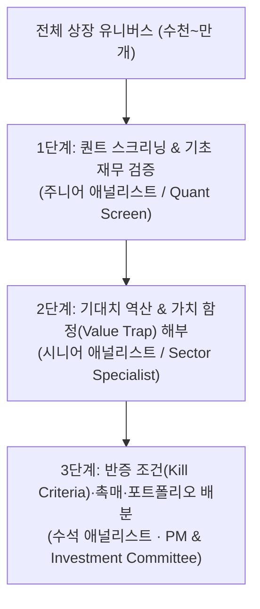

# 월스트리트 저평가 주식 발굴 프로세스 및 우리 예측 모델 (`/quant/model`) 비교 · `v3` 제안

> 작성일: 2026-11-14 (온타리오 기준)  
> 관련 코드 및 문서: [`src/web_export/value_model.py`](../src/web_export/value_model.py) · [`docs/블로그주식분석.md`](블로그주식분석.md)  
> 대상 페이지: `https://seancho.vercel.app/quant/model` (`내계좌 › 예측 모델`)

---

## 목차

1. **[1부] 월스트리트급 기관은 저평가 주식을 어떻게 찾는가?** *(우리 모델을 모른다는 가정)*
   - 1.1 월스트리트가 정의하는 '저평가'의 3대 축 (그리고 워런 버핏의 위치)
   - 1.2 월스트리트 실제 의사결정 파이프라인 (주니어 → 시니어 → PM)
   - 1.3 [1단계] 주니어 애널리스트 / 1차 퀀트 스크리닝의 역할
   - 1.4 [2단계] 시니어 애널리스트의 역할 — "왜 싼가?(Value Trap)" 해부
   - 1.5 [3단계] 수석 애널리스트 & 포트폴리오 매니저(PM)의 역할
2. **[2부] 월스트리트 방식 vs 우리 예측 모델 (`/quant/model`) 1:1 비교**
   - 2.1 역할별·단계별 1:1 매핑 비교표
   - 2.2 우리 예측 모델(`v1`·`v2`)이 월스트리트 기준으로도 뛰어난 강점 4가지
   - 2.3 월스트리트 시각에서 본 차이점과 한계 (개선 포인트 5가지)
   - 2.4 2부 결론 (한 줄 요약)
3. **[3부] `v3 (수석 애널리스트 · PM)` 설계를 위한 월스트리트 롤모델 추천**
   - 3.1 현재 우리 모델(`v1`·`v2`)의 월스트리트 계보
   - 3.2 `v3`로 벤치마킹할 월스트리트 최고 대가·운용사 4선
   - 3.3 최종 추천: `v1` · `v2` · `v3` 완전체 라인업 비교
   - 3.4 기존 데이터(`yfinance`)로 즉시 구현 가능한 `v3 (PM)` 4대 실전 규칙
4. **[4부] 종합 결론 (Summary & 다음 단계)**

---
---

# 1부. 월스트리트급 기관은 저평가 주식을 어떻게 찾는가?

월스트리트에서 "저평가된 주식(Undervalued Stock)"을 찾는다는 것은 단순히 **PER·PBR이 낮은 주식을 고르는 것이 아니다.** 월가에서는 단순 저배수 종목의 상당수를 **"싼 이유가 있는 주식(Value Trap, 가치 함정)"** 으로 본다.

실제 월스트리트(Citadel·Point72 같은 멀티매니저 헤지펀드, Baupost·Pershing Square 같은 정통 밸류 펀드, AQR·BlackRock 같은 퀀트 운용사, 골드만삭스·모건스탠리 리서치)에서는 **주니어 애널리스트 → 시니어 애널리스트 → 포트폴리오 매니저(PM)** 로 이어지는 다단계 검증 깔때기를 통해 종목을 압축한다.

---

## 1.1 월스트리트가 정의하는 '저평가'의 3대 축

| 접근 방식 | 대표 하우스 | 저평가의 정의 및 핵심 무기 |
|---|---|---|
| **① 정통 펀더멘털 밸류** (Fundamental Long/Short · Value) | Baupost(세스 클라만), Pershing Square(빌 애크먼), Greenlight(데이비드 아인혼) | **내재가치(Intrinsic Value) 대비 안전마진(Margin of Safety)** + 시장 컨센서스와 다른 독자적 시각(**Variant Perception**) + 가치 재평가 계기(**Catalyst**) |
| **② 시스템적·팩터 밸류** (Systematic / Quantitative Value) | AQR(클리프 아스네스), Gotham(조엘 그린블랫), Dimensional, BlackRock Systematic | 단순 저PER이 아닌 **복합 밸류(FCF/EV, EBIT/EV)** + **퀄리티(ROIC, 매출총이익률, 분식회계 배제)** + **실적·가격 추세 결합** 및 업종 중립화 |
| **③ 퀀타멘털** (Quantamental — 현대 월가 표준) | Citadel Surveyor, Point72, Counterpoint Global(모건스탠리) | 1단계에서 정량 스크리닝·포렌식 회계·Reverse DCF로 유니버스를 좁히고, 2단계에서 시니어 애널리스트가 사업 해자와 구조적 리스크를 정밀 해부 |

### 💡 잠깐: 워런 버핏(Warren Buffett)은 이 중 어느 접근방식인가?

워런 버핏은 **기본적으로 [접근방식 ①: 정통 펀더멘털 밸류]의 원조이자 정점**이다. 하지만 흥미로운 점은 **버핏 본인은 ①번(사람이 직접 10-K를 읽고 판단하는 펀더멘털)으로 투자했는데, ②번(AQR 같은 퀀트 하우스)이 버핏의 두뇌를 수학 공식으로 복제해 냈고, 이를 자동화 파이프라인과 결합한 것이 ③번(우리 모델의 지향점)** 이라는 사실이다.

1. **버핏의 원래 소속 — 접근방식 ① (정통 펀더멘털 밸류의 진화)**
   - **초기 버핏 (벤저민 그레이엄식 Deep Value):** 회사가 아무리 평범해도 청산가치(장부가)보다 무조건 싼 '담배꽁초 주식'을 사서 한 모금 피우고 파는 방식.
   - **중·후기 버핏 (찰리 멍거 합류 이후 Quality Compounder):** *"그냥 싼 삼류 기업을 사지 말고, **자본수익률(ROE·ROIC)이 꾸준히 높은 일류 기업을 적당한 가격(안전마진)** 에 사서 오래 보유하라."* (3부에서 추천하는 **프랑수아 로숑·테리 스미스**가 바로 이 중·후기 버핏의 직계 후예다.)
2. **왜 접근방식 ②(퀀트·팩터)와도 연결되는가? — AQR의 전설적인 논문 《Buffett's Alpha》**
   - 3부 첫 번째 추천 하우스인 **AQR(클리프 아스네스 팀)** 이 발표한 유명 논문 *《Buffett's Alpha (버핏의 알파)》* 에서, 버핏의 40년 포트폴리오를 정량 데이터로 역추적해 보니 버핏의 수익률은 신비한 직관이 아니라 **딱 3가지 팩터 공식(접근방식 ②)** 으로 완벽히 설명되었다:
     - **Quality (고품질·일관성):** `ROE`·`ROIC`가 높고, 매년 이익 변동성(`CV`)이 낮은 회사
     - **Low Beta (저베타·안전성):** 시장보다 덜 흔들리고(베타 $\beta$가 낮고), 부도 위험(`Altman Z` 등)이 없으며 빚이 적은 회사
     - **Cheap Owner Earnings + Buybacks (실질 현금흐름 저평가 + 자사주 소각):** 회계상 순이익이 아닌 **주주 실질 귀속 현금(Owner Earnings)** 대비 주가가 싸고, 남는 현금으로 **자사주를 사서 소각(`sh_y > 0`)** 하는 회사
3. **우리 예측 모델(`v1` → `v2` → `v3`) 속의 워런 버핏**
   - 결국 우리가 만든 `/quant/model`은 **"①번 워런 버핏의 투자 철학을 ②·③번(퀀트·자동화 파이프라인)으로 구현한 버핏 복제기"** 에 가깝다.

| 워런 버핏의 핵심 원칙 (주주서한) | 우리 모델에서의 위치 | 코드 대응 ([`value_model.py`](../src/web_export/value_model.py)) |
|---|---|---|
| *"자본수익률이 꾸준히 높은 기업만 본다"* | **주니어 (`v1`)** | `ROE ≥ 15%`, `ROIC ≥ 12% > WACC`, 변동성 `CV ≤ 0.3` |
| *"저베타 우량주가 장기 복리에 유리하다"* | **주니어 (`v1`)** | 요구수익률 `Ke = Rf + β × 5.36%` (저베타일수록 허들 낮음) |
| *"제1원칙: 절대 돈을 잃지 마라 (안전마진)"* | **시니어 (`v2`)** | **하방 관문 (`g_bear`)**: FCF가 30% 토막 나고 성장이 멈춰도 `알파 ≥ 0` |
| *"주식보상비용(SBC)은 선물이 아니라 진짜 비용이다 (Owner Earnings)"* | **PM (`v3` 제안 1)** | `FCF_real = FCF − SBC(주식보상비용)` 차감 |
| *"최고의 자본배분은 저평가 때 자사주를 소각하는 것이다"* | **PM (`v3` 제안 3)** | 주주환원율 `sh_y (배당 + 자사주 순매입) > 0` 관문 |

- **한 줄 정리:** **버핏 본인**은 **①번(정통 펀더멘털)** 이고, **버핏의 두뇌를 수학 공식으로 뽑아낸 것**이 **②번(AQR의 *Buffett's Alpha*)** 이며, **그 공식을 매일 2,100개 종목에 자동으로 돌려 후보를 추리고(`v1`·`v2`·`v3`) 마지막에 사람(`author` / 4단계 체크리스트)과 대조하는 하이브리드**가 **③번(퀀타멘털 = 우리 시스템의 지향점)** 이다.

---

## 1.2 월스트리트 실제 의사결정 파이프라인

---

## 1.3 [1단계] 유니버스 정제 & 1차 재무 필터 (주니어 애널리스트 / Quant Screen)

주니어 애널리스트(또는 1차 퀀트 파이프라인)의 역할은 **"분석할 가치가 없는 기업과 회계적 지뢰를 제거하고, 숫자상 저평가된 후보군을 추리는 것"** 이다.

1. **비교 불가능 섹터 분리 및 유동성 컷**
   - 은행·보험·리츠(REITs)처럼 부채가 곧 영업자산이거나 잉여현금흐름(FCF)의 정의가 전혀 다른 업종을 일반 기업 유니버스에서 분리한다.
   - 기관 자금이 들어갈 수 있도록 시가총액(보통 US\$1B 이상)과 일평균 거래대금 기준을 적용한다.
2. **퀄리티(Quality) & 자본효율성 검증**
   - *"이 회사가 주주와 채권자의 돈을 굴려 자본비용 이상의 수익을 내는가?"*
   - 핵심 지표는 **ROIC(투하자본수익률) > WACC(가중평균자본비용)**, 그리고 **ROE의 장기 일관성(낮은 변동성)** 이다. 한두 해 반짝 번 회사가 아니라 수년간 꾸준히 높은 자본수익률을 유지했는지를 본다.
3. **재무 건전성 & 포렌식(분식회계) 스크리닝**
   - 손익계산서의 당기순이익은 경영진이 회계 추정으로 부풀리기 쉽다.
   - 따라서 **영업현금흐름/FCF 전환율**, **이자보상배율(`EBIT / 이자비용`)**, 부도 위험(**Altman Z-Score** 등), 매출채권이나 발생액(Accruals) 급증을 통한 이익 조작 가능성(**Beneish M-Score**, Sloan Ratio 등)을 먼저 체크한다.
4. **기초 밸류에이션 모델링 (DCF / Multiples)**
   - 과거 성장률과 기본 가정을 넣은 2~3단계 DCF(현금흐름할인법) 또는 FCF 수익률(FCF Yield) 모델을 돌려, 요구수익률(CAPM 기반 `Ke` 또는 `WACC`) 대비 **안전마진(Margin of Safety)** 이 있는 종목 리스트와 목표 매수가를 뽑아 시니어에게 올린다.

---

## 1.4 [2단계] "왜 싼가?" 검증 & 기대치 해부 (시니어 애널리스트)

주니어가 *"재무도 우량하고 DCF로 계산해 보니 30% 저평가된 주식입니다"* 라고 가져오면, 월가 시니어 애널리스트는 절대 바로 매수하지 않는다. 시니어는 **"시장이 바보가 아닌데 왜 이 좋은 회사를 싸게 팔고 있는가?"** 부터 의심한다.

1. **Reverse DCF (시장 내재 기대치 역산 — Expectations Investing)**
   - 애널리스트가 임의로 미래 성장률(예: 연 8%)을 가정해 적정주가를 구하는 것은 입력값에 따라 결론이 널뛰기 쉽다.
   - 대신 시니어는 **현재 주가를 출발점**으로 놓고 역산한다:
     > *"지금 주가가 정당화되려면 시장이 이 회사의 영구 성장률(Implied Growth Rate)을 몇 %로 보고 있는가?"*
   - 예를 들어 실제로는 연 7%씩 성장하는 회사인데, 현재 주가가 **"앞으로 영원히 0% 성장할 것"** 이라는 극단적 비관을 반영하고 있다면, 이 **'실제 성장률과 시장 내재 성장률의 괴리(Gap)'** 가 바로 진짜 알파(Variant Perception)가 된다.
2. **가치 함정(Value Trap) 및 최근 실적 모멘텀 훼손 체크**
   - 5년 평균 ROE·FCF가 아무리 좋아도, **최근 1~2분기 매출이나 마진이 전년 동기 대비 꺾이기 시작한 기업**은 과거 평균의 착시(Falling Knife)일 확률이 높다.
   - 시니어는 연간 평균 뒤에 숨은 **최근 분기(YoY) 추세**를 확인해 성장 엔진이 멈추고 있는 기업을 걸러낸다.
3. **하방 스트레스 테스트 (Bear Case / Downside Protection)**
   - *"우리의 성장 가정이 틀려서 FCF가 20~30% 토막 나고 성장이 멈춰도, 현재 주가에서 원금 손실(또는 요구수익률 미달)을 피할 수 있는가?"*
   - 상승 여력(Upside)보다 **최악의 시나리오(Bear Case)에서 바닥이 어디인지**를 먼저 계산한다.
4. **회계 왜곡 조정 (Normalized FCF / Owner Earnings)**
   - 회계기준(GAAP) FCF를 그대로 믿지 않고, **주식보상비용(SBC)** 차감, 일회성 비용 조정, 운전자본 착시 제거, 경기 사이클 고점(Peak Earnings) 여부를 보정한다.
5. **모델 파라미터 민감도(Sensitivity) 점검**
   - 베타($\beta$)나 영구 성장률($g$)을 조금만 보수적으로 바꿔도 '저평가' 결론이 깨진다면, 그 아이디어는 안전마진이 얇다고 판단한다.

---

## 1.5 [3단계] 반증 조건(Kill Criteria)·촉매(Catalyst)·포트폴리오 리스크 관리 (PM)

시니어의 검증을 통과해도 PM이 포트폴리오에 편입할 때는 다음 세 가지를 확정한다.

1. **사전 반증 조건 (Pre-mortem / Kill Criteria)**
   - 매수 전에 미리 *"어떤 숫자가 나오면 우리의 가설이 틀렸다고 인정하고 즉시 손절/청산할 것인가?"* (예: 분기 매출 역성장 전환, 품질 지표 이탈, 시장 내재 기대치가 실제 성장을 추월, 적정가 도달)를 명문화해 감정에 휘둘리는 물타기를 막는다.
2. **촉매 (Catalyst) & 자본배분 검증**
   - 저평가된 주식이 만년 저평가로 남지 않으려면, 경영진이 잉여현금으로 **자사주 매입·소각(Buyback)** 이나 배당을 통해 주당 가치를 스스로 끌어올리는지(Self-Help Catalyst), 반대로 유상증자·스톡옵션으로 주주를 희석시키지는 않는지 확인한다.
3. **테마·업종 집중(Crowding) 통제**
   - 개별 종목 10개를 골랐는데 알고 보니 7개가 전부 "AI 공포로 폭락한 IT 서비스주"라면, 이는 10개 종목에 분산 투자한 것이 아니라 **하나의 거시/테마에 몰빵한 것**이다. PM은 업종·팩터 쏠림을 체크해 포트폴리오 편입 한도를 둔다.

---
---

# 2부. 월스트리트 방식 vs 우리 예측 모델 (`/quant/model`) 1:1 비교

우리 백엔드 코드([`src/web_export/value_model.py`](../src/web_export/value_model.py#L1-L85))와 설계 문서([`docs/블로그주식분석.md`](블로그주식분석.md#L426-L541))에 구현된 **주니어(`v1`) · 시니어(`v2`) · 저자(`author`)** 구조를 월스트리트 프로세스와 1:1로 대조해 보면, **우리 모델의 `주니어(v1) → 시니어(v2)` 진화 구조는 실제 월스트리트 밸류/퀀타멘털 하우스의 의사결정 체계를 정확히 코드로 옮겨 놓은 형태**임을 알 수 있다.

---

## 2.1 역할별·단계별 1:1 매핑 비교표

| 월스트리트 프로세스 | 우리 예측 모델 (`/quant/model`) | 실제 코드 구현 ([`value_model.py`](../src/web_export/value_model.py)) |
|---|---|---|
| **유니버스 정제** (금융·리츠 분리, 시총 컷) | **공통 대상 (`us-tsx-1b`)** | 미국(S&P 500·NASDAQ·NYSE) + 캐나다(TSX), 시총 US\$1B 이상. **은행·보험·운용·증권·리츠 제외**(단, FDS 같은 금융데이터·결제망·보험중개는 유지). 중복 상장/클래스주는 1개로 통합 ([`L200-L214`](../src/web_export/value_model.py#L200-L214)) |
| **주니어 애널리스트** (Quality + Forensic + 기본 DCF 스크리닝) | **주니어 (`v1`)** | **① 품질 관문 5개**: ROE(평균 ≥15%, CV≤0.3), ROIC(평균 ≥12%, CV≤0.3, ROIC>WACC), Altman Z(≥2.99), Beneish M(≤−2.22), FCF(전 해 흑자 & FCF합 > 순차입합) **② 가격 관문**: 3년 평균 FCF 수익률 기반 2단계 IRR(5년 `g1` [-5%,+10%], 이후 영구 `g2=2.5%`) − 요구수익률 `Ke` ≥ **+5%p** **③ 우선순위 (`top_v1`)**: 매수 기준가까지 남은 하락폭(`drop`) 순 ([`L474-L526`](../src/web_export/value_model.py#L474-L526), [`L571-L575`](../src/web_export/value_model.py#L571-L575)) |
| **시니어 애널리스트** (Reverse DCF, 스트레스 테스트, Falling Knife 제거, 민감도·섹터 집중 체크) | **시니어 (`v2`)** | 주니어(`v1`)에 **5가지 시니어 보강** 추가 ([`L528-L593`](../src/web_export/value_model.py#L528-L593)): 1. **Reverse DCF 괴리(`gap`) 우선순위**: 시장 내재 영구 성장률 `implied_g = (Ke - FCF_y)/(1 + FCF_y)` 역산 → `gap = g1 - implied_g` 큰 순 정렬 2. **하방 스트레스 관문(`g_bear`)**: FCF −30% 토막 & 향후 5년 성장 ≤ 0%에서도 `alpha_bear ≥ 0` 3. **반증 조건(`kill_reasons`)**: 품질 탈락 / 최근 분기(YoY)·연간 매출 동시 감소(`rev_down`) / `gap < 0` / 적정가 도달(`alpha < 0`) 시 기록 종료 4. **베타 민감도(`sensitive`)**: 베타 하한을 `0.3 → 0.6`으로 올리면 탈락하는 종목 경고 배지 5. **업종 집중 경고(`theme_counts`)**: 상위 20개 내 동일 업종 3개 이상 경고 |
| **부티크/스페셜리스트** (정성적 해자·특수상황·카탈리스트 분석) | **저자 (`author` — Baoro Research)** | 숫자 공식만으로 알 수 없는 사업 구조, 일시적 공포 vs 구조적 쇠퇴 판별, 특수상황(광산 블록케이브·송유관 프로젝트 등) 심층 리서치. 우리 주니어·시니어와 같은 날부터 수익률 대결 ([`L98-L143`](../src/web_export/value_model.py#L98-L143)) |

---

## 2.2 우리 예측 모델(`v1`·`v2`)이 월스트리트 기준으로도 뛰어난 강점 4가지

1. **주니어(`v1`)에서 시니어(`v2`)로 넘어가며 "진짜 월가식 질문"을 던짐**
   - 주니어(`v1`)는 단순히 *"매수 기준가 대비 얼마나 싼가(`drop`)"* 로 줄을 세운다.
   - 반면 시니어(`v2`)는 **① 하방 스트레스 테스트(`FCF -30%`, `성장 0%`)** 를 통과시키고, **② 시장이 반영한 내재 성장률(`implied_g`)과 실제 성장률(`g1`)의 괴리(`gap`)** 로 우선순위를 매기며, **③ 최근 분기·연간 매출이 줄어드는 Falling Knife(`rev_down`)** 를 잘라낸다. 이는 월가 시니어 애널리스트가 주니어의 리포트를 반려할 때 쓰는 핵심 논리 그대로다.
2. **원작자(Baoro Research) 모델의 방법론적 허점을 정석대로 교정함 ([`블로그주식분석.md` 9.7절](블로그주식분석.md#L531-L541))**
   - **영구 성장률(`g2`) 교정**: 저자는 영구 성장률로 국채금리(~4.8%)를 써서 저베타 종목의 가치를 과대평가했으나, 우리 모델은 월가 표준(장기 실질 GDP + 물가 하단인 **2.5%**)으로 고정했다.
   - **현금흐름 지표 단일화**: 저자처럼 기업마다 DDM·배당+자사주·FCFE 중 입맛에 맞는 공식을 골라 쓰는 재량(Confirmation Bias)을 없애고 **3년 평균 FCF** 하나로 통일했다.
   - **베타 민감도(`sensitive`) 가시화**: 베타가 0.3으로 낮게 잡혀 요구수익률(`Ke`)이 낮아진 덕에 간신히 통과한 종목(예: CGI 사례)을 배지로 바로 드러낸다.
3. **Beneish M-Score + Altman Z-Score + 현금흐름 순차입 비교의 결합**
   - 개인이나 일반 퀀트 스크리너들이 흔히 놓치는 **분식회계(`Beneish M ≤ −2.22`)** 와 **빚내서 배당/자사주 매입하는 회사 차단(`FCF 합 > 순차입 합`)** 이 기본 관문으로 들어가 있어 재무 지뢰를 피하는 능력이 강하다.
4. **사후 과적합(Hindsight Bias)을 원천 차단한 실험 설계**
   - 백테스트 숫자를 맞출 때까지 규칙을 고치는 대신, **시작일에 규칙을 고정**하고(바꾸려면 새 버전 신설) 저자 종목을 모르는 상태(`own_universe`)에서 `v1` · `v2` · `author`를 전진 기록(`value_log.json`)으로 SPY/XIU와 경쟁시키는 방식은 기관급 리서치 거버넌스에 부합한다.

---

## 2.3 월스트리트 시각에서 본 차이점과 한계 (개선 포인트 5가지)

월스트리트의 시니어 애널리스트나 퀀트 PM이 현재 `v1`·`v2` 코드를 리뷰한다면, 다음 5가지를 **"무료 데이터와 자동화 구조 때문에 생기는 차이점"** 으로 짚어낼 것이다.

### ① 주식보상비용(SBC, Stock-Based Compensation) 미차감 문제 *(가장 큰 실전 차이)*
- **현황**: [`value_model.py`](../src/web_export/value_model.py#L462-L465)에서 `Free Cash Flow (= Operating Cash Flow + Capital Expenditure)`를 그대로 사용한다.
- **월가의 시각**: 회계상 주식보상비용(SBC)은 현금이 나가지 않았다는 이유로 영업현금흐름(OCF)에 다시 더해진다. 하지만 미국 IT·소프트웨어·데이터 서비스 기업(FDS, ACN, ADBE, INTU 등 우리 모델 상위에 자주 뜨는 업종)은 임직원 연봉의 상당 부분을 주식으로 주며, 이는 주주 지분 희석(실질적 비용)이다.
- **영향**: 월가 시니어는 반드시 **`Adjusted FCF = FCF - SBC`** 로 밸류에이션한다. SBC를 빼지 않으면 테크/서비스 기업의 FCF 수익률이 1~3%p 부풀려져 실제보다 싸게 보인다. (`yfinance` 현금흐름표의 `Stock Based Compensation` 행으로 보완 가능)

### ② 시가총액(Market Cap) 대비 FCF 수익률과 부채(Debt) 레버리지 착시
- **현황**: 가격 관문에서 `fcf_y = 3년 평균 FCF ÷ 시가총액(mcap_fc)`을 구하고 주주 요구수익률(`Ke`)과 비교한다 ([`L513-L518`](../src/web_export/value_model.py#L513-L518)).
- **월가의 시각**: 부채가 많은 기업은 시가총액(E)이 작아져서 `FCF ÷ 시가총액`이 높게 나타난다. 물론 품질 관문(`Altman Z ≥ 2.99`, `ROIC > WACC`)으로 과도한 부채 기업을 1차로 걸러내지만, 관문을 통과한 기업들 사이에서는 **무차입 현금부자 기업보다 적당히 부채를 쓴 기업의 `fcf_y`가 더 높게 나오는 구조적 편향**이 있다.
- **영향**: 월가에서는 순부채(`총부채 − 현금`)를 시가총액에 반영한 **기업가치(`EV = Market Cap + Debt − Cash`)** 기준으로 FCF 수익률을 보거나, 순현금/순부채만큼 매수 기준가(`buy`)를 보정한다.

### ③ 과거 매출 성장률(`g1`) vs 미래 컨센서스(Forward Estimates)
- **현황**: `g1`은 과거 4~5년 연간 매출 CAGR을 쓰고, 시니어(`v2`)가 최근 분기/연간 매출 감소(`rev_down`) 여부로 보완한다 ([`L510-L512`](../src/web_export/value_model.py#L510-L512), [`L539-L553`](../src/web_export/value_model.py#L539-L553)).
- **월가의 시각**: 주가는 과거 4년 평균이 아니라 **향후 12~24개월 컨센서스(Forward Revenue/EPS)와 애널리스트 추정치 상향/하향(Earnings Revisions)** 에 반응한다. 아직 매출이 역성장(`rev_down`)까지는 안 갔더라도 성장률이 `12% → 8% → 3%`로 급감속 중이면 시장은 먼저 주가를 떨어뜨린다.

### ④ 4~5년 데이터 한계로 인한 경기순환주 고점(Cyclical Peak) 착시
- **현황**: `yfinance` 무료 재무제표가 최근 4~5년치만 제공하기 때문에, 최근 3~4년이 업황 호황기였던 경기순환주(원자재·산업재·건자재 등)는 **평균 ROE·ROIC가 높고 변동성(CV)도 낮게** 찍힌다.
- **월가의 시각**: 월가는 최소 10년(불황기를 포함한 한 사이클 전체) 데이터를 쓰거나, 경기순환주는 피크 FCF가 아닌 **장기 평균 마진(Normalized Margin)** 을 곱한 정상 FCF를 넣는다. (현재는 시니어 `v2`의 `FCF -30%` 하방 관문이 이 위험을 상당 부분 완충해 주고 있다.)

### ⑤ "일시적 공포 vs 구조적 쇠퇴"와 촉매(Catalyst)의 판별
- **현황**: [`블로그주식분석.md` 9.4절](블로그주식분석.md#L504-L516)에 정리된 것처럼, 주가가 빠진 이유가 *"AI에 시장을 영구히 뺏기는 구조적 쇠퇴"* 인지 *"과도한 공포로 인한 일시적 매도"* 인지는 재무제표에 **1~2년 시차를 두고** 나타난다.
- **월가의 시각**: 월가에서는 이 시차를 메우기 위해 **대체 데이터(신용카드 결제액, 앱 트래픽, 구인공고 추세, 고객 이탈률)** 와 산업 전문가 인터뷰(Expert Network)를 쓴다. 우리 사이트에서는 이 영역을 억지로 공식화하지 않고, **저자(`author`)의 정성적 리서치와 주니어(`v1`)·시니어(`v2`)의 정량 규칙을 나란히 두고 장기 성적을 비교**하도록 설계한 것이 현실적이고 영리한 해법이다.

---

## 2.4 2부 결론 (한 줄 요약)

- **주니어(`v1`)** 는 월가의 **Quality + Forensic + DCF 안전마진 스크리너** 역할을 충실히 수행하고 있고,
- **시니어(`v2`)** 는 월가 시니어 애널리스트의 핵심 무기인 **Reverse DCF(내재 기대치 괴리 `gap`) + Bear Case 스트레스 테스트(`FCF -30%`) + 실적 훼손 손절 규칙(`kill_reasons`)** 을 정확히 짚어내어 `v1`의 가치 함정(Value Trap) 위험을 한 단계 높게 걸러내고 있다.
- 여기에 향후 **`v3` (수석 애널리스트 / PM)** 를 얹는다면, 가장 월가다운 업그레이드는 **① FCF에서 주식보상비용(SBC) 차감**, **② 시가총액 대신 EV(순차입금/순현금 반영) 기반 밸류에이션 보정**, **③ 주주환원(`sh_y > 0`) 확인 및 업종 집중 제한**이다.

---
---

# 3부. `v3 (수석 애널리스트 · PM)` 설계를 위한 월스트리트 롤모델 추천

## 3.1 현재 우리 모델(`v1`·`v2`)의 월스트리트 계보

먼저 현재 `v1`과 `v2`가 이미 어떤 월스트리트 대가를 닮아 있는지 정리하면 다음과 같다.

- **주니어(`v1`)의 롤모델** = **애스워스 다모다란(Aswath Damodaran, NYU 교수)** + **회계 포렌식(Altman · Beneish)**
  - 이자보상배율로 부도 스프레드를 매겨 WACC를 구하고([`value_model.py L91-L95`](../src/web_export/value_model.py#L91-L95)), 2단계 FCF IRR로 매수 기준가를 뽑는 정석 밸류에이션 교과서 스타일이다.
- **시니어(`v2`)의 롤모델** = **마이클 모부신(Michael Mauboussin, 모건스탠리 Counterpoint Global 리서치 헤드)** + **세스 클라만(Seth Klarman, Baupost Group)**
  - 모부신의 명저 *《Expectations Investing(기대치 투자)》* 핵심인 **"현재 주가가 내포한 영구 성장률(`implied_g`)을 역산해 실제 성장률과의 괴리(`gap`) 찾기"** 와, 클라만의 **"하방 안전마진(`FCF -30%` 스트레스 테스트)"** 이 정확히 `v2`에 구현되어 있다.

따라서 **`v3 (수석 애널리스트 / PM)`** 은 `v2`가 놓치는 마지막 사각지대(**① 회계상 FCF 부풀리기(주식보상비용 SBC), ② 부채 레버리지 착시(EV 미반영), ③ 자본배분·주주희석, ④ 특정 업종 쏠림**)를 해결하는 인물이어야 한다.

---

## 3.2 `v3`로 벤치마킹할 월스트리트 최고 대가·운용사 4선

우리 시스템(`us-tsx-1b` 유니버스 + `yfinance` 재무·가격 데이터)에 **코드로 바로 이식할 수 있는 월스트리트 최고 대가·운용사 4곳**은 다음과 같다.

### 후보 1. 클리프 아스네스 (Cliff Asness) — **AQR Capital Management**
> **한 줄 요약:** *"가치 함정(Value Trap)을 수학적으로 격파한 현대 퀀트 밸류 PM의 정점"*

- **어떤 회사/인물인가?**
  - 시카고대 유진 파마(노벨경제학상) 제자로 골드만삭스 퀀트 헤드를 거쳐 AQR을 설립한 현대 팩터 투자의 대부다.
  - "왜 싼 주식이 오르지 않고 계속 싼가?"를 연구해 **Quality Minus Junk(QMJ)** 논문과 **회계 왜곡을 제거한 진짜 밸류**를 정립했다.
- **무엇을 따라 해야 하나? (`v2` 대비 차이점)**
  1. **주식보상비용(SBC) 차감 (`True FCF = FCF - SBC`)**: 미국 테크·데이터 서비스 기업들이 현금 대신 주식을 뿌려 `FCF`를 부풀리는 착시를 제거한다.
  2. **시가총액(Market Cap) 대신 기업가치(`EV = 시총 + 총부채 − 현금`) 기준 평가**: 부채가 많아 시총이 작아 보이는 회사가 유리해지는 현상을 막고, 순현금이 많은 알짜 기업을 제대로 대우한다.
  3. **매출총이익률(`Gross Profit / Total Assets`) 또는 마진 추세 결합**: 손익계산서 맨 아래(순이익·FCF)보다 조작이 불가능한 매출총이익·영업이익 마진의 견고함을 본다.

### 후보 2. 프랑수아 로숑 (François Rochon, **Giverny Capital**) & 테리 스미스 (Terry Smith, **Fundsmith**)
> **한 줄 요약:** *"미국 + 캐나다(TSX) 주식으로 30년간 시장을 이긴 '퀄리티 컴파운더(Quality Compounder)' PM"*

- **어떤 회사/인물인가?**
  - **프랑수아 로숑(Giverny Capital)**: 캐나다 몬트리올 기반으로 1993년부터 **미국 상장주 + 캐나다 TSX 종목**을 운용해 연평균 ~15%(S&P 500 대비 연 +4~5%p 초과수익)를 기록한 전설적인 PM이다. **우리 모델의 대상(`us-tsx-1b`, 미국+TSX)과 투자 무대가 100% 일치**한다.
  - **테리 스미스(Fundsmith)**: *"좋은 회사를 사서, 비싸게 사지 말고, 아무것도 하지 마라"* 라는 3원칙으로 유명한 영미권 최고 퀄리티 펀드매니저다.
- **무엇을 따라 해야 하나? (`v2` 대비 차이점)**
  1. **자본배분(Capital Allocation) & 주식 희석 차단**: 아무리 FCF가 좋아도 유상증자나 과도한 스톡옵션으로 **주식 수가 늘어나는 회사(주당 가치 희석)** 는 사지 않는다. 반대로 잉여현금으로 **자사주를 꾸준히 사서 소각하는 회사(Cannibals)** 에 높은 점수를 준다.
     - *(참고: 우리 [`value_model.py L514`](../src/web_export/value_model.py#L514)에 이미 `sh_y`(3년 평균 배당+자사주 순매입 수익률)가 계산되어 있는데, 지금은 화면 표시만 하고 관문에는 안 쓰고 있다!)*
  2. **이익의 질(Cash Conversion)과 마진 방어력**: 매출(`g1`)만 느는 것이 아니라 영업이익률(`EBIT / Revenue`)이 최근 해에 꺾이지 않았는지 확인한다.

### 후보 3. 조엘 그린블랫 (Joel Greenblatt) — **Gotham Asset Management**
> **한 줄 요약:** *"월가 연 40% 신화, 'ROIC + EV 대비 정상화 현금흐름(Normalized FCF/EV)'의 창시자"*

- **어떤 회사/인물인가?**
  - 헤지펀드 고담 캐피탈(Gotham Capital)에서 10년간 연평균 50% 수익률을 올리고, 현재는 기관용 롱숏 밸류 펀드(Gotham Asset Management)를 운용하는 컬럼비아대 교수다.
- **무엇을 따라 해야 하나? (`v2` 대비 차이점)**
  1. **피크 마진(Peak Earnings) 착시 제거**: 최근 3년이 업황 최고점(예: 원자재·해운·건설 호황)이어서 FCF가 일시적으로 부풀려진 경기순환주를 걸러내기 위해, 최근 마진이 과거 중앙값보다 비정상적으로 높으면 평균 마진으로 눌러서(Normalize) 계산한다.
  2. **`EV` 대비 기대수익률 + 섹터 분산**: 개별 종목의 저평가도 중요하지만, 상위 포트폴리오를 짤 때 특정 업종에 베팅이 쏠리지 않도록 강제 분산한다.

### 후보 4. 빌 애크먼 (Bill Ackman) — **Pershing Square Capital**
> **한 줄 요약:** *"Top 10 소수 정예 집중투자 PM — '업종 쿼터제'와 '확실한 주주환원 촉매(Catalyst)'"*

- **어떤 회사/인물인가?**
  - 철저한 재무 관문을 통과한 **딱 8~12개 대형 우량주**에만 집중 투자하는 하이 컨빅션(High-Conviction) 헤지펀드 매니저다. 우리 모델이 매달 뽑는 **`top_v1` / `top_v2` (상위 10종목 묶음)** 와 포트폴리오 호흡이 똑같다.
- **무엇을 따라 해야 하나? (`v2` 대비 차이점)**
  1. **PM의 포트폴리오 규율 (업종 하드 캡)**: `v2`는 상위 20개 안에 같은 업종이 3개 이상이면 경고(`theme_counts`)만 띄우지만, 실제 PM은 **Top 10 포트폴리오에 같은 업종(Industry)을 최대 2개까지만 편입**해 거시/테마 한 방에 계좌 전체가 흔들리는 일을 막는다.
  2. **자체 촉매(Self-Help Catalyst)**: 남이 사주길 기다리는 만년 저평가주가 아니라, 회사가 스스로 **자사주 매입+배당(`sh_y`)** 으로 주당순이익(EPS)을 밀어 올리는 종목을 선호한다.

---

## 3.3 최종 추천: `v1` · `v2` · `v3` 완전체 라인업 비교

한 명만 베끼기보다 **"클리프 아스네스(AQR)의 회계 정밀도 + 프랑수아 로숑(Giverny)의 자본배분 + 조엘 그린블랫/빌 애크먼의 EV·분산 규율"** 을 합친 **'월스트리트 PM(`v3`)'** 으로 정의하는 것이 가장 설득력 있고 스토리텔링도 명확하다.

| 단계 | 페르소나 | 월스트리트 롤모델 | 핵심 질문 (한 줄 정의) |
|---|---|---|---|
| **주니어 (`v1`)** | 1차 재무 스크리너 | **Aswath Damodaran** (NYU / 정석 밸류에이션) | *"장부상 재무가 우량하고(5대 관문), 3년 평균 FCF 대비 주가가 싼가?"* |
| **시니어 (`v2`)** | 가치 함정(Value Trap) 검증 | **Michael Mauboussin & Seth Klarman** (Morgan Stanley · Baupost) | *"시장이 반영한 성장률(`implied_g`)이 지나치게 비관적인가? FCF가 30% 꺾여도 버티고, 최근 매출이 줄고 있진 않은가?"* |
| **수석·PM (`v3` 제안)** | **회계 왜곡 교정 & 포트폴리오 규율** | **Cliff Asness (AQR) & François Rochon (Giverny)** | *"주식보상(SBC)과 부채(EV)를 빼도 진짜 싼가? 주주를 희석시키지 않고 자사주를 소각(`sh_y > 0`)하며, Top 10이 한 업종에 쏠리지 않았는가?"* |

---

## 3.4 기존 데이터(`yfinance`)로 즉시 구현 가능한 `v3 (PM)` 4대 실전 규칙

외부 유료 API 없이 현재 [`value_model.py`](../src/web_export/value_model.py)가 받는 `yfinance` 연간/분기 재무제표에 행 하나(`Stock Based Compensation`)만 추가하면 바로 구현할 수 있는 `v3` 규칙이다.

### 규칙 1. SBC(주식보상비용) 차감 진성 FCF (`Real Owner FCF`)
- **배경 (AQR / 다모다란)**: IT·데이터·서비스 기업이 현금 급여 대신 주식을 발행해 회계상 FCF를 부풀리는 착시를 차단한다.
- **수식**:
  $$\text{FCF}_{\text{real}} = \text{FCF} - \text{Stock Based Compensation}$$
- **적용**: 최근 3년 평균 $\text{FCF}_{\text{real}}$을 기준으로 가격 관문과 하방 관문을 다시 평가한다.

### 규칙 2. 순부채/순현금(`EV`) 보정 밸류에이션
- **배경 (조엘 그린블랫 / AQR)**: 시가총액(`Market Cap`)만 분모로 쓰면 부채가 많은 기업이 싸 보이고, 무차입 현금부자 기업이 비싸 보이는 왜곡을 바로잡는다.
- **수식**:
  $$\text{EV} = \text{Market Cap} + \text{Total Debt} - \text{Cash}$$
  $$\text{Real FCF Yield} = \frac{\text{3년 평균 }\text{FCF}_{\text{real}}}{\text{EV}}$$
- **적용**: 순현금($\text{Cash} > \text{Total Debt}$) 기업은 매수 기준가가 올라가고, 순부채 기업은 부채 부담만큼 매수 기준가가 엄격해진다.

### 규칙 3. 자본배분·주주희석 방지 관문 (`sh_y > 0` & 마진 방어)
- **배경 (프랑수아 로숑 / 테리 스미스)**: 벌어들인 현금을 주주에게 돌려주지 않고 유상증자·스톡옵션으로 지분을 희석하는 기업, 혹은 매출은 늘어도 영업이익률이 무너지는 기업을 걸러낸다.
- **수식**:
  - 주주환원 수익률 `sh_y` (3년 평균 `[배당 + 자사주매입 − 주식발행] ÷ 시가총액`, 이미 [`value_model.py L514`](../src/web_export/value_model.py#L514)에 계산됨) `> 0`
  - 최근 해 영업이익률(`EBIT / Revenue`)이 최근 4~5년 평균 영업이익률의 80% 이상 유지(급격한 마진 훼손 없음)

### 규칙 4. PM 포트폴리오 룰 — Top 10 업종 쿼터제 (`MAX_PER_INDUSTRY = 2`)
- **배경 (빌 애크먼 / 기관 PM 리스크 관리)**: `v2`에서는 상위 20개 내 동일 업종 3개 이상일 때 경고(`theme_counts`)만 표시하지만, `v3` PM은 실제 포트폴리오(`top_v3` 상위 10종목)를 구성할 때 **같은 업종(Industry)에서 최대 2종목까지만 편입**한다.
- **효과**: 특정 시기(예: AI 대체 공포로 IT 컨설팅·정보서비스 업종이 동반 급락할 때)에 Top 10이 사실상 '단일 테마 베팅'으로 변질되는 것을 자동으로 막아 준다.

---
---

# 4부. 종합 결론 (Summary & 다음 단계)

1. **우리 예측 모델(`/quant/model`)의 현주소**
   - 현재 구축된 **주니어(`v1`) → 시니어(`v2`) + 저자(`author`)** 비교 구조는 단순한 개인용 주식 스크리너 수준을 넘어, 실제 월스트리트 퀀타멘털·밸류 하우스의 **3단계 의사결정 파이프라인(1차 재무·포렌식 필터 → 2차 Reverse DCF 기대치 역산 및 하방 스트레스 테스트 → 정성 리서치와의 대조)** 과 구조적으로 일치한다.
   - 특히 사후에 유리한 규칙만 끼워 맞추는 백테스트 과적합을 피하고, **시작일에 규칙을 고정한 뒤 같은 유니버스(`us-tsx-1b`)에서 전진 기록(`value_log.json`)으로 SPY/XIU와 승부를 겨루는 설계**는 기관급 리서치 원칙에 부합한다.

2. **왜 `v1(주니어) → v2(시니어) → v3(수석·PM)` 3단 구조가 완전체인가?**
   - **주니어(`v1` — 다모다란·포렌식 스타일)**: *"장부상 우량하고 현금흐름 대비 주가가 싼 종목"* 을 추려낸다.
   - **시니어(`v2` — 모부신·클라만 스타일)**: *"시장이 과도하게 비관적(`gap > 0`)이면서, FCF가 30% 꺾여도 버티고(`g_bear`), 최근 매출이 줄어들지 않는(`not rev_down`) 종목"* 만 남겨 가치 함정(Value Trap)을 걸러낸다.
   - **수석·PM(`v3` — 아스네스·로숑·그린블랫 스타일)**: *"주식보상비용(SBC)과 부채 착시(EV)를 걷어내도 진짜 싸며, 주주를 희석시키지 않고 자사주를 소각(`sh_y > 0`)하고, 포트폴리오가 특정 업종에 쏠리지 않게(동일 업종 최대 2종목) 규율을 지키는 최종 포트폴리오"* 를 완성한다.

3. **향후 적용 시 체크포인트**
   - `v1`과 `v2`의 기존 규칙과 기록은 절대 건드리지 않고 그대로 유지한다.
   - `v3`를 도입할 경우 [`value_model.py`](../src/web_export/value_model.py)의 `CF_ROWS`에 `Stock Based Compensation`을 추가하고, 위 4대 규칙(`FCF - SBC`, `EV` 기준 수익률, `sh_y > 0` 및 마진 유지, `top_v3` 업종당 최대 2종목 캡)을 별도 그룹(`v3`, `v3_top`)으로 추가해 `v1` · `v2` · `v3` · `author` 네 주체의 실전 성과를 나란히 비교할 수 있다.

